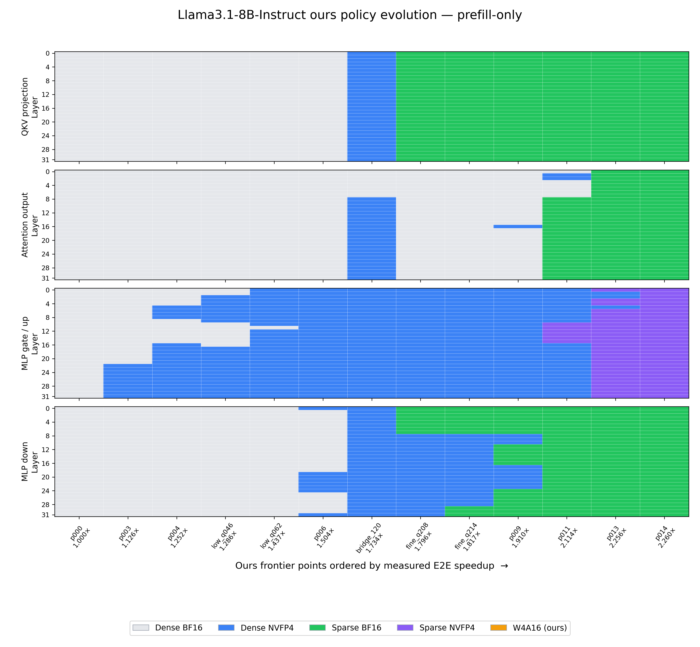
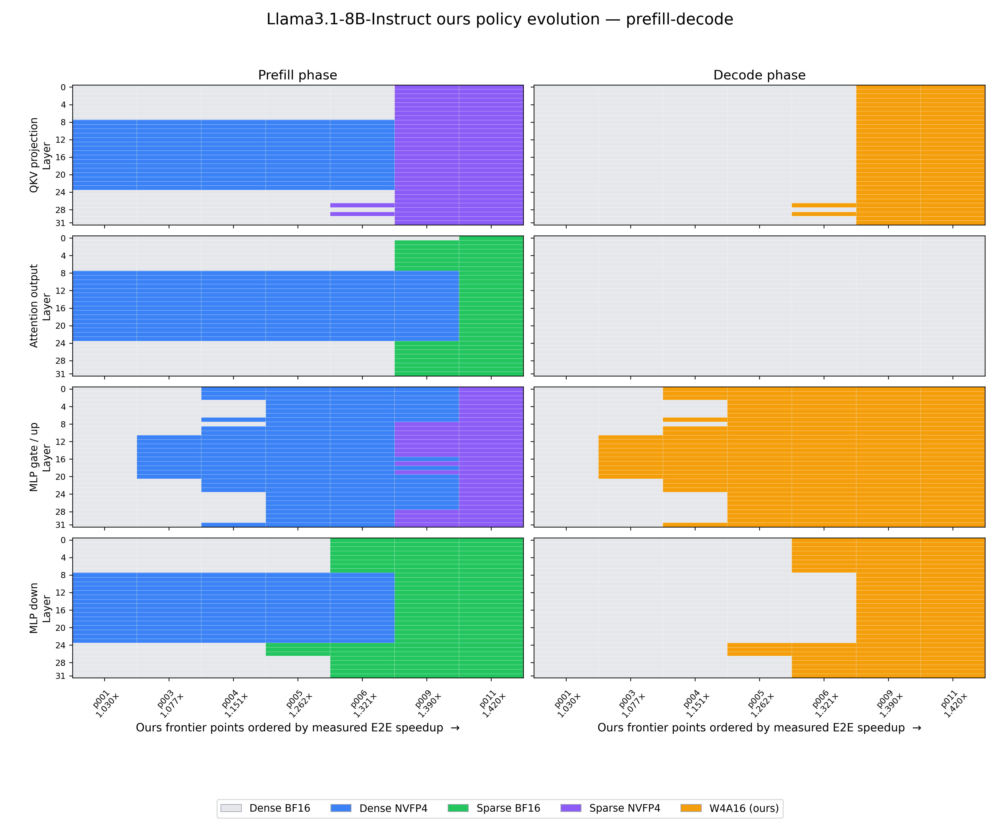

# COSPAQ 建模、策略求解与真实验证：完整实现说明（v2）

## 0. 这套方法到底包含什么

从论文方法的角度看，COSPAQ 的核心确实可以概括为两个模型：

1. **质量代理模型（quality proxy）**：预测一个层异构、模块异构和阶段异构策略相对
   dense BF16 的质量损失 \(\Delta\mathrm{NLL}\)。
2. **延迟代理模型（latency proxy）**：预测同一策略中各个压缩 Linear module 的执行时间，
   再按照推理阶段的真实执行次数组成策略级延迟。

但完整方法并不止“训练两个回归器”。最终系统还包括：

3. **canonical 压缩状态**：保证 SparseGPT、NVFP4 packing 和运行时语义在建模、导出及
   真实评测之间完全一致。
4. **约束优化器**：在质量预算下最小化预测延迟，或在速度目标下最小化预测质量损失。
5. **真实 vLLM closure**：对优化器给出的候选策略重新导出权重，并实测 NLL、端到端速度
   和下游任务指标。论文中的最终点来自这里，而不是直接来自代理模型。

因此，完整的数据流是：

```text
canonical compression
        │
        ├── local module perturbation ──> quality proxy ─┐
        │                                                │
        └── CUTLASS module profiling ───> latency proxy ─┼─> constrained solver
                                                         │
                                                         ▼
                                                candidate policies
                                                         │
                                                         ▼
                      real phase-vLLM NLL + speed + downstream-task closure
                                                         │
                                                         ▼
                                                  paper Pareto curve
```

一个必须始终坚持的边界是：

> 代理模型负责低成本地搜索大空间；真实 vLLM closure 决定论文中的最终横纵坐标。

本文档以 Llama3.1-8B-Instruct 的冻结实现为主，并分别说明：

- **prefill-only**：\(B=8\)，输入长度 \(S=2048\)，只计 prefill。
- **prefill-decode**：\(B=8\)，输入长度 \(S=2048\)，输出长度 \(O=64\)，包含一次
  prefill 和后续 decode。

---

## 1. 记号、决策粒度和压缩动作

### 1.1 模型中的决策单元

Llama3.1-8B-Instruct 有 \(L=32\) 个 Transformer layer。每层将实际 Linear module
归并为四个 fused module group：

| 类型 \(t\) | 模块 |
|---|---|
| `qkv_proj` | query、key、value projection |
| `o_proj` | attention output projection |
| `gate_up_proj` | MLP gate 和 up projection |
| `down_proj` | MLP down projection |

因此共有

$$
N_{\mathrm{module}}=32\times4=128
$$

个决策单元。记第 \(i\) 个单元的 layer 为 \(l_i\)，类型为 \(t_i\)，矩阵 shape 为
\((N_i,K_i)\)。

为了控制质量模型参数量，32 个 layer 被划分为 4 个连续 bucket：

$$
b(l)=\left\lfloor \frac{l}{8}\right\rfloor,\qquad b\in\{0,1,2,3\}.
$$

layer bucket **只用于共享质量系数**；最终策略仍然能够对每一个 layer、每一个 fused
module 独立选择压缩动作，并不会把同一 bucket 内的 8 层强制设成相同方法。

### 1.2 五种运行时动作

每个决策单元的候选动作集合为

$$
\mathcal A=
\{\mathrm{BF16},\mathrm{DenseNVFP4},\mathrm{SparseBF16},
\mathrm{SparseNVFP4},\mathrm{W4A16}\}.
$$

具体语义如下。

| 策略名 | 权重 | 激活 | 稀疏语义 | 运行内核 |
|---|---|---|---|---|
| `dense_bf16` | BF16 | BF16 | dense | dense BF16 |
| `dense_nvfp4` | NVFP4 | 在线低精度激活 | dense | dense NVFP4 W4A4 |
| `sparse_bf16` | BF16 | BF16 | calibrated 2:4 | sparse BF16 |
| `sparse_nvfp4` | NVFP4 | 在线低精度激活 | calibrated pairwise 4:8 | sparse NVFP4 W4A4 |
| `w4a16_ours` | 4-bit | BF16 | dense | Marlin W4A16 |

内核速度表中 `w4a16_ours` 对应 `marlin_nvfp4`。

不是所有 shape 和 phase 都必然支持全部五个动作。动作支持表
`action_support.csv` 是优化器的硬约束：

$$
\mathcal A_i^{(r)}
=\{a\in\mathcal A\mid \mathrm{supported}(r,i,a)=1\}.
$$

不支持的动作不是被赋予一个很大的 penalty，而是直接从候选集合删除。

### 1.3 两个场景的策略变量

prefill-only 只需要一个动作：

$$
\pi_i=a_i,\qquad a_i\in\mathcal A_i^{(\mathrm{prefill})}.
$$

为兼容 phase runtime，导出的 JSON 仍同时包含 `prefill` 和 `decode`，但二者填写同一方法：

```json
{
  "model.layers.0.self_attn.qkv_proj": {
    "prefill": "dense_nvfp4",
    "decode": "dense_nvfp4"
  }
}
```

prefill-decode 则为同一模块独立选择两个阶段的动作：

$$
\pi_i=(a_i^{p},a_i^{d}),
\quad
a_i^{p}\in\mathcal A_i^{(p)},
\quad
a_i^{d}\in\mathcal A_i^{(d)}.
$$

例如：

```json
{
  "model.layers.0.self_attn.qkv_proj": {
    "prefill": "sparse_nvfp4",
    "decode": "w4a16_ours"
  }
}
```

这就是“阶段异构”：同一个权重模块在 prefill 与 decode 阶段允许采用不同表示和内核。

---

## 2. Canonical 压缩状态：所有建模成立的前提

### 2.1 为什么不能直接在运行时 `--prune`

早期实验暴露出两个会破坏建模闭环的问题：

1. naive `--prune` 并不等价于经过校准的 SparseGPT。它会让 sparse uniform endpoint
   与 mixed policy 的误差分布不一致。
2. 已经是 NVFP4 packed 的权重若再次 pack，会发生重复量化，导致真实质量标签与建模时
   的压缩语义不同。

因此，当前流程先离线生成 canonical states，后续局部误差采集、policy 导出和真实
vLLM 评测都从同一 canonical state 出发。

### 2.2 当前 canonical 状态

生成入口：

```text
artifacts/debug/057_llama31_8b_instruct_b8_o64_canonical_pareto/
  scripts/prepare_canonical_sparse.py
```

校准数据为 WikiText-2 train：

- 128 个校准样本；
- sequence length 为 2048；
- seed 为 0。

元数据：

```text
.../canonical/calibration/wikitext2_metadata.json
```

两类稀疏状态为：

- `sparse_bf16`：SparseGPT 校准得到的 canonical 2:4 BF16 权重；
- `sparse_nvfp4`：SparseGPT 校准得到的 pairwise 4:8 **prequant** 权重。

第二类保留 prequant 状态，真正的 NVFP4 packing 只在 phase exporter 中执行一次。

canonical manifest 中冻结的内容哈希为：

```text
sparse_bf16:  60aaf...
sparse_nvfp4: 081c...
```

这里最重要的不是哈希本身，而是每次导出必须校验：

```python
assert source_state == "canonical"
assert nvfp4_pack_count == 1
assert runtime_quant_method == "phase_hetero_mytest"
```

### 2.3 Uniform 与 ours 的运行时必须统一

Uniform baseline 和 mixed policy 都使用相同的 `phase_hetero_mytest` runtime。这样可确保：

- 激活量化路径一致；
- EOS/EOT、KV cache 和 scheduler 口径一致；
- dense NVFP4 不会走一套 uniform 专用 runtime，而 ours 走另一套 phase runtime；
- 最终速度和质量差异仅来自策略，而不是 runtime 实现差异。

离线导出 checkpoint 的时间、canonical-to-CUTLASS 转换时间和
canonical-to-Marlin 转换时间不属于每个请求的在线延迟，因此不进入 Pareto 横轴。

---

## 3. 质量建模：从局部扰动到策略级 \(\Delta\mathrm{NLL}\)

## 3.1 为什么采用 NLL，而不直接拟合下游任务

下游指标存在三个问题：

1. 一个策略完成 CNN/DM、DialogSum、IWSLT 或 ARC 的全量评测非常昂贵；
2. accuracy、ROUGE 和 BLEU 离散且方差较大，不适合作为细粒度优化约束；
3. 用某一个下游任务训练策略模型容易对该任务过拟合。

因此，质量模型拟合一个任务无关代理：

$$
\Delta\mathrm{NLL}(\pi)
=
\mathrm{NLL}_{\mathrm{real\text{-}vLLM}}(\pi)
-
\mathrm{NLL}_{\mathrm{real\text{-}vLLM}}(\pi_{\mathrm{BF16}}).
$$

优化器只用预测的 \(\widehat{\Delta\mathrm{NLL}}\) 筛选候选；最终仍在完整下游任务上实测。
因此本方法没有假设“NLL 与任意下游指标严格线性”，只要求它能够稳定地区分低损失、
中损失和高损失策略。

## 3.2 局部相对 MSE 特征

对 phase \(r\)、模块 \(i\) 和方法 \(a\)，保持上游 hidden state 不变，分别执行原始
BF16 module 与 canonical compressed module：

$$
y_{r,i}=f_i^{\mathrm{BF16}}(x_{r,i}),
\qquad
\widetilde y_{r,i,a}=f_{i,a}(x_{r,i}).
$$

局部误差定义为：

$$
e_{r,i,a}
=
\frac{
\sum_{x\in\mathcal C_r}
\left\|\widetilde y_{r,i,a}(x)-y_{r,i}(x)\right\|_2^2
}{
\sum_{x\in\mathcal C_r}
\left\|y_{r,i}(x)\right\|_2^2+\epsilon
}.
$$

实现对应：

```python
sq_error += (estimate - reference).float().pow(2).sum().item()
sq_reference += reference.float().pow(2).sum().item()
output_rel_mse = sq_error / max(sq_reference, 1e-12)
```

采集脚本：

```text
artifacts/debug/056_llama2_prefill_decode_b8_o64_canonical_pareto/
  scripts/collect_canonical_phase_local_errors.py
```

Llama3 冻结表：

```text
artifacts/debug/057_llama31_8b_instruct_b8_o64_canonical_pareto/
  llama31_8b_instruct/local_errors/
    prefill_dense_nvfp4.csv
    prefill_sparse_bf16.csv
    prefill_sparse_nvfp4.csv
    prefill_w4a16_ours.csv
    decode_dense_nvfp4.csv
    decode_sparse_bf16.csv
    decode_sparse_nvfp4.csv
    decode_w4a16_ours.csv
```

BF16 的局部误差按定义为 0。

### 3.2.1 关于 decode local feature 的准确含义
**TODO**

当前 collector 使用完整的 \(2048+64\) token 序列进行 eager HF forward，并取最后
64 个 token position 的 module input：

```python
decode_x = hidden_states[:, -OUTPUT_TOKENS:, :]
```

然后对这些 position 比较 BF16 和压缩 module 输出。因此它是
**decode-region local perturbation feature**，不是在真实 KV cache 下执行 64 次 vLLM
single-token decode 后逐步采集的 kernel 输出。

这一近似没有被隐藏：真实 KV cache、逐 token 误差传播以及 phase runtime 行为最终由
真实 phase-vLLM 的策略级 NLL 标签吸收。它的优势是局部特征采集成本可控；局限是不能
仅凭 local MSE 独立推出真实 decode NLL。

## 3.3 从 128 个模块聚合到结构化特征

对策略 \(\pi\)，构造结构化特征：

$$
X_{r,a,b,t}(\pi)
=
\sum_{i=1}^{128}
\mathbf 1[b(l_i)=b]\,
\mathbf 1[t_i=t]\,
\mathbf 1[a_i^{(r)}=a]\,
e_{r,i,a}.
$$

直观上，\(X_{r,a,b,t}\) 是“某个 phase 中，某种方法在某个 layer 区间和 module type
上造成的局部扰动总量”。

代码可简化为：

```python
x = np.zeros((num_phases, num_methods, 4, 4), dtype=np.float64)

for module in modules:
    r = phase_id
    a = method_id(policy[module.name][phase_name])
    b = module.layer // 8
    t = fused_type_id(module.name)
    x[r, a, b, t] += local_error[phase_name, module.name, a]
```

prefill-only 删除 phase 维，特征形状为：

```text
[5 methods, 4 layer buckets, 4 module types] = 80
```

prefill-decode 保留 phase 维，特征形状为：

```text
[2 phases, 5 methods, 4 layer buckets, 4 module types] = 160
```

这里“80/160 个特征”不等于训练 80/160 个彼此独立的自由系数。下一节的结构化参数共享
会显著降低有效自由度。

## 3.4 结构化、非负的全局校准

### 3.4.1 为什么不能只把 local MSE 相加

相同的相对 MSE 出现在不同位置，其真实影响并不相同：

- sparse 与 quantization 的误差形态不同；
- attention projection 和 MLP projection 的敏感度不同；
- 浅层、中层和深层对最终 logits 的影响不同；
- prefill 与 decode 的误差传播路径不同。

因此，local MSE 只提供“扰动量”，全局校准负责学习“该扰动量如何映射到
\(\Delta\mathrm{NLL}\)”。

### 3.4.2 Prefill-only 系数

prefill-only 的系数为：

$$
w_{a,b,t}
=
\frac{
\operatorname{ReLU}
\left(g+u_a+v_b+z_t\right)
}{s_x},
$$

其中：

- \(g\)：全局敏感度；
- \(u_a\)：压缩方法效应；
- \(v_b\)：layer bucket 效应；
- \(z_t\)：module type 效应；
- \(s_x\)：训练集平均 feature mass，用于数值归一化。

最终预测为：

$$
\widehat{\Delta\mathrm{NLL}}_{\mathrm{po}}(\pi)
=
c+
\sum_{a,b,t}X_{a,b,t}(\pi)w_{a,b,t}.
$$

### 3.4.3 Prefill-decode 系数

prefill-decode 增加 phase effect：

$$
w_{r,a,b,t}
=
\frac{
\operatorname{ReLU}
\left(g+p_r+u_a+v_b+z_t\right)
}{s_x}.
$$

预测为：

$$
\widehat{\Delta\mathrm{NLL}}_{\mathrm{pd}}(\pi)
=
c+
\sum_{r,a,b,t}X_{r,a,b,t}(\pi)w_{r,a,b,t}.
$$

这里没有手工给 decode 质量乘 \(63\)。原因是策略级训练标签已经是真实 63-step
teacher-forced decode NLL；\(p_r\) 及其他结构项会根据真实标签学习 prefill/decode
局部误差对最终 NLL 的相对贡献。

核心 PyTorch 形式为：

```python
# prefill-only
raw = global_term + method_term[:, None, None]
raw = raw + bucket_term[None, :, None]
raw = raw + type_term[None, None, :]
weight = torch.relu(raw)
pred = bias + ((x / feature_scale) * weight).sum(dim=(1, 2, 3))

# prefill-decode
raw = global_term + phase_term[:, None, None, None]
raw = raw + method_term[None, :, None, None]
raw = raw + bucket_term[None, None, :, None]
raw = raw + type_term[None, None, None, :]
weight = torch.relu(raw)
pred = bias + ((x / feature_scale) * weight).sum(dim=(1, 2, 3, 4))
```

ReLU 的作用是让已激活的贡献非负，同时允许某些结构组合的边际贡献精确为 0。实验中
Softplus 会强迫所有单元产生严格正的损失，容易系统性高估包含少量 sparse module 的
mixed policy，因此最终实现采用 ReLU。

### 3.4.4 训练目标

训练目标为带 \(L_2\) 正则的 MSE：

$$
\mathcal L
=
\frac{1}{|\mathcal D_{\mathrm{train}}|}
\sum_{\pi\in\mathcal D_{\mathrm{train}}}
\left(
\widehat{\Delta\mathrm{NLL}}(\pi)
-\Delta\mathrm{NLL}(\pi)
\right)^2
+
\lambda\|\theta_{\neg c}\|_2^2,
$$

其中 \(\lambda=0.05\)，bias \(c\) 不正则化。当前脚本使用：

```text
dtype=float64
optimizer=Adam
learning_rate=0.03
steps=4000
```

---

## 4. Prefill-only：质量标签、拟合和最终用途

## 4.1 真实 NLL 标签

prefill-only 使用固定的 100 个 WikiText block，每个 block 含 2049 token：

```text
artifacts/debug/058_llama31_prefill_canonical_sparse_quality_recalibration/
  llama31_8b_instruct/samples/wikitext_2048.pt
```

第一个至第 2048 个 token 作为 prompt，通过真实 phase-vLLM 的 prompt logprobs 评分
2048 个 next-token transition。总评分 token 数为：

$$
100\times2048=204{,}800.
$$

标签不是 HF eager NLL，也不是由 local MSE 合成，而是：

```text
policy checkpoint
  -> phase_hetero_mytest vLLM
  -> prompt_logprobs
  -> average NLL
  -> subtract real BF16 average NLL
```

评测入口：

```text
artifacts/debug/058_llama31_prefill_canonical_sparse_quality_recalibration/
  scripts/run_nll_policy.py

artifacts/debug/046_prefill_only_real_vllm_quality_recalibration/
  scripts/evaluate_runtime_prefill_nll.py
```

质量测量采用：

- `max_num_seqs=1`，减少策略标签的显存和调度噪声；
- 禁用 chunked prefill；
- 相同 tokenizer、样本和 runtime；
- BF16 reference 的实测平均 NLL 为约 \(1.98339065\)，PPL 为约 \(7.2673\)。

`max_num_seqs=1` 只用于质量标签稳定性，不代表速度场景中的 batch size 变成 1。速度仍按
\(B=8,S=2048\) 实测。

## 4.2 训练与 holdout

实现：

```text
artifacts/debug/058_llama31_prefill_canonical_sparse_quality_recalibration/
  scripts/fit_quality.py
```

冻结 policy 集中：

- `p00`–`p53`：54 个训练 policy；
- 其余 18 个：holdout policy。

holdout 的含义是：这些策略的真实 NLL 在训练系数时不可见，仅用于检验对未参与拟合的
mixed policy 的预测能力。

最终指标：

| Split | MAE | RMSE | Spearman |
|---|---:|---:|---:|
| Train | 0.024081 | 0.031923 | 0.9671 |
| Holdout | 0.026190 | 0.033053 | 0.9917 |

这里：

$$
\mathrm{MAE}
=\frac1n\sum_j|\widehat{\Delta\mathrm{NLL}}_j-\Delta\mathrm{NLL}_j|,
$$

$$
\mathrm{RMSE}
=
\sqrt{\frac1n\sum_j
\left(\widehat{\Delta\mathrm{NLL}}_j-\Delta\mathrm{NLL}_j\right)^2}.
$$

Spearman 衡量排序能力。对 Pareto 搜索而言，候选策略的相对排序通常比非常小的绝对
偏移更重要。

冻结模型：

```text
artifacts/debug/061_llama31_prefill_warmed_speed_revalidation/
  llama31_8b_instruct/reports/quality/model.json
```

## 4.3 Prefill-only 中质量模型最终做什么

它只做两件事：

1. 给每个 module-action 提供可加的预测质量代价；
2. 在给定 \(\Delta\mathrm{NLL}\) budget 时过滤和排序候选策略。

它不直接预测 ARC-Challenge accuracy，也不将预测值写成论文纵轴。候选点导出后，需要
重新实测：

- 真实 vLLM WikiText NLL；
- ARC-Challenge `acc_norm`；
- 若需要，WikiText PPL、ARC-Easy `acc`、Winogrande `acc`、MMLU `acc`。

---

## 5. Prefill-decode：质量标签、拟合和最终用途

## 5.1 为什么标签必须包含真实 decode 过程

只测试 prefill NLL 无法覆盖：

- phase 切换；
- KV cache；
- 每一步 decode 的误差传播；
- prefill 方法与 decode 方法的交互。

因此，prefill-decode 的标签使用真实 vLLM V1 teacher forcing。

样本 tensor 的形状为：

$$
(100,2048+64)=(100,2112).
$$

前 2048 个 token 是 prompt，后 64 个 token 是固定 target。运行时用
`TeacherForceBatchProcessor` 强制模型在每一步生成 ground-truth target，并读取该 target
的 logprob。实现还会检查实际生成 token id 与 target id 是否完全一致。

调用链：

```text
artifacts/debug/056_llama2_prefill_decode_b8_o64_canonical_pareto/
  scripts/run_canonical_nll.py
    -> artifacts/debug/044_.../scripts/stream_phase_policy_nll.py
    -> artifacts/debug/044_.../scripts/evaluate_runtime_decode_nll.py
```

总评分 token 数：

$$
100\times64=6{,}400.
$$

场景参数为：

```text
batch_size = 8
input_length = 2048
output_length = 64
max_num_batched_tokens = 8 * (2048 + 64) = 16896
```

每次运行必须检查 phase trace 至少包含：

```text
enter_decode
apply_decode
```

否则该标签不能被视为阶段异构策略的有效标签。

BF16 reference 的实测平均 NLL 为约 \(1.89662574\)，PPL 为约 \(6.66337\)。

## 5.2 Coverage-aware split

72 个校准策略不是“最终 Pareto 点”，而是为了让质量模型看到不同的：

- 方法占比；
- layer bucket；
- module type；
- prefill/decode 组合。

划分脚本：

```text
artifacts/debug/056_llama2_prefill_decode_b8_o64_canonical_pareto/
  scripts/build_coverage_holdout.py
```

划分过程只读取策略的结构统计，不读取 NLL 标签：

1. 将每个 policy 转成归一化的 method/phase/count feature；
2. 固定 uniform anchors `p00`–`p04` 在训练集；
3. 用 deterministic farthest-point selection 选择覆盖不同区域的训练点；
4. 得到 54 train 和 18 holdout。

这样避免随机 split 恰好把某一类结构全部留在训练集或全部留在 holdout。

## 5.3 拟合结果

实现：

```text
artifacts/debug/056_llama2_prefill_decode_b8_o64_canonical_pareto/
  scripts/fit_phase_quality.py
```

冻结模型与指标：

```text
artifacts/debug/057_llama31_8b_instruct_b8_o64_canonical_pareto/
  llama31_8b_instruct/reports/quality_coverage_holdout/
    model.json
    metrics.json
```

| Split | MAE | RMSE | Spearman |
|---|---:|---:|---:|
| Train | 0.026760 | 0.034111 | 0.9499 |
| Holdout | 0.041254 | 0.052941 | 0.9628 |

这说明模型不是只记住 54 个训练策略；在结构覆盖不同的 18 个策略上仍能较好保留质量
排序。

## 5.4 Prefill-decode 中质量模型最终做什么

预测目标是整个 teacher-forced decode 序列的 \(\Delta\mathrm{NLL}\)，不是：

$$
\Delta\mathrm{NLL}_{p}+63\Delta\mathrm{NLL}_{d}.
$$

因此，优化器中的质量代价为训练后系数对两个 phase local feature 的加权和；不额外给
decode 人工乘 63。

候选策略 closure 时再实测：

- 100 blocks、64 target tokens 的真实 teacher-forced NLL；
- CNN/DailyMail：ROUGE-L 等；
- DialogSum：ROUGE-L、BERTScore 等；
- IWSLT：SacreBLEU 等。

当前论文 Pareto 图可选 IWSLT BLEU，但该选择只影响展示指标，不改变策略训练过程。

---

## 6. Kernel latency 模型：校准 Roofline 与残差修正

## 6.1 预测对象究竟是什么

预测器面向 CUTLASS wrapper 的**完整 Linear module forward**，不是只根据理论 FLOPs
估算纯 GEMM 指令时间。因此，profiling 中能够体现：

- input/activation quantization；
- weight/scale 读取；
- sparse metadata；
- kernel launch；
- output write；
- wrapper 中属于在线 forward 的必要处理。

生产实现：

```text
fake/kernels/cutlass/cutlass_wrapper/modeling/kernel_predictor.py
fake/kernels/cutlass/cutlass_wrapper/modeling/
  dense_bf16/
  dense_nvfp4/
  sparse_bf16/
  sparse_nvfp4/
  marlin_nvfp4/
```

需要区分：

- **在线 module forward 时间**：进入代理模型；
- **离线 canonical conversion / checkpoint export 时间**：不进入请求延迟；
- **vLLM 非 Linear 时间**：由策略级 E2E 校准吸收。

## 6.2 方法感知的理论 work 和 traffic

对 Linear shape \((M,N,K)\)，基础计算量和流量近似如下。所有公式是 Roofline prior，
不是最终预测。

### Dense BF16

$$
F_{\mathrm{dbf16}}=2MNK,
$$

$$
D_{\mathrm{dbf16}}
=2MK+2NK+2MN.
$$

### Sparse BF16

2:4 sparsity 将有效乘加量近似减半：

$$
F_{\mathrm{sbf16}}=MNK,
$$

$$
D_{\mathrm{sbf16}}
=2MK+2MN+\frac{2NK}{1.777778}.
$$

这里的 \(1.777778\approx16/9\) 不是拟合参数，而是 2:4 sparse BF16 加入结构化
sparsity metadata 后的权重压缩比。对每组 4 个 BF16 权重：

- dense 表示需要 \(4\times16=64\) bit；
- 2:4 sparse 只保存 2 个非零 BF16 value，需要 \(2\times16=32\) bit；
- 还需约 4 bit metadata 记录两个非零值在四个位置中的分布。

因此压缩表示每组需要 \(32+4=36\) bit，权重压缩比为：

$$
\rho_{\mathrm{sbf16}}
=
\frac{64}{36}
=
\frac{16}{9}
\approx1.777778.
$$

所以 sparse BF16 权重流量也可以更直观地写成：

$$
D_{\mathrm{sbf16,weight}}
=
\underbrace{NK}_{\text{50\% nonzero BF16 values}}
+
\underbrace{\frac{NK}{8}}_{\text{2:4 position metadata}}
=
\frac{9}{8}NK
=
\frac{2NK}{16/9}.
$$

完整流量于是为：

$$
D_{\mathrm{sbf16}}
=
\underbrace{2MK}_{\text{dense BF16 activation}}
+
\underbrace{\frac{9}{8}NK}_{\text{sparse values + metadata}}
+
\underbrace{2MN}_{\text{BF16 output}}.
$$

该表达描述的是与 cuSPARSELt packed representation 一致的解析近似；具体 tensor
alignment、padding、cache reuse 和 metadata 访问行为仍由实测校准及 residual model
吸收。也就是说，它解释了为什么 2:4 sparsity 的权重压缩比约为 \(1.78\times\)，而不是
忽略 metadata 时的理想 \(2\times\)。

### Dense NVFP4 W4A4

$$
F_{\mathrm{dnvfp4}}=2MNK,
$$

$$
D_{\mathrm{dnvfp4}}
=2MK+0.5MK+0.5NK+\frac{MK+NK}{16}+2MN.
$$

其中 \(2MK\) 表示原始输入读取，\(0.5MK\) 表示量化激活，\(0.5NK\) 表示 4-bit 权重，
scale 近似为 \((MK+NK)/16\)。

### Sparse NVFP4 W4A4

$$
F_{\mathrm{snvfp4}}=MNK,
$$

$$
D_{\mathrm{snvfp4}}
=
\underbrace{2MK}_{\text{BF16 input read}}
+
\underbrace{0.5MK}_{\text{packed FP4 activation}}
+
\underbrace{\frac{MK}{32}}_{\text{activation scales}}
+
\underbrace{0.25NK}_{\text{sparse FP4 values}}
+
\underbrace{\frac{NK}{16}}_{\text{4:8 position metadata}}
+
\underbrace{\frac{NK}{32}}_{\text{weight scales}}
+
\underbrace{2MN}_{\text{BF16 output}}.
$$

也可以简写为：

$$
D_{\mathrm{snvfp4}}
=
2MK+0.5MK+\frac{MK}{32}
+\frac{11}{32}NK+2MN.
$$

这里的 \(NK/16\) 是论文推荐的 metadata-aware 解析项：pairwise 4:8 的每组 8 个
权重需保存 4 bit 的位置编码，故平均为每个原始权重 \(0.5\) bit，即 \(NK/16\) bytes。
对当前 CUTLASS SM120 sparse FP4 layout，更严格的 metadata physical-buffer 大小为：

$$
D_{\mathrm{metadata,physical}}
=
\frac{
\operatorname{align}(N,128)
\operatorname{align}(K,256)
}{16}\ \mathrm{bytes}.
$$

Llama 的主要 Linear shape 满足这些对齐要求，因此该式通常退化为 \(NK/16\)。具体的
padding、cache reuse 和 metadata 访问行为仍由实测 profile 与 residual model 吸收。

#### 当前冻结实现差异

当前冻结的 sparse_nvfp4_model.py 在 analytical prior 中使用较早的简化式：

~~~python
weight_bytes = 0.25 * N * K
scale_bytes = (M * K + N * K) / 32
~~~

即未显式加入 \(NK/16\) metadata。其 benchmark target 仍是完整 Sparse NVFP4
module-forward，故真实 metadata 开销已部分被该 kernel family 独立拟合的
\(B_{\mathrm{eff}}\)、小-shape floor 与 residual correction 吸收；精确 profile shape
也直接返回实测 median，最终论文 E2E 坐标始终来自真实 vLLM closure。

上面的 metadata-aware 式是论文方法的推荐统一口径。若要把它作为生产速度代理的逐项
精确实现，需要在 predictor 中加入该项，重新拟合 Sparse NVFP4 base/residual，并复核
kernel-level unseen-shape 误差及 solver 候选排序；无需因此重测已完成真实 closure 的最终
Pareto 坐标。

### Marlin W4A16

$$
F_{\mathrm{marlin}}=2MNK,
$$

$$
D_{\mathrm{marlin}}
=2MK+0.5NK+\frac{NK}{16}+2MN.
$$

## 6.3 校准 Roofline base

对每种 kernel family，利用 profile 数据估计有效算力和有效带宽，而不是直接使用 GPU
datasheet peak：

$$
P_{\mathrm{eff}}
=Q_{0.99}\left(\frac{F_j}{T_j}\right),
\qquad
B_{\mathrm{eff}}
=Q_{0.99}\left(\frac{D_j}{T_j}\right).
$$

基础延迟为：

$$
T_{\mathrm{roof}}(M,N,K)
=
\max\left(
\frac{F(M,N,K)}{P_{\mathrm{eff}}},
\frac{D(M,N,K)}{B_{\mathrm{eff}}}
\right)
+T_{\mathrm{launch}}.
$$

部分 kernel family 还对小 \(K/N\) shape 增加低分位 latency floor，避免 Roofline 在
极小问题规模下给出不现实的亚 launch 延迟。

这个 base 的作用是提供物理外推能力。与直接对 latency 做黑盒拟合相比，即使出现训练
集中没有的 \((N,K)\) shape，预测仍然至少满足：

- 计算量随 \(MNK\) 增大；
- 内存流量随 tensor 大小增大；
- compute-bound 与 memory-bound 之间取瓶颈。

## 6.4 学习 Roofline 的系统性残差

真实 kernel 会受到 tile、tail、occupancy 和 reuse 影响，因此拟合：

$$
r_j
=
\log\frac{T_j^{\mathrm{measured}}}
{T_{\mathrm{roof},j}}.
$$

特征包括：

- \(\log_2 M,\log_2 N,\log_2 K\)；
- 两两交互与 shape ratio；
- arithmetic intensity；
- tile 数和 tail 比例；
- output bytes、activation bytes、weight bytes、scale bytes；
- reuse 指标；
- small/large-shape flags。

Ridge 给出平滑的全局残差：

$$
\widehat r_{\mathrm{ridge}}(x)=\beta^\top\phi(x).
$$

同时取 12 个最近 profile shape，按距离倒数插值得到局部残差：

$$
\widehat r_{\mathrm{NN}}(x)
=
\frac{\sum_{j\in\mathcal N_{12}(x)}
\frac{r_j}{d(x,x_j)+\epsilon}}
{\sum_{j\in\mathcal N_{12}(x)}
\frac{1}{d(x,x_j)+\epsilon}}.
$$

根据最近邻距离自适应混合：

$$
\lambda(x)
=
\operatorname{clip}
\left(
\frac{2.5}{2.5+d_{\min}(x)},0.25,0.95
\right),
$$

$$
\widehat r(x)
=
\lambda(x)\widehat r_{\mathrm{NN}}(x)
+[1-\lambda(x)]\widehat r_{\mathrm{ridge}}(x).
$$

最终：

$$
\widehat T_{\mathrm{module}}
=
T_{\mathrm{roof}}\exp(\widehat r).
$$

若请求 shape 在 production profile 表中精确存在，生产预测器直接返回该 shape 的实测
median。未见 shape 的 ablation 则必须按 \((N,K)\) group 划分，防止同一个 Linear
shape 泄露到 train 和 test。

## 6.5 Llama3 的实际 Linear shapes

在 \(B=8,S=2048\) 下：

$$
M_{\mathrm{prefill}}=B\cdot S=16384,
\qquad
M_{\mathrm{decode}}=B=8.
$$

Llama3.1-8B 使用 GQA，四类 fused shape 应为：

| Module group | \(N\) | \(K\) |
|---|---:|---:|
| qkv | \(4096+1024+1024=6144\) | 4096 |
| o | 4096 | 4096 |
| gate/up | 28672 | 4096 |
| down | 4096 | 14336 |

因此，qkv 不能套用普通 MHA 的 \(3H=12288\)。

### 当前冻结实现中的已知技术债

prefill-only 的 `038/action_support.csv` 与后续 exact profile 使用了正确的
\(N_{\mathrm{qkv}}=6144\)。

但冻结的 057 prefill-decode `action_support.csv` 由继承自 Llama2 的
`audit_speed_actions.py` 生成，其中 qkv 曾按 `3 * hidden_size = 12288` 写入。这会使
**raw prefill-decode proxy 中 qkv 项**存在偏差。

它不会篡改论文最终点，因为最终横轴来自真实 vLLM E2E speed closure；但它可能影响候选
策略的 raw 排序和搜索效率。后续重新生成 prefill-decode speed table 时，应从模型配置
读取：

```python
q_dim = num_attention_heads * head_dim
kv_dim = num_key_value_heads * head_dim
qkv_out_features = q_dim + 2 * kv_dim
```

论文中的设计公式应使用真实 GQA shape；不能把历史脚本中的 `3H` 当作方法定义。

---

## 7. 从 module latency 到场景级延迟

## 7.1 Prefill-only raw latency

对策略 \(\pi\)：

$$
\widehat L_{\mathrm{linear}}^{\mathrm{po}}(\pi)
=
\sum_{i=1}^{128}
\widehat T_{\mathrm{module}}
\left(
M=16384,N_i,K_i,a_i
\right).
$$

它是所有被压缩 Linear module 的预测总时间，不包含：

- RMSNorm；
- RoPE；
- attention 与 KV cache 的非 Linear 部分；
- sampling；
- Python/vLLM scheduler；
- runtime 固定开销。

## 7.2 Prefill-decode raw latency

长度 64 的 generation 中，prefill 产生第一个 output token，随后发生 63 次
single-token decode。因此：

$$
\widehat L_{\mathrm{linear}}^{\mathrm{pd}}(\pi)
=
\sum_{i=1}^{128}
\widehat T_i(M=16384,a_i^p)
+
63
\sum_{i=1}^{128}
\widehat T_i(M=8,a_i^d).
$$

这里 decode 乘 63 是**执行次数的确定性计算**，与质量模型不同。质量不能手工乘 63，
但每一步都真实执行的 decode Linear latency 必须乘 63。

## 7.3 为什么还需要 E2E calibration

令 raw proxy 为 \(x(\pi)\)，真实 vLLM 延迟为 \(y(\pi)\)。二者不相等，因为：

$$
y(\pi)
=
x(\pi)
+L_{\mathrm{nonlinear}}(\pi)
+L_{\mathrm{scheduler}}(\pi)
+L_{\mathrm{phase}}(\pi)
+L_{\mathrm{overlap}}(\pi).
$$

其中部分项并非常数，例如在线激活量化、不同 kernel 的 workspace、phase 切换及
overlap 会随策略组成变化。当前主实验采用一维 PAVA 单调校准，而不是假设所有开销都能
由一个固定常数表示。

给定训练 pair：

$$
\{(x_j,y_j)\}_{j=1}^n,
$$

PAVA 求解：

$$
\min_{z_1,\ldots,z_n}
\sum_{j=1}^n(z_j-y_j)^2
\quad
\mathrm{s.t.}\quad
z_1\le z_2\le\cdots\le z_n,
$$

其中样本已按 \(x_j\) 升序排列。若相邻 fitted value 违反单调性，PAVA 将其合并为一个
block 并用 block mean 替代，直到全局单调。

实现逻辑可写为：

```python
pairs = sorted(zip(raw_latency, measured_latency))
blocks = []

for x, y in pairs:
    blocks.append({"weight": 1, "mean": y, "xs": [x]})
    while len(blocks) >= 2 and blocks[-2]["mean"] > blocks[-1]["mean"]:
        right = blocks.pop()
        left = blocks.pop()
        weight = left["weight"] + right["weight"]
        mean = (
            left["weight"] * left["mean"]
            + right["weight"] * right["mean"]
        ) / weight
        blocks.append({"weight": weight, "mean": mean})
```

预测时在 PAVA nodes 间线性插值，在边界外 clamp：

$$
\widehat L_{\mathrm{E2E}}(\pi)
=g_{\mathrm{PAVA}}\left(
\widehat L_{\mathrm{linear}}(\pi)
\right).
$$

PAVA 只做单调映射，不改变 raw proxy 的策略顺序。因此优化器仍可直接最小化 raw
latency；PAVA 用于将其换算为更接近真实 E2E 的绝对时间。positive affine calibration
只在诊断实验中作为简单对照，不是当前主流程的最终校准器。

---

## 8. 两个场景的速度校准口径

## 8.1 Prefill-only

最终速度协议：

```text
batch_size = 8
input_length = 2048
max_num_seqs = 8
max_num_batched_tokens = 16384
chunked_prefill = disabled
```

同一个 engine 内：

1. 加载一次 policy；
2. 执行一次不计时 warmup；
3. 连续执行 5 次相同请求；
4. 取 5 次 E2E latency 的 median。

校准脚本：

```text
artifacts/debug/061_llama31_prefill_warmed_speed_revalidation/
  scripts/fit_speed_calibrator.py
```

12 个设计 policy 中，7 个用于拟合，5 个用于 holdout：

```text
holdout = p42, p45, p52, p60, p68
```

结果：

| Predictor | Holdout latency MAE |
|---|---:|
| Raw, dense-scaled | 43.2008 ms |
| PAVA monotone | 17.8461 ms |

最终论文中的 speedup 为：

$$
\mathrm{Speedup}(\pi)
=
\frac{
\operatorname{median}L_{\mathrm{BF16}}^{\mathrm{measured}}
}{
\operatorname{median}L_{\pi}^{\mathrm{measured}}
}.
$$

## 8.2 Prefill-decode

场景：

```text
batch_size = 8
input_length = 2048
output_length = 64
KV cache = BF16
chunked_prefill = disabled
runtime = phase_hetero_mytest
```

正式 speed closure 使用每个 policy 5 个 fresh-process 测量，取 median。fresh process
可避免前一个异构 policy 的 materialization、allocator 或 phase state 污染后一个
policy，但成本高于 prefill-only 的 same-engine warmed 方式。

校准设计：

```text
artifacts/debug/056_llama2_prefill_decode_b8_o64_canonical_pareto/
  scripts/build_speed_calibration_design.py
```

冻结 split：

```text
train   = p00, p01, p02, p03, p04, p07, p21
holdout = p37, p05, p24, p18, p23
```

结果：

| Predictor | Holdout latency MAE |
|---|---:|
| Raw, dense-scaled | 499.16 ms |
| PAVA monotone | 224.24 ms |

064 消融以相对误差重报为：

| Variant | E2E MAPE |
|---|---:|
| Raw composition | 18.17% |
| + PAVA E2E calibration | 8.30% |

prefill-decode 的绝对误差明显高于 prefill-only。这说明其真实 E2E 延迟更受 scheduler、
phase transition、workspace 和 overlap 影响。它不意味着最终论文速度是不可信的，因为
最终点全部重新实测；它意味着 raw proxy 更适合作为候选排序器，而不能替代真实 closure。

---

## 9. 约束优化：怎样从两个模型得到策略

## 9.1 Prefill-only 的 multiple-choice knapsack

质量预算集合为：

```python
QUALITY_BUDGETS = (
    0.0, 0.005, 0.01, 0.02, 0.04, 0.06, 0.08, 0.12,
    0.18, 0.25, 0.35, 0.5, 0.7, 1.0, 1.3, 1.7,
)
QUALITY_STEP = 0.002
```

对 module \(i\) 和动作 \(a\)，质量代价为：

$$
q_{i,a}
=
e_{p,i,a}
\times
\frac{
\operatorname{ReLU}(g+u_a+v_{b(i)}+z_{t(i)})
}{s_x}.
$$

也就是 local error 与学习到的 sensitivity coefficient 相乘，准确代码形式是：

```python
q = local_error[module, method] * relu_coefficient[method, bucket, module_type]
q = q / feature_scale
```

拟合模型中的 bias \(c\) 对所有 policy 都是同一个常数，因此不会改变最优策略。当前
prefill-only solver 在回溯后将它加回 `predicted_delta_nll`，但 DP 状态本身只累积
module-action 的可变贡献。

离散 bin：

```python
if method == "dense_bf16":
    qbin = 0
else:
    qbin = max(1, ceil(q / QUALITY_STEP))
```

非 BF16 至少占一个 bin，避免由于 ReLU 系数恰好为 0 而出现“免费压缩动作”。

优化问题：

$$
\min_{\{a_i\}}
\sum_i\widehat T_i(a_i)
\quad
\mathrm{s.t.}\quad
\sum_i q_{i,a_i}\le Q.
$$

动态规划递推：

$$
\mathrm{DP}_i[b]
=
\min_{a\in\mathcal A_i}
\left\{
\mathrm{DP}_{i-1}[b-qbin_{i,a}]
+\widehat T_i(a)
\right\}.
$$

每个 budget 回溯最小 latency 策略，并去除内容完全相同的重复 policy。

实现：

```text
artifacts/debug/058_llama31_prefill_canonical_sparse_quality_recalibration/
  scripts/solve_pareto.py
```

## 9.2 Prefill-decode 的 phase-pair knapsack

每个 module 的动作不再是一个方法，而是：

$$
\alpha_i=(a_i^p,a_i^d)
\in
\mathcal A_i^p\times\mathcal A_i^d.
$$

过滤不支持动作后，每个 module 最多有 \(5\times5=25\) 个 phase pair。

质量代价：

$$
q_{i,\alpha}
=
\sum_{r\in\{p,d\}}
e_{r,i,a_i^r}
\times
\frac{
\operatorname{ReLU}
\left(g+p_r+u_{a_i^r}+v_{b(i)}+z_{t(i)}\right)
}{s_x}.
$$

同样，模型 bias 是 policy 无关常数，不参与 DP 的动作比较。冻结的 prefill-decode
solver 输出的 additive proxy 未将 bias 加回，因此其 `predicted_delta_nll` 应理解为
**用于排序和预算的可变质量代价**；与模型散点图中的完整预测值比较时需要再加上 bias。

延迟代价：

$$
\ell_{i,\alpha}
=
\widehat T_i(M=16384,a_i^p)
+63\widehat T_i(M=8,a_i^d).
$$

预算：

```python
QUALITY_BUDGETS = (
    0.0, 0.01, 0.02, 0.04, 0.07, 0.10, 0.15, 0.22,
    0.32, 0.45, 0.65, 0.9, 1.2, 1.6, 2.0,
)
QUALITY_STEP = 0.002
```

求解：

$$
\min_{\{\alpha_i\}}\sum_i\ell_{i,\alpha_i}
\quad
\mathrm{s.t.}\quad
\sum_iq_{i,\alpha_i}\le Q.
$$

在这版 prefill-decode solver 中，若某个 compressed cell 的 ReLU contribution 恰好为
0，它可能进入零质量 bin。为避免零预算解因此覆盖 dense reference，脚本会显式插入
`point_000` dense-BF16 baseline。prefill-only solver 则更严格地让所有非 BF16 动作至少
占一个 bin。两者都不允许丢失真实 BF16 anchor，但后续统一实现时宜采用后者。

实现：

```text
artifacts/debug/056_llama2_prefill_decode_b8_o64_canonical_pareto/
  scripts/solve_pareto.py
```

脚本还支持按 raw speedup target 求解：在满足 latency cap 的候选状态中选择预测质量代价
最小者。这适合补充特定横轴区间，但仍使用同一质量模型和速度模型，不是手工设计策略。

冻结运行中 decode `sparse_nvfp4` 若被动作审计判定不支持，会从该 phase 候选中删除。

## 9.3 为什么 solver 输出还不是最终 Pareto

代理模型存在误差，所以 solver 得到的是 screening frontier：

```text
predicted quality + predicted latency
             ↓
       candidate policies
```

对候选点实测后，可能出现：

- 两个预测不同的点实际上速度接近；
- 某个点真实 NLL 高于预算；
- 某个点被 uniform 或另一个 ours 点支配；
- 某个预测上略差的 bridge 点在下游指标上更好。

因此最后需要对真实结果重新做 non-dominated filtering：

$$
\pi_j\text{ dominates }\pi_i
\iff
s_j\ge s_i,\ q_j\ge q_i,
\text{ 且至少一个严格不等式},
$$

这里 \(s\) 是实测 speedup，\(q\) 是实测下游质量（越大越好）。

---

## 10. 真实 closure：最终具体是怎么做的

## 10.1 候选策略导出

对每个候选 policy：

1. 从 dense checkpoint 和 canonical sparse states 读取对应 module；
2. 按 phase 生成所需 dense/sparse、BF16/NVFP4/Marlin 表示；
3. 校验 canonical manifest；
4. 确保 NVFP4 只 pack 一次；
5. 写入 phase policy 和 checkpoint metadata；
6. 用 `phase_hetero_mytest` 加载。

策略 checkpoint 是可删除的中间产物；只要保留：

- policy JSON；
- canonical manifest；
- exporter 版本；
- NLL、速度、下游结果；

就可以重新导出。

## 10.2 Prefill-only closure

每个候选点依次完成：

```text
real vLLM WikiText NLL
    -> warmed E2E prefill speed, 5 repetitions, median
    -> ARC-Challenge and optional extra tasks
```

质量任务可并行放到多张 GPU；正式速度测试应在空闲 GPU 上串行，避免 GPU 竞争、CPU 到
GPU 带宽竞争和不同进程初始化互相干扰。

最终绘图：

- 横轴：真实 E2E prefill speedup vs dense BF16；
- 纵轴：真实 ARC-Challenge `acc_norm` 或其他实测任务指标；
- uniform points 与 ours points 均使用相同 runtime；
- 被支配的 ours 点可不连入最终 frontier，但原始数据保留。

相关 refined/bridge closure：

```text
artifacts/debug/068_llama31_prefill_uniform_envelope_refinement/
```

## 10.3 Prefill-decode closure

每个候选点依次完成：

```text
real 100 × 64 teacher-forced vLLM NLL
    -> 5 fresh-process E2E latency measurements, median
    -> CNN/DailyMail, DialogSum, IWSLT generation evaluation
```

下游集合规模为：

- CNN/DailyMail：1000；
- DialogSum：1500；
- IWSLT：333。

生成任务沿用相同 legacy/common prompt 协议，确保同一模型内 BF16、uniform 和 ours
公平。Llama3 native chat template 的小规模诊断不能替换主实验结果。

最终绘图：

- 横轴：真实 prefill-decode E2E speedup；
- 纵轴：真实 ROUGE-L、BERTScore 或 SacreBLEU；
- 论文可选 IWSLT BLEU 作为主图；
- NLL 预测图是建模验证图，不是最终任务 Pareto 图。

## 10.4 哪些量预测，哪些量必须实测

| 量 | 来源 | 用途 | 是否作为论文最终坐标 |
|---|---|---|---|
| local relative MSE | canonical module 离线测量 | 质量特征 | 否 |
| kernel/module latency | profiling + Roofline/residual | 速度代理 | 否 |
| policy \(\widehat{\Delta\mathrm{NLL}}\) | 质量模型 | 搜索约束 | 否 |
| policy raw/E2E predicted latency | latency model + PAVA | 搜索与成本预估 | 否 |
| real-vLLM \(\Delta\mathrm{NLL}\) | 真实 runtime | closure、模型验证 | 可用于 NLL 图 |
| real-vLLM E2E latency | 真实 runtime | closure | **是，横轴** |
| downstream score | 完整任务评测 | 最终质量 | **是，纵轴** |

---

## 11. 消融实验具体验证了什么

## 11.1 质量模型逐步消融

质量消融采用 prefill-decode 的 coverage holdout，三个 variant 是逐步叠加：

| Variant | 含义 | Holdout MAE | RMSE | Spearman |
|---|---|---:|---:|---:|
| Q0: Local only | 直接聚合局部扰动，最弱全局校准 | 0.0571 | 0.0711 | 0.920 |
| Q1: + structure | 加入 method、bucket、module-type 结构效应 | 0.0468 | 0.0568 | 0.944 |
| Q2: + phase | 再加入 prefill/decode phase effect | **0.0413** | **0.0529** | **0.963** |

它说明：

1. local perturbation 本身有信息，但不能完全解释端到端质量；
2. 结构位置和压缩方法的敏感度共享能够降低误差；
3. 对 phase-heterogeneous generation，phase effect 进一步改善预测。

prefill-only 没有 phase 维，因此不应把 Q2 的 phase 收益错误地声称为 prefill-only
设计收益。

## 11.2 Kernel latency 消融

| Variant | Unseen-shape MAPE | P90 error | Spearman |
|---|---:|---:|---:|
| Direct fit | 14.80% | 37.47% | 0.957 |
| + calibrated Roofline | 10.78% | 27.92% | 0.962 |
| + residual correction | **8.01%** | **22.03%** | **0.972** |

这里评估的是 **module/kernel latency**，不是 E2E latency。按 \((N,K)\) group 隔离
unseen shape，验证 Roofline prior 的物理外推与 residual 的局部修正均有收益。

## 11.3 E2E composition 消融

| Variant | E2E MAPE |
|---|---:|
| Refined kernel predictor + raw phase composition | 18.17% |
| + PAVA E2E calibration | **8.30%** |

这个表评估的是 **策略级 vLLM latency**。它与上一个 8.01% 不是同一个指标：

- 8.01%：unseen module shape 的 latency error；
- 8.30%：策略级 E2E vLLM latency error。

PAVA 不属于 kernel predictor，而是 module latency 聚合到 E2E 后的最后一层校准。

## 11.4 校准样本数量

校准样本敏感度实验冻结最终 72-policy pool，用 nested subsets 反复拟合质量模型。主模型
使用 54 个 calibration policy：

| Calibration policies | Holdout MAE | 采集成本 |
|---:|---:|---:|
| 54 | 0.0413 | 48.6 GPU-min |
| 72 | 0.0340 | 71.4 GPU-min |

扩展曲线显示误差随样本增多总体下降，并在约 54–64 个样本后趋于平缓；因此 54 是精度
与成本的折中，而不是“必须恰好使用 54 才能工作”。

## 11.5 Runtime overlap

overlap 消融属于运行时系统设计，不属于质量/速度代理模型本身。它验证 phase
materialization/transition 可与执行重叠，并降低暴露在 E2E latency 中的切换开销。

代理模型不直接加一个“overlap 奖励”；真实 overlap 效应由：

1. 策略级 E2E 校准样本；
2. 最终真实 vLLM closure；

共同反映。这样避免使用无法稳定测量的手工 overlap 常数。

---

## 12. 从一个新模型开始时的完整实施顺序

下面是方法真正的端到端顺序，而不是只训练两个模型。

### Step 1：冻结场景和 runtime

明确：

```text
model
batch size
input/output length
KV-cache dtype
chunked-prefill setting
max_num_seqs
max_num_batched_tokens
runtime quant_method
tokenizer and prompt protocol
```

这些条件一旦改变，真实 E2E speed closure 必须重新测；质量模型是否需要重训取决于
真实压缩语义和 NLL 口径是否改变。

### Step 2：解析模型结构和动作支持

从模型 config 计算真实 GQA qkv shape，枚举 128 个决策单元，在 prefill/decode 两个
\(M\) 上核验五类 kernel 是否支持。

输出：

```text
architecture_manifest.json
action_support.csv
```

### Step 3：生成 canonical sparse states

用固定 WikiText 校准集运行 SparseGPT，生成：

```text
sparse_bf16 canonical state
sparse_nvfp4 canonical prequant state
canonical_manifest.json
```

先用 uniform sparse checkpoint 做小规模真实性检查，再开始大批量策略评测。

### Step 4：采集 local quality feature

分别采集：

```text
phase × method × layer × module type -> output relative MSE
```

如果只做 prefill-only，可只使用 prefill table；prefill-decode 使用两套 phase table。

### Step 5：构造 calibration policies 并实测 NLL

policy pool 必须覆盖：

- 五种 uniform anchors；
- 不同方法比例；
- 不同 layer bucket；
- attention 与 MLP；
- prefill/decode 不同组合。

不要把最终 solver 输出当训练数据的唯一来源，否则模型只会在自己已经偏好的区域内拟合。

### Step 6：拟合质量模型并做 holdout 验证

至少报告：

```text
train/holdout MAE
train/holdout RMSE
train/holdout Spearman
predicted-vs-measured scatter
method/phase/bucket/type coefficient inspection
```

还应检查 sparse uniform endpoint 是否异常大、mixed sparse 是否被系统性高估。这通常能
暴露 canonical 语义不一致、naive pruning 或重复 packing，而不一定是回归器容量不足。

### Step 7：建立 module latency profile

对每种 kernel family 和相关 \((M,N,K)\) 采集 module-forward latency，拟合：

```text
calibrated Roofline base + ridge/local residual
```

验证必须包含 unseen \((N,K)\) group，不能只报告 exact-shape lookup 的误差。

### Step 8：做场景级 E2E speed calibration

选择少量覆盖不同策略组成的 policy：

```text
raw phase composition -> measured vLLM E2E -> PAVA
```

prefill-only 与 prefill-decode 的 composition 公式不同，因此需要各自的 E2E calibration；
底层 kernel predictor 可以共享。

### Step 9：约束优化

运行 multiple-choice knapsack，沿一组 \(\Delta\mathrm{NLL}\) budget 或 raw speedup target
产生候选点。检查：

```text
unsupported action absent
dense BF16 point present
max-speed endpoint present
candidate speed range sufficiently covered
duplicate policies removed
```

### Step 10：真实 closure

对所有保留候选：

```text
export -> provenance check -> real NLL -> real E2E speed -> downstream tasks
```

速度串行、精度并行；有 OOM 或外部 GPU 干扰的速度样本直接废弃，不做人工修正。

### Step 11：形成论文产物

保存：

```text
policy JSON
canonical hashes
raw model predictions
real NLL
five speed repetitions and median
all downstream metrics
dominance status
plot source CSV/JSON
Pareto figures
summary.md / result.tex
```

最终 paper frontier 仅由同一 runtime、同一协议下的实测数据构造。

---

## 13. 常见误解与实现检查

### 13.1 “模型预测准，所以无需真实测速”

错误。速度 proxy 负责搜索；E2E scheduler 与 phase behavior 无法完全由 module sum
解释，特别是 prefill-decode。最终必须实测。

### 13.2 “prefill-only 和 prefill-decode 使用完全相同的质量模型”

不准确。二者共享：

- canonical states；
- local relative-MSE 思想；
- method/bucket/type 参数共享；
- 非负全局校准。

但二者的特征张量、真实 NLL 标签和系数公式不同。prefill-decode 多一个 phase 维，并
拟合真实 64-token teacher-forced NLL。

### 13.3 “两个场景需要两套独立 kernel predictor”

不需要。底层 kernel family predictor 可以共享，只需查询不同 \(M\)：

```text
prefill: M = 16384
decode:  M = 8
```

不同的是 phase composition 和 E2E PAVA calibration。

### 13.4 “layer bucket 会禁止 layer-heterogeneous policy”

不会。bucket 只让 8 层共享一个敏感度偏置；local error 仍逐 module 存储，solver 仍逐
module 选动作。

### 13.5 “质量预算等于下游 accuracy drop”

不是。预算单位是预测 \(\Delta\mathrm{NLL}\)。下游 accuracy/ROUGE/BLEU 只在 closure
中实测。

### 13.6 “sparse NVFP4 等于先随便剪枝再量化”

不是。它必须来自 SparseGPT calibrated canonical prequant state，并且最终只 pack 一次。

### 13.7 “Uniform baseline 可用另一个更方便的 vLLM 接口”

不可以用于主对比。Uniform 和 ours 必须使用同一 `phase_hetero_mytest` runtime，否则
激活量化、packing 或 scheduler 差异会混入结果。

---

## 14. 关键实现与产物索引

### 14.1 质量与 canonical

```text
artifacts/debug/057_llama31_8b_instruct_b8_o64_canonical_pareto/
  scripts/prepare_canonical_sparse.py
  llama31_8b_instruct/canonical/
  llama31_8b_instruct/local_errors/
  llama31_8b_instruct/reports/quality_coverage_holdout/

artifacts/debug/058_llama31_prefill_canonical_sparse_quality_recalibration/
  scripts/fit_quality.py
  scripts/run_nll_policy.py
  scripts/solve_pareto.py

artifacts/debug/056_llama2_prefill_decode_b8_o64_canonical_pareto/
  scripts/collect_canonical_phase_local_errors.py
  scripts/build_coverage_holdout.py
  scripts/fit_phase_quality.py
  scripts/run_canonical_nll.py
  scripts/solve_pareto.py
```

### 14.2 速度

```text
fake/kernels/cutlass/cutlass_wrapper/modeling/kernel_predictor.py
fake/kernels/cutlass/cutlass_wrapper/modeling/{kernel_family}/

artifacts/debug/061_llama31_prefill_warmed_speed_revalidation/
  scripts/fit_speed_calibrator.py

artifacts/debug/056_llama2_prefill_decode_b8_o64_canonical_pareto/
  scripts/build_speed_calibration_design.py

artifacts/debug/057_llama31_8b_instruct_b8_o64_canonical_pareto/
  llama31_8b_instruct/speed/
```

### 14.3 消融和最终结果

```text
artifacts/debug/064_llama31_modeling_ablation/
artifacts/debug/065_quality_calibration_sample_sensitivity/
artifacts/debug/068_llama31_prefill_uniform_envelope_refinement/
artifacts/debug/060_two_model_two_scenario_result_consolidation/
```

---

## 15. 最简洁但准确的论文方法表述

可以将整个方法概括为：

> We first characterize each canonical compression action using its module-level
> output perturbation and calibrated CUTLASS module latency. A structured,
> non-negative quality model maps local perturbations to policy-level real-vLLM
> \(\Delta\mathrm{NLL}\), sharing statistical strength across compression methods,
> layer regions, module types, and, for generation, inference phases. In parallel,
> a method-aware calibrated Roofline model predicts module latency and learns the
> residual effects of tensor shapes, tiling, tails, and data movement. We compose
> module latencies according to the exact prefill/decode execution counts and use
> monotonic E2E calibration to account for non-Linear runtime overheads. A
> multiple-choice knapsack solver then searches module- and phase-heterogeneous
> policies under quality budgets. All reported Pareto points are finally re-exported
> from canonical states and validated with real phase-vLLM latency and downstream
> task evaluation.

更重要的是，读者应当从实现上理解：

```text
局部特征不是最终质量；
Roofline 不是最终速度；
solver 输出不是最终 Pareto；
只有 canonical 一致、真实 vLLM closure 后的点才是论文结果。
```

---

## Appendix A. 单模块真实 NLL 与可加质量代理

质量模型的监督标签只在策略级可观测：每条训练样本是

$$
\left(\pi,\Delta\mathrm{NLL}_{\mathrm{real}}(\pi)\right).
$$

local relative MSE 是固定的模块级输入特征；训练后得到的
\(q_{i,a}\) 是将策略级预测写成可求解形式时的**可加质量代理**：

$$
\widehat{\Delta\mathrm{NLL}}(\pi)
=
c+\sum_i q_{i,a_i}.
$$

因此，\(q_{i,a}\) 不应解释为“仅压缩模块 \(i\) 为方法 \(a\) 后，真实最终 NLL
必然增加的精确因果量”。其价值在于：由 mixed-policy 的真实 NLL 校准后，模块动作的
代理代价之和能近似联合压缩策略的真实 \(\Delta\mathrm{NLL}\)，从而与
multiple-choice knapsack 的质量约束直接对齐。

一个有价值、但不同于 local-MSE Q0 的诊断 baseline 是单模块真实 NLL 加和。令
\(\pi^{(i\leftarrow a)}\) 表示仅将模块 \(i\) 设为动作 \(a\)、其余模块保持 BF16 的策略，定义

$$
\delta_{i,a}
=
\Delta\mathrm{NLL}_{\mathrm{real}}
\left(\pi^{(i\leftarrow a)}\right).
$$

它对任意 mixed policy 的预测为：

$$
\widehat{\Delta\mathrm{NLL}}_{\mathrm{single}}(\pi)
=
\sum_i\delta_{i,a_i}.
$$

若真实 NLL 对模块动作严格可加，该 baseline 足以提供精确的 knapsack 质量代价，
不再需要本文的 local-feature calibration。然而 Transformer 的层间 hidden-state 传播与
logit-to-NLL 映射通常使

$$
\Delta\mathrm{NLL}_{\mathrm{real}}(\{i,j\})
\neq
\Delta\mathrm{NLL}_{\mathrm{real}}(\{i\})
+
\Delta\mathrm{NLL}_{\mathrm{real}}(\{j\}).
$$

故单模块真实边际量并不能保证对高压缩率 mixed policy 准确。本文的结构化校准模型通过
mixed-policy 标签学习这种非严格可加性在 method、bucket、module type 与 phase 上的平均
修正；但其输出仍是用于搜索的近似，最终候选必须 real-vLLM closure。

若实施该诊断，应让 proposed model 与该 baseline 在**相同的未见 mixed-policy holdout**上
报告 MAE、RMSE、Spearman，以及在质量预算下 solver 候选的真实 NLL。还应明确评测预算：
prefill-only 的单模块 baseline 约需

$$
1+128\times(\text{非 BF16 的支持动作数})
$$

次真实 NLL 评测，通常多于本文拟合所用的策略级 calibration labels；prefill-decode 的
phase 组合会进一步增加次数。因此宜同时报告不等预算下的最强单模块 baseline 与等
real-vLLM 评测预算的比较。该 Appendix 定义的是建议的消融协议，并不声称当前已完成该实验。

---

## Appendix B. 经验帕累托界限审计：我们的前沿距离更优策略还有多远

前面的章节说明了 COSPAQ 如何利用质量与延迟代理模型搜索候选，并通过真实 vLLM closure
得到论文中的最终前沿。本节进一步回答一个不同的问题：

> 约束优化器给出的 ours frontier 是否只是代理模型偏好的局部解？如果脱离原求解路径，
> 使用随机搜索、局部邻域搜索和高 leverage 模块扰动，还能在真实速度与真实下游质量上
> 找到明显更好的策略吗？

对应实验位于：

```text
artifacts/debug/069_llama31_pareto_search_audit/
```

实验的核心目的不是再次验证代理模型的拟合误差，而是用一组**独立生成、完整实测**的
challenger 直接攻击现有 ours frontier，从而估计它与更优经验帕累托界限之间可能存在的
距离。

### B.1 “真正的帕累托界限”在这里如何理解

令 \(\Pi\) 表示所有满足 kernel action support 的策略集合。对任意策略 \(\pi\)，记真实
E2E speedup 为 \(s(\pi)\)，真实下游质量为 \(q(\pi)\)，且二者都是越大越好。真正的
Pareto 集合应为：

$$
\mathcal P^\star
=
\left\{
\pi\in\Pi:
\nexists\pi'\in\Pi,\ 
s(\pi')\ge s(\pi),\
q(\pi')\ge q(\pi),
\text{ 且至少一个严格不等式}
\right\}.
$$

prefill-only 最多有 \(5^{128}\) 种 module-level assignment；prefill-decode 对同一模块
独立选择两个 phase action，未考虑 action support 前的组合上界进一步达到
\(25^{128}\)。因此，不可能枚举 \(\Pi\) 并严格证明论文前沿就是
\(\mathcal P^\star\)。

069 实验采用一个有限但有针对性的 challenger 集合 \(\mathcal C\)，检查每个既有
reference point \(\pi_r\) 是否被其中某点支配：

$$
\operatorname{dominated}_{\mathcal C}(\pi_r)
\iff
\exists \pi_c\in\mathcal C:
s(\pi_c)\ge s(\pi_r),\
q(\pi_c)\ge q(\pi_r).
$$

因此，这是一项**经验最优性审计**：

- 若找到支配点，实测 speedup gain 与 quality gain 就给出了原前沿至少还可改进多少；
- 若没有找到支配点，说明原前沿对当前搜索预算和扰动族具有较强鲁棒性；
- “未找到”不等价于数学上证明距离为 0，也不能排除更大规模搜索发现新点。

这个限定很重要。本文将 069 的结果解释为“ours 已经非常接近当前可发现的经验前沿”，
而不声称完成了指数级策略空间的全局最优证明。

### B.2 Challenger 如何独立构造

两个场景各固定生成 30 个 challenger，共 60 个策略。候选生成不读取 ARC-Challenge
或 IWSLT 的真实标签，避免根据最终纵轴反复挑点。三类策略分别覆盖全局随机探索、已有
前沿附近的局部探索，以及代理模型认为最有可能产生收益的位置。

| Family | 每场景数量 | 构造方式 | 审计目的 |
|---|---:|---|---|
| Random | 15 | 从 dense BF16 出发，按分层比例随机选择模块并替换为合法的非 BF16 action | 检查原 solver 是否遗漏远离既有前沿的全局区域 |
| Neighborhood | 10 | 5 个代表性 ours parent，各做一次 5% 和 15% module mutation | 直接检查既有前沿附近是否存在容易发现的局部改进 |
| Suspicious | 5 | 对每个 parent 扰动 proxy leverage 最高的 32 个模块 | 对最可能具有高速度收益/低质量代价的模块做定向攻击 |

Random 的替换比例为：

```text
5%, 5%, 10%, 10%, 20%, 20%, 35%, 35%,
50%, 50%, 65%, 65%, 80%, 80%, 100%
```

它既覆盖接近 dense BF16 的低扰动区域，也覆盖高度压缩的最大速度区域。对
prefill-decode，每个被选择模块随机采样的是合法的
\((a_i^{p},a_i^{d})\) phase pair，而不是强制两个 phase 使用相同方法。

Neighborhood 的 5% 和 15% mutation 对 128 个决策单元分别约为 6 个和 19 个模块。
两个场景的 parent 为：

| 场景 | 五个 neighborhood/suspicious parent |
|---|---|
| Prefill-only | `point_000`, `point_004`, `point_006`, `fine_q208`, `point_014` |
| Prefill-decode | `point_001`, `point_004`, `point_006`, `point_009`, `point_011` |

这些 parent 从高质量端、中间区域和最大速度端取样，因此 neighborhood 并非只围绕某一个
容易改进的点。

Suspicious family 先对每个模块计算 proxy leverage。其实现可概括为：

$$
h_i
=
\frac{
\max_{\alpha\in\mathcal A_i}
\left[\ell_i(\mathrm{BF16})-\ell_i(\alpha)\right]
}{
\max\left(
\min_{\alpha:q_i(\alpha)>0}q_i(\alpha),10^{-9}
\right)
}
+0.1\max_{\alpha\in\mathcal A_i}q_i(\alpha),
$$

然后选取 \(h_i\) 最高的 32 个模块，在每个 parent 周围将这些 action 随机改为其他合法
action。该分数使用冻结的 latency/quality proxy 来确定“值得攻击的位置”，但最终
Pareto 判断完全不使用 proxy 坐标。

候选生成使用固定基准 seed `20260723`，两个场景采用分离的确定性随机流。静态验证要求：

- 每个场景严格为 15 random、10 neighborhood、5 suspicious；
- 每个 policy 恰好包含 128 个 fused Linear action；
- 所有 prefill/decode action 均满足冻结的 support table；
- 60 个 policy 内容唯一，并保存稳定 SHA256。

### B.3 所有坐标都来自真实 closure

069 不用预测 latency 或预测 \(\Delta\mathrm{NLL}\) 代替最终坐标。每个 challenger 都
重新导出 checkpoint，并沿用论文点相同的 runtime、batch、sequence length 和下游协议。

| 场景 | 真实速度协议 | 真实质量协议 | 冻结 BF16 分母 |
|---|---|---|---:|
| Prefill-only | \(B=8,S=2048\)，一次 warmup 后 5 次 warmed E2E，取 median | 完整 ARC-Challenge `acc_norm` | 1087.5269 ms |
| Prefill-decode | \(B=8,S=2048,O=64\)，5 个 fresh-process E2E，取 median | 完整 IWSLT 333 SacreBLEU | 2198.6882 ms |

prefill-decode 使用 fresh process，是为了避免前一个异构 policy 的 materialization、
allocator 或 phase state 污染后一个 policy。两个场景都沿用 canonical sparse states 和
`phase_hetero_mytest` runtime；禁止退回 naive runtime pruning，也禁止重复 NVFP4 pack。

为确保新增候选与历史 ours 点可以共用横轴，正式批次前后各测一次 dense BF16 anchor。
超过 3% 的首尾漂移，或相对冻结论文 anchor 超过 3%，都会让汇总失败。

| 场景 | Before | After | 首尾漂移 | 相对冻结 anchor | 检查 |
|---|---:|---:|---:|---:|---|
| Prefill-only | 1090.416 ms | 1089.901 ms | 0.047% | 均小于 0.3% | Pass |
| Prefill-decode | 2160.006 ms | 2213.518 ms | 2.477% | 分别为 1.76% / 0.67% | Pass |

最终两个场景均完成 30/30 speed 和 30/30 完整任务质量；没有预测坐标、不完整任务结果
或受外部 GPU 干扰的失败样本进入报告。新增 challenger 的 speedup 统一用冻结 BF16
分母计算，而不是各自选择更有利的临时 anchor。

### B.4 正式审计的总体结果

正式结果如下：

| 场景 | Challenger | Challenger 自身前沿 | Ours reference 前沿 | 被支配的 ours | 保留的 ours | 合并前沿点数 |
|---|---:|---:|---:|---:|---:|---:|
| Prefill-only | 30 | 7 | 13 | 2 | 11 | 13 |
| Prefill-decode | 30 | 4 | 7 | 0 | 7 | 10 |
| 合计 | 60 | — | 20 | 2 | 18 | — |

换言之，20 个既有 ours reference 在各自场景加入 30 个定向 challenger 后，共有 18 个
仍未被支配，保留率为 90%。更重要的是：

1. prefill-decode 的 7 个 ours reference 全部保留；
2. prefill-only 只有两个点被改进，且改进量均较小；
3. random 和 suspicious 搜索没有形成一条整体高于 ours 的替代前沿；
4. challenger 的主要作用是在相邻 ours 点之间增加少量 bridge，或在极端低质量端扩展
   速度，而不是推翻 ours 在主要质量区间的权衡。

这正是该实验希望验证的结论：代理模型与约束求解器得到的 ours frontier 并非明显偏离
一个容易找到的更优区域；在相同真实 closure 口径下，它已经是一个质量很高的经验
Pareto 近似。

### B.5 Prefill-only：仅发现两个很小的局部改进

13 个 ours reference 中，只有以下两个被 challenger 支配：

| Ours point | Ours \((s,q)\) | Challenger | Challenger \((s,q)\) | Speedup gain | ARC `acc_norm` gain |
|---|---:|---|---:|---:|---:|
| `point_000` | (1.0000, 0.556314) | `random_002` | (1.0305, 0.562287) | +0.0305x | +0.005973 |
| `point_004` | (1.2523, 0.546075) | `neighborhood_003` | (1.2596, 0.548635) | +0.0073x | +0.002560 |

第一个点位于 dense BF16 附近。`random_002` 在保持 ARC-Challenge 更高的同时获得
1.0305x speedup，说明极低压缩率区域仍可通过少量随机替换改善。它对前沿的提示是：
dense anchor 附近可以补一个更好的低风险点，而不是中高 speedup 区域的 ours 解整体失效。

第二个点正是局部 neighborhood 找到的改进，但幅度只有：

- speedup 坐标增加 0.0073x，相对 `point_004` 的 speedup 约增加 0.58%；
- ARC-Challenge `acc_norm` 绝对增加 0.00256，即约 0.256 个百分点。

其余 11 个 ours reference，包括 068 补充的低质量损失点、bridge 点以及 2.1x--2.26x
高速度端，均没有被 30 个 challenger 支配。Challenger 自身虽有 7 个 non-dominated
点，但与 ours 合并后只有 `random_002` 和 `neighborhood_003` 留在 union frontier；
其余 challenger 会被 ours 或上述两个点支配。

因此，prefill-only 的审计结论不是“完全没有任何可改进空间”，而是：

> 可发现的 gap 集中在两个局部位置，且量级很小；ours 在主要速度范围内已经紧贴经验
> 前沿。

### B.6 Prefill-decode：正式 7 个 ours 点无一被支配

prefill-decode 的 7 个 ours reference 为：

| Policy | Speedup | IWSLT SacreBLEU | 被 30 个 challenger 支配 |
|---|---:|---:|---|
| `point_001` | 1.0297x | 11.637853 | No |
| `point_003` | 1.0767x | 11.115958 | No |
| `point_004` | 1.1513x | 10.763937 | No |
| `point_005` | 1.2622x | 10.550167 | No |
| `point_006` | 1.3210x | 10.312285 | No |
| `point_009` | 1.3898x | 6.711961 | No |
| `point_011` | 1.4204x | 1.288545 | No |

30 个 challenger 中有 4 个组成 challenger-only frontier，但与 ours 合并后仅有三个
neighborhood 点进入 union frontier：

| Challenger | Speedup | IWSLT SacreBLEU | 作用 |
|---|---:|---:|---|
| `neighborhood_003` | 1.1313x | 11.100305 | 填充 `point_003` 与 `point_004` 之间 |
| `neighborhood_005` | 1.3317x | 10.188323 | 填充 `point_006` 与高速度低质量区域之间 |
| `neighborhood_009` | 1.5274x | 1.242957 | 扩展极端最高速度端，但质量低于 `point_011` |

这些点都没有同时提高某个 ours reference 的速度和质量。例如
`neighborhood_003` 比 `point_003` 快，但 BLEU 略低；它比 `point_004` 的 BLEU 高，
但速度更慢。`neighborhood_009` 明显更快，但 BLEU 低于最低质量的 `point_011`。

特别值得注意的是，15 个 random 和 5 个 suspicious-module challenger 均未进入
ours+challenger union frontier。也就是说，即使：

- 从 dense BF16 全局随机替换最高到 100% 的模块；
- 或集中攻击 proxy 认为 leverage 最高的 32 个模块；

仍未找到一条整体优于 ours 的 prefill-decode 路径。这个结果比只在 solver 自己输出的
点之间做 non-dominated filtering 更强，因为 challenger 的生成方式已经脱离原来的
budget sweep。

### B.7 极端速度点、复测与 presentation-only 图的边界

正式 prefill-decode 审计中的 `neighborhood_009` 达到 1.5274x，视觉上明显越过 ours
最高速度端。该点并非一次偶然的异常快样本：后续在同一 GPU、同一 fresh-process 协议下
复测，`point_011` 和 `neighborhood_009` 的中位延迟分别为 1496.97 ms 与
1423.14 ms，后者稳定快 5.19%。但是它的正式 IWSLT SacreBLEU 为 1.242957，低于
`point_011` 的 1.288545，因此在二维判据下不支配 `point_011`，也不会改变“正式 7 个
ours reference 均未被支配”的结论。

为了让 presentation 图保持与主曲线相近的横轴范围，069 另外生成了一份明确标记为
display-only 的图：

```text
prefill_decode/report/pareto_search_audit_display.{png,pdf}
prefill_decode/report/display_exclusions.json
prefill_decode/report/display_challengers.csv
```

该图从展示散点和展示用 union frontier 中排除 `neighborhood_009`，并用一个完整实测的
新 5% neighborhood 点 `neighborhood_012` 替代：

| Policy | Parent | Mutated modules | Median latency | Speedup | IWSLT |
|---|---|---:|---:|---:|---:|
| `neighborhood_012` | `point_006` | 6/128 | 1698.89 ms | 1.2942x | 10.349794 |

`neighborhood_012` 完成 IWSLT 333/333，且没有空输出。它只用于 presentation-only
视图，不进入原来固定的 30 个 challenger，也不修改：

- `all_results.csv`；
- 正式 `challenger_frontier.csv` 和 `union_frontier.csv`；
- `gap_to_reference.csv`；
- 原始 `pareto_search_audit.{png,pdf}`；
- 本节 B.4--B.6 的正式统计。

替代点探索还保留了未用于展示的 `neighborhood_011`。该 post-audit 点实测为
1.4838x / BLEU 1.438638，会支配最低质量端的 `point_011`，因此不能把它悄然当成普通
展示替代而仍声称图中 ours 完全不变。它没有进入预先固定的 30 点正式审计统计，但这一
结果说明：在极端低质量端继续做 post-hoc neighborhood search 仍可能找到改进。

因此，presentation-only 图只能用于更清楚地展示主要质量区间的整体形状；关于经验
最优性的定量结论必须以未删除任何点的正式 CSV 和正式图为准。这个数据边界避免了为了
版面效果而改写实验结论。

### B.8 最终结论与论文表述边界

069 支持如下结论：

1. **主前沿已经很好。** 两场景合计 20 个 ours reference 中有 18 个经受住对应场景
   challenger pool 的攻击；prefill-decode 正式审计为 7/7 全部保留。
2. **Prefill-only 的剩余 gap 很小。** 两个被支配点的最大改进为 +0.0305x speedup
   坐标和 +0.005973 accuracy，另一个局部点仅提高 +0.0073x 和 +0.002560。
3. **改进主要是 bridge 或尾部扩展。** Challenger 没有形成一条系统性高于 ours 的
   新前沿；主要质量区间仍由 ours points 定义。
4. **极端尾部仍有搜索空间。** Post-audit neighborhood 结果表明，在非常低 BLEU 的
   最大速度端仍可能改进，因此不应把“整体很好”写成“每个端点已全局最优”。
5. **结论来自真实 closure。** 所有正式坐标使用真实 E2E latency 和完整下游任务，
   不是质量/速度代理模型的自我验证。

适合论文的准确表述是：

> 在每个场景 30 个 label-blind random、neighborhood 和 leverage-guided challenger
> 的真实 E2E/下游任务审计中，原有 20 个 reference frontier points 有 18 个保持
> non-dominated；prefill-decode 的 7 个 reference points 全部保留，而 prefill-only
> 仅出现两个小幅局部改进。这说明 COSPAQ 求得的策略在主要质量—速度区间已经接近当前
> 搜索预算下可发现的经验帕累托界限，但该有限审计不构成全局最优证明，极端低质量尾部
> 仍可能通过进一步局部搜索得到改善。

### B.9 可复现产物

关键入口和正式产物为：

```text
artifacts/debug/069_llama31_pareto_search_audit/
  scripts/generate_candidates.py
  scripts/validate_candidates.py
  scripts/launch.py
  scripts/summarize.py
  summary.md

  llama31_8b_instruct/prefill_only/
    search/candidates.csv
    search/metadata.json
    report/all_results.csv
    report/challenger_frontier.csv
    report/union_frontier.csv
    report/gap_to_reference.csv
    report/summary.json
    report/pareto_search_audit.{png,pdf}

  llama31_8b_instruct/prefill_decode/
    search/candidates.csv
    search/metadata.json
    report/all_results.csv
    report/challenger_frontier.csv
    report/union_frontier.csv
    report/gap_to_reference.csv
    report/summary.json
    report/pareto_search_audit.{png,pdf}
    report/pareto_search_audit_display.{png,pdf}
    report/display_exclusions.json
```

其中 `pareto_search_audit`、正式 CSV 和 `summary.json` 用于实验结论；
`pareto_search_audit_display` 只用于 presentation。二者必须在引用时明确区分。

### B.10 Ours 前沿的逐层策略演化

为了观察 ours frontier 并非只在标量 speedup/quality 上变化，069 进一步将每个
reference policy 的 128 个 module action 展开成逐层热力图：

- 横轴为原始 ours reference points，并按真实 E2E speedup 从小到大排列；
- 纵轴为 Llama3.1 的 Layer 0--31；
- 四个面板分别对应 `qkv_proj`、`o_proj`、`gate_up_proj` 和 `down_proj`；
- 颜色固定表示 `dense_bf16`、`dense_nvfp4`、`sparse_bf16`、
  `sparse_nvfp4` 和 `w4a16_ours`；
- prefill-decode 将 prefill 与 decode 分成两列，直接展示 phase-heterogeneous
  action 如何随前沿移动而变化。

Prefill-only 策略演化：



Prefill-decode 策略演化：



图中 `pNNN` 是 `point_NNN` 的缩写，`bridge_120` 对应
`bridge_dense_nvfp4_120`；每列标签第二行给出该点的真实 E2E speedup。图只包含 ours
reference，不包含 uniform 或 069 challenger，因此展示的是本文方法沿自身前沿增加
压缩程度时的策略变化，而不是审计候选的组成。

图中可以直接观察到四个现象：

1. Prefill-only 的低/中 speedup 点首先在部分 MLP layer 使用 dense NVFP4；随着
   speedup 增加，策略才逐步扩展到 attention projection，并从 dense NVFP4 过渡到
   sparse BF16 和 sparse NVFP4。
2. Prefill-only 最大速度点 `point_014` 由 96 个 sparse BF16 与 32 个 sparse NVFP4
   module 构成；不同 module type 的切换顺序并不相同，说明前沿不是简单的 uniform
   quantization ratio sweep。
3. Prefill-decode 的两个 phase 呈现清晰分工：prefill 从 dense NVFP4 逐步过渡到
   sparse BF16/NVFP4，而 decode 中被压缩的 module 使用 W4A16，并从 0 个逐步增加到
   96 个。
4. 最高速度的 `point_011` 在 prefill 使用 64 个 sparse BF16 和 64 个 sparse NVFP4，
   在 decode 则使用 96 个 W4A16、保留 32 个 dense BF16。这直观展示了
   phase-heterogeneous policy 相比单一 uniform 方法的结构自由度。

两张图的每个色块都可追溯到长表：

```text
prefill_only/report/ours_strategy_evolution.csv
prefill_decode/report/ours_strategy_evolution.csv
```

长表逐行记录 scenario、policy、实测 speedup/quality、phase、layer、module type、
runtime method 和原始 policy JSON，可用于重新配色、制作局部放大图或统计各方法占比。
