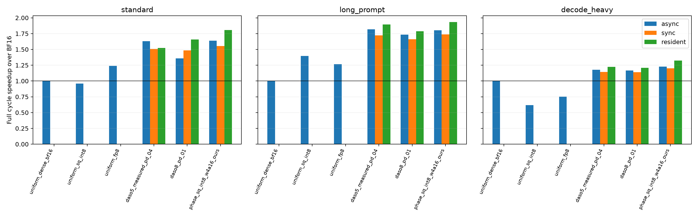
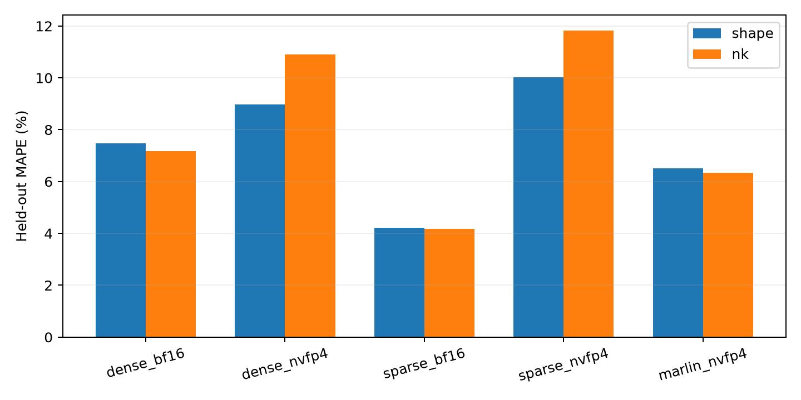

# Run004：准备、预测、接口、传输与内存开销

固定六份已完成质量评测的策略，三种代表负载。所有新增无插桩速度在同一GPU6；异步/同步/双驻留使用相同权重与输入，9组跨模式输出逐token相同。
generation从提交请求计时，cycle额外包含下一次prefill的同步恢复。双驻留是额外显存控制，不等同于原文单表示释放流水线。

## 实际运行时成本

| 策略 | 模式 | 负载 | TTFT ms | E2E ms | 恢复 ms | 完整cycle ms | E2E加速 | cycle加速 |
| --- | --- | --- | ---: | ---: | ---: | ---: | ---: | ---: |
| uniform_dense_bf16 | async | standard | 1354.2 | 2422.5 | 1.3 | 2423.7 | 1.000× | 1.000× |
| uniform_dense_bf16 | async | long_prompt | 2766.1 | 3910.7 | 1.3 | 3912.0 | 1.000× | 1.000× |
| uniform_dense_bf16 | async | decode_heavy | 57.7 | 3663.1 | 1.3 | 3664.3 | 1.000× | 1.000× |
| uniform_sq_int8 | async | standard | 581.3 | 2522.8 | 1.6 | 2524.4 | 0.960× | 0.960× |
| uniform_sq_int8 | async | long_prompt | 1265.3 | 2799.9 | 1.3 | 2801.2 | 1.397× | 1.397× |
| uniform_sq_int8 | async | decode_heavy | 33.7 | 5913.5 | 1.3 | 5914.8 | 0.619× | 0.620× |
| uniform_fp8 | async | standard | 671.8 | 1955.2 | 1.3 | 1956.5 | 1.239× | 1.239× |
| uniform_fp8 | async | long_prompt | 1479.9 | 3089.7 | 1.7 | 3091.3 | 1.266× | 1.265× |
| uniform_fp8 | async | decode_heavy | 28.9 | 4865.4 | 1.3 | 4866.6 | 0.753× | 0.753× |
| transfer_daso5_measured_prefill_decode_04 | async | standard | 572.0 | 1392.8 | 94.2 | 1487.0 | 1.739× | 1.630× |
| transfer_daso5_measured_prefill_decode_04 | async | long_prompt | 1235.5 | 2056.3 | 94.1 | 2150.4 | 1.902× | 1.819× |
| transfer_daso5_measured_prefill_decode_04 | async | decode_heavy | 110.2 | 3019.5 | 94.1 | 3113.7 | 1.213× | 1.177× |
| transfer_daso5_measured_prefill_decode_04 | sync | standard | 690.0 | 1512.2 | 94.1 | 1606.4 | 1.602× | 1.509× |
| transfer_daso5_measured_prefill_decode_04 | sync | long_prompt | 1356.5 | 2178.9 | 94.1 | 2273.0 | 1.795× | 1.721× |
| transfer_daso5_measured_prefill_decode_04 | sync | decode_heavy | 152.5 | 3115.7 | 94.2 | 3209.9 | 1.176× | 1.142× |
| transfer_daso5_measured_prefill_decode_04 | resident | standard | 574.5 | 1589.9 | 0.9 | 1590.8 | 1.524× | 1.524× |
| transfer_daso5_measured_prefill_decode_04 | resident | long_prompt | 1242.3 | 2061.8 | 0.7 | 2062.6 | 1.897× | 1.897× |
| transfer_daso5_measured_prefill_decode_04 | resident | decode_heavy | 27.4 | 2991.9 | 0.7 | 2992.6 | 1.224× | 1.224× |
| transfer_daso8_prefill_decode_01 | async | standard | 631.0 | 1696.2 | 82.1 | 1782.5 | 1.428× | 1.360× |
| transfer_daso8_prefill_decode_01 | async | long_prompt | 1349.5 | 2186.5 | 70.9 | 2257.3 | 1.789× | 1.733× |
| transfer_daso8_prefill_decode_01 | async | decode_heavy | 89.9 | 3071.1 | 70.9 | 3142.0 | 1.193× | 1.166× |
| transfer_daso8_prefill_decode_01 | sync | standard | 727.3 | 1562.2 | 70.9 | 1633.1 | 1.551× | 1.484× |
| transfer_daso8_prefill_decode_01 | sync | long_prompt | 1446.8 | 2283.3 | 70.9 | 2354.2 | 1.713× | 1.662× |
| transfer_daso8_prefill_decode_01 | sync | decode_heavy | 135.8 | 3143.1 | 70.9 | 3214.0 | 1.165× | 1.140× |
| transfer_daso8_prefill_decode_01 | resident | standard | 632.6 | 1463.5 | 0.8 | 1464.2 | 1.655× | 1.655× |
| transfer_daso8_prefill_decode_01 | resident | long_prompt | 1354.5 | 2187.1 | 0.8 | 2187.9 | 1.788× | 1.788× |
| transfer_daso8_prefill_decode_01 | resident | decode_heavy | 29.8 | 3029.8 | 0.8 | 3030.6 | 1.209× | 1.209× |
| phase_sq_int8_w4a16_ours | async | standard | 579.0 | 1356.0 | 124.1 | 1480.0 | 1.787× | 1.638× |
| phase_sq_int8_w4a16_ours | async | long_prompt | 1261.9 | 2045.1 | 124.1 | 2169.2 | 1.912× | 1.803× |
| phase_sq_int8_w4a16_ours | async | decode_heavy | 74.3 | 2859.3 | 124.1 | 2983.4 | 1.281× | 1.228× |
| phase_sq_int8_w4a16_ours | sync | standard | 662.7 | 1437.5 | 124.1 | 1561.6 | 1.685× | 1.552× |
| phase_sq_int8_w4a16_ours | sync | long_prompt | 1347.3 | 2125.2 | 124.1 | 2249.3 | 1.840× | 1.739× |
| phase_sq_int8_w4a16_ours | sync | decode_heavy | 119.4 | 2923.8 | 124.1 | 3047.9 | 1.253× | 1.202× |
| phase_sq_int8_w4a16_ours | resident | standard | 580.3 | 1342.2 | 0.8 | 1343.0 | 1.805× | 1.805× |
| phase_sq_int8_w4a16_ours | resident | long_prompt | 1265.6 | 2021.4 | 0.8 | 2022.2 | 1.935× | 1.935× |
| phase_sq_int8_w4a16_ours | resident | decode_heavy | 26.5 | 2767.7 | 0.8 | 2768.4 | 1.324× | 1.324× |

## 实际内存与理论传输字节

以下为standard负载，GiB=2^30 bytes。GPU allocator包含6GiB KV及工作区；单独列出Linear权重storage。host RSS与pinned权重不应相加，后者已经属于进程内存。GPU运行峰值在该计时组前reset，包含恢复/warmup/正式生成；初始化峰值另列，host峰值为进程累计。均不能解释为纯权重大小。

| 策略 | 模式 | GPU权重 | GPU初始化allocated | GPU初始化峰值 | GPU运行峰值 | host权重 | pinned权重 | host RSS | decode H2D | 恢复 H2D |
| --- | --- | ---: | ---: | ---: | ---: | ---: | ---: | ---: | ---: | ---: |
| uniform_dense_bf16 | async | 12.938 | 21.526 | 21.640 | 23.151 | 0.000 | 0.000 | 2.309 | 0.000 | 0.000 |
| uniform_sq_int8 | async | 6.476 | 15.064 | 15.178 | 17.752 | 0.000 | 0.000 | 2.305 | 0.000 | 0.000 |
| uniform_fp8 | async | 6.476 | 15.064 | 15.178 | 16.876 | 0.000 | 0.000 | 2.308 | 0.000 | 0.000 |
| transfer_daso5_measured_prefill_decode_04 | async | 4.885 | 13.484 | 14.976 | 17.706 | 10.545 | 10.545 | 16.157 | 5.660 | 4.885 |
| transfer_daso5_measured_prefill_decode_04 | sync | 4.885 | 13.484 | 14.976 | 17.238 | 10.545 | 10.545 | 16.157 | 5.660 | 4.885 |
| transfer_daso5_measured_prefill_decode_04 | resident | 10.545 | 19.145 | 19.145 | 22.895 | 10.545 | 10.545 | 16.157 | 0.000 | 0.000 |
| transfer_daso8_prefill_decode_01 | async | 6.351 | 14.946 | 15.061 | 18.029 | 8.284 | 8.284 | 12.841 | 4.605 | 3.679 |
| transfer_daso8_prefill_decode_01 | sync | 6.351 | 14.946 | 15.061 | 17.591 | 8.284 | 8.284 | 12.859 | 4.605 | 3.679 |
| transfer_daso8_prefill_decode_01 | resident | 10.956 | 19.553 | 19.553 | 21.615 | 8.284 | 8.284 | 12.853 | 0.000 | 0.000 |
| phase_sq_int8_w4a16_ours | async | 6.476 | 15.064 | 15.178 | 20.782 | 10.114 | 10.114 | 15.507 | 3.639 | 6.476 |
| phase_sq_int8_w4a16_ours | sync | 6.476 | 15.064 | 15.178 | 17.752 | 10.114 | 10.114 | 15.509 | 3.639 | 6.476 |
| phase_sq_int8_w4a16_ours | resident | 10.114 | 18.721 | 18.721 | 21.408 | 10.114 | 10.114 | 15.511 | 0.000 | 0.000 |

在该实际配置，双驻留Linear权重分别为10.55/10.96GiB，仍低于BF16的12.94GiB；但同时保留10.55/8.28GiB pinned host权重，而uniform BF16没有这份常驻host缓存。额外CPU开销和压缩后的GPU总量应同时报告。
异步并非每种策略都更快：standard负载下五候选DASO的异步生成1393ms、同步1512ms；七候选DASO则为1696ms、1562ms。双驻留还改变分配/缓存/调度，不能将与异步的全部差异都解释成DMA。完整cycle列保留恢复代价与这些反例。

## 延迟预测准确性与边界

原广覆盖profiling数据按新固定seed重新划分，shape和N/K组分别严格留出，所有模型仅用各自训练分区重新拟合。此CPU重放使用历史profiling设备/协议，不能充当新的跨硬件泛化实验。

| 方法 | 留出 | 训练shape | 测试shape | MAPE | median APE | p90 APE | 拟合s | 批查询s |
| --- | --- | ---: | ---: | ---: | ---: | ---: | ---: | ---: |
| dense_bf16 | shape | 1930 | 643 | 7.47% | 3.09% | 18.83% | 0.017 | 0.258 |
| dense_bf16 | nk | 1921 | 652 | 7.17% | 3.03% | 15.79% | 0.016 | 0.252 |
| dense_nvfp4 | shape | 827 | 276 | 8.97% | 4.27% | 23.73% | 0.025 | 0.094 |
| dense_nvfp4 | nk | 845 | 258 | 10.91% | 4.20% | 31.42% | 0.024 | 0.085 |
| sparse_bf16 | shape | 734 | 244 | 4.22% | 2.08% | 10.96% | 0.019 | 0.073 |
| sparse_bf16 | nk | 720 | 258 | 4.18% | 2.05% | 8.87% | 0.019 | 0.073 |
| sparse_nvfp4 | shape | 608 | 202 | 10.02% | 6.00% | 25.29% | 0.024 | 0.077 |
| sparse_nvfp4 | nk | 596 | 214 | 11.83% | 7.19% | 30.10% | 0.026 | 0.067 |
| marlin_nvfp4 | shape | 641 | 214 | 6.51% | 3.37% | 18.64% | 0.023 | 0.073 |
| marlin_nvfp4 | nk | 639 | 216 | 6.35% | 3.60% | 15.11% | 0.024 | 0.067 |

另做极少局部数据控制：每方法仅16个训练点，6种M留出。部分方法误差很大，sparse原模型在小M不支持的点显式记为unsupported；实际部署PaddedLinear会padding，但本控制不把已见的padding后shape算作独立留出。完整负面结果保存在latency_holdout_metrics.csv，不能声称16点足够校准新硬件。

整模型附加误差使用003冻结profile与最终GPU0测量：用每负载BF16的E2E−Linear和作为固定项，其他策略均未参与校准。下面给出全部其他预定点的误差；固定项包含非Linear/引擎成本，策略相关传输残差仍可能很大。模块profile来自GPU3、整模型来自GPU0，都是5090；这不是同一卡的kernel因果拆分。

| 场景 | 模型 | 点数 | MAPE | median APE | p90 APE |
| --- | --- | ---: | ---: | ---: | ---: |
| prefill_only | raw_ape_percent | 98 | 25.38% | 24.61% | 34.57% |
| prefill_only | offset_ape_percent | 98 | 5.77% | 2.61% | 7.79% |
| prefill_decode | raw_ape_percent | 153 | 42.94% | 42.83% | 65.35% |
| prefill_decode | offset_ape_percent | 153 | 17.36% | 12.87% | 39.21% |

## 准备与搜索成本

完整[原始成本表](results/preparation_costs.csv)区分原001、8bit增量002和新shape增量003。SparseGPT两种pattern各约305s，HAWQ Hessian约1766s，原DASO prefill标签壁钟约4856s（单GPU），P+D约2583s（先串行、再多卡）；8bit新增标签另计并行壁钟与累计标签工作。质量拟合/搜索只有数秒到十几秒，但标签采集不能省略。历史阶段有并行重叠，不能将全部wall time简单相加为一次串行用时。
003的360个完整forward shape测量约131.5s；47份策略CPU重放4.91s，均复用既有质量模型。从零部署与更换B/S/O的增量成本不同。
精确/反向求解与36/64/80层规模的搜索计时见[run005](../005/results/exact_solver_audit.json)。扩展重复真实8B动作表，只验证搜索复杂度，不代表32B质量。

## 接口、非Linear与规模

- 真实MLP接口检查98个组合：7×7方法对、M=8/16384。gate/up输出及SiLU后输入均为contiguous BF16；每个Linear内部完成对应激活量化/打包和输出缩放，无压缩激活跨层ABI。逐组件与完整链均实测；链残差还包括cache、launch与同步，不能全算作格式转换。
- 12份独立CPU/CUDA trace只运行1个prefill+3个decode；kernel、H2D与重叠区间保留。类别由kernel名称判定，other明确保留。trace耗时不混入无插桩速度；copy未重叠时长本身也不等于关键路径损失。
- 完成112个真实GPU大shape forward，采用[官方Qwen3-32B配置](https://huggingface.co/Qwen/Qwen3-32B/raw/main/config.json)的四种N/K与四种M。特别是Q宽8192而hidden_size=5120，O投影K=8192。权重/激活为合成数据，未部署完整预训练32B模型，不提供32B质量/E2E结论。
- 本机没有30B权重缓存，现有phase运行时TP=1；无法以单卡常驻BF16公平完成30B整模型对照。此限制保留，不以shape微基准替代整模型。

## 独立profiler的GPU时间组成

以下均为1个prefill+3个decode，单位ms。kernel时间按名称分类；各类别是GPU kernel持续时间之和，不等于主机端E2E。copy含该窗口的GPU memcpy事件，重叠是与kernel区间的交集。

| 策略 | 模式 | 负载 | GEMM | attention | quant/scale | nonlinear/norm/rope | other | copy | copy-kernel overlap |
| --- | --- | --- | ---: | ---: | ---: | ---: | ---: | ---: | ---: |
| transfer_daso8_prefill_decode_01 | async | standard | 468.20 | 3.82 | 35.01 | 78.71 | 67.26 | 88.20 | 86.88 |
| transfer_daso8_prefill_decode_01 | async | decode_heavy | 21.41 | 0.26 | 0.64 | 2.88 | 15.38 | 88.10 | 12.97 |
| transfer_daso8_prefill_decode_01 | sync | standard | 468.51 | 3.85 | 34.92 | 76.46 | 66.85 | 88.09 | 0.00 |
| transfer_daso8_prefill_decode_01 | sync | decode_heavy | 21.35 | 0.26 | 0.63 | 2.96 | 15.34 | 88.13 | 0.00 |
| transfer_daso8_prefill_decode_01 | resident | standard | 468.26 | 3.77 | 34.88 | 76.55 | 66.86 | 0.05 | 0.00 |
| transfer_daso8_prefill_decode_01 | resident | decode_heavy | 21.30 | 0.26 | 0.63 | 2.96 | 15.31 | 0.11 | 0.00 |
| phase_sq_int8_w4a16_ours | async | standard | 386.26 | 3.81 | 111.10 | 79.84 | 12.85 | 70.66 | 70.58 |
| phase_sq_int8_w4a16_ours | async | decode_heavy | 22.29 | 0.28 | 1.72 | 2.91 | 3.63 | 69.87 | 7.34 |
| phase_sq_int8_w4a16_ours | sync | standard | 385.77 | 3.84 | 110.61 | 77.78 | 12.03 | 69.83 | 0.00 |
| phase_sq_int8_w4a16_ours | sync | decode_heavy | 22.27 | 0.28 | 1.69 | 3.02 | 3.59 | 69.87 | 0.00 |
| phase_sq_int8_w4a16_ours | resident | standard | 385.89 | 3.85 | 110.51 | 77.75 | 12.00 | 0.04 | 0.00 |
| phase_sq_int8_w4a16_ours | resident | decode_heavy | 22.26 | 0.28 | 1.71 | 3.03 | 3.50 | 0.10 | 0.00 |

## 图与原始证据

[运行时CSV](results/runtime_summary.csv) · [逐token控制审计](results/runtime_semantics_audit.json) · [MLP接口](results/mlp_interfaces.csv) · [大shape](results/large_shapes.csv) · [profiler汇总](results/profile_summary.json)。
所有原始计时、trace、命令源码快照、失败记录与可重建权重释放记录保留。
