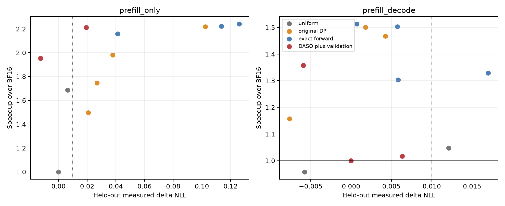

# Run005：数值网格、反向约束和独立可行性验证

候选池在验证前冻结：38份唯一策略、42个原始比较点。保持run002质量拟合与run003完整forward成本不变。验证后选择写入并哈希，随后才执行最终test。

## 前向/反向求解

原2000-bin DP与real-valued one-hot MILP对照。前向min预测Linear延迟、约束预测ΔNLL；反向min预测ΔNLL、约束预测Linear延迟。P+D在无switch交互项的同一代理下拆成288个phase-module，数值质量系数缩放改善求解容差。原DP仍按144个phase-pair动作计算。
16个随机小实例双向穷举检查、22个前向↔反向Pareto复核通过。其最优性只针对冻结可加代理，不保证真实NLL或TTFT/E2E。

| 场景 | 质量预算 | 原DP预测Linear ms | 精确预测Linear ms | DP/精确 |
| --- | ---: | ---: | ---: | ---: |
| prefill_only | 0.005 | 595.31 | 372.38 | 1.599 |
| prefill_only | 0.01 | 493.78 | 359.33 | 1.374 |
| prefill_only | 0.02 | 416.84 | 356.49 | 1.169 |
| prefill_only | 0.04 | 357.20 | 352.22 | 1.014 |
| prefill_decode | 0.005 | 849.14 | 560.03 | 1.516 |
| prefill_decode | 0.01 | 748.01 | 557.90 | 1.341 |
| prefill_decode | 0.02 | 573.07 | 554.35 | 1.034 |
| prefill_decode | 0.04 | 553.63 | 548.66 | 1.009 |

原网格逐模块上取整可累计显著保守误差：uniform SQ-INT8的prefill预测ΔNLL原始约0.001799，网格后约0.028430；P+D分别约−0.001479与0.036625。精确解消除此数值漏选，但不修复质量代理偏差。

## 实际质量和速度

验证、最终test分别为独立WikiText validation/test split各64个非重叠窗口。prefill和P+D质量均按目标B8实际执行；prefill计2047个prompt target，P+D计64个teacher-forced target。原003的prefill采用B1，本轮B8结果应单独比较。速度统一GPU2、B8/S2048/O1或64、6GiB BF16 KV、2 warmups+5 timed，校准/最终输入seed分开。

DASO+validation使用预先固定的mean ΔNLL + 2 paired SE + 0.005 guard，BF16锚点实际差值恒为0。质量可行的候选中选择校准实测延迟最小者。该额外验证阶段不属于原文实现，不将guard称为形式化泛化保证。原DP、精确解及所有预定预算均保留，不用test反馈挑点。

| 场景 | 方法 | 质量预算 | 实测ΔNLL | 描述性95%区间 | 实测ms | 相对BF16 | 超预算 |
| --- | --- | ---: | ---: | --- | ---: | ---: | ---: |
| prefill_only | uniform_dense_bf16 | — | 0.00000 | [0.00000, 0.00000] | 1125.5 | 1.000× | — |
| prefill_only | uniform_sq_int8 | — | -0.01252 | [-0.01538, -0.00972] | 576.3 | 1.953× | — |
| prefill_only | uniform_fp8 | — | 0.00633 | [0.00515, 0.00754] | 667.5 | 1.686× | — |
| prefill_only | exact_prefill_only_q0.005 | 0.005 | 0.04119 | [0.03671, 0.04589] | 521.6 | 2.158× | 0.03619 |
| prefill_only | exact_prefill_only_q0.01 | 0.01 | 0.01936 | [0.01366, 0.02515] | 508.7 | 2.213× | 0.00936 |
| prefill_only | exact_prefill_only_q0.02 | 0.02 | 0.11354 | [0.10551, 0.12170] | 506.2 | 2.224× | 0.09354 |
| prefill_only | exact_prefill_only_q0.04 | 0.04 | 0.12597 | [0.11598, 0.13597] | 502.2 | 2.241× | 0.08597 |
| prefill_only | dp_prefill_only_q0.005 | 0.005 | 0.02084 | [0.01718, 0.02467] | 752.4 | 1.496× | 0.01584 |
| prefill_only | dp_prefill_only_q0.01 | 0.01 | 0.02687 | [0.02277, 0.03103] | 644.3 | 1.747× | 0.01687 |
| prefill_only | dp_prefill_only_q0.02 | 0.02 | 0.03784 | [0.03279, 0.04303] | 568.2 | 1.981× | 0.01784 |
| prefill_only | dp_prefill_only_q0.04 | 0.04 | 0.10246 | [0.09458, 0.11052] | 507.1 | 2.219× | 0.06246 |
| prefill_decode | uniform_dense_bf16 | — | 0.00000 | [0.00000, 0.00000] | 2019.0 | 1.000× | — |
| prefill_decode | uniform_sq_int8 | — | -0.00577 | [-0.01769, 0.00547] | 2107.5 | 0.958× | — |
| prefill_decode | uniform_fp8 | — | 0.01208 | [0.00676, 0.01748] | 1927.5 | 1.047× | — |
| prefill_decode | exact_prefill_decode_q0.005 | 0.005 | 0.00575 | [-0.00775, 0.01973] | 1343.2 | 1.503× | 0.00075 |
| prefill_decode | exact_prefill_decode_q0.01 | 0.01 | 0.00584 | [-0.01064, 0.02303] | 1549.2 | 1.303× | 0.00000 |
| prefill_decode | exact_prefill_decode_q0.02 | 0.02 | 0.00073 | [-0.01663, 0.01814] | 1334.5 | 1.513× | 0.00000 |
| prefill_decode | exact_prefill_decode_q0.04 | 0.04 | 0.01699 | [-0.00205, 0.03617] | 1519.1 | 1.329× | 0.00000 |
| prefill_decode | dp_prefill_decode_q0.005 | 0.005 | -0.00762 | [-0.02225, 0.00744] | 1744.8 | 1.157× | 0.00000 |
| prefill_decode | dp_prefill_decode_q0.01 | 0.01 | -0.00593 | [-0.02106, 0.00994] | 1486.6 | 1.358× | 0.00000 |
| prefill_decode | dp_prefill_decode_q0.02 | 0.02 | 0.00426 | [-0.00932, 0.01838] | 1375.7 | 1.468× | 0.00000 |
| prefill_decode | dp_prefill_decode_q0.04 | 0.04 | 0.00180 | [-0.01483, 0.01864] | 1344.8 | 1.501× | 0.00000 |
| prefill_only | verified_prefill_only_q0.005 | 0.005 | -0.01252 | [-0.01538, -0.00972] | 576.3 | 1.953× | 0.00000 |
| prefill_only | verified_prefill_only_q0.01 | 0.01 | -0.01252 | [-0.01538, -0.00972] | 576.3 | 1.953× | 0.00000 |
| prefill_only | verified_prefill_only_q0.02 | 0.02 | -0.01252 | [-0.01538, -0.00972] | 576.3 | 1.953× | 0.00000 |
| prefill_only | verified_prefill_only_q0.04 | 0.04 | 0.01936 | [0.01366, 0.02515] | 508.7 | 2.213× | 0.00000 |
| prefill_decode | verified_prefill_decode_q0.005 | 0.005 | 0.00000 | [0.00000, 0.00000] | 2019.0 | 1.000× | 0.00000 |
| prefill_decode | verified_prefill_decode_q0.01 | 0.01 | 0.00000 | [0.00000, 0.00000] | 2019.0 | 1.000× | 0.00000 |
| prefill_decode | verified_prefill_decode_q0.02 | 0.02 | 0.00633 | [0.00001, 0.01258] | 1985.2 | 1.017× | 0.00000 |
| prefill_decode | verified_prefill_decode_q0.04 | 0.04 | -0.00593 | [-0.02106, 0.00994] | 1486.6 | 1.358× | 0.00000 |

## 实际质量预算违约

| 场景 | 版本 | 点数 | 超预算点数 | 最大超预算 |
| --- | --- | ---: | ---: | ---: |
| prefill_only | exact forward | 4 | 4 | 0.093540 |
| prefill_only | original DP | 4 | 4 | 0.062456 |
| prefill_decode | exact forward | 4 | 1 | 0.000747 |
| prefill_decode | original DP | 4 | 0 | 0.000000 |
| prefill_only | DASO plus validation | 4 | 0 | 0.000000 |
| prefill_decode | DASO plus validation | 4 | 0 | 0.000000 |

## 反向SLA：代理约束与实际约束分别检查

三个SLA比例为BF16校准实测的95%/80%/65%。raw inverse只约束预测Linear成本；verification inverse在候选中先要求校准中位延迟×1.05不超过实际SLA，再选择guarded validation损失最小者。表中“不可行”明确保留，不静默回退到违约配置。最终新seed速度才用于审计，同时报告中位数与全部5个timed样本，不能用中位数满足代替逐请求硬SLA保证。

| 场景 | 方法 | SLA ms | 最终中位ms | 最慢timed ms | 中位超出ms | 违约timed/5 | 实测ΔNLL |
| --- | --- | ---: | ---: | ---: | ---: | ---: | ---: |
| prefill_only | inverse_prefill_only_r0.95 | 1069.0 | 1015.7 | 1016.7 | 0.0 | 0/5 | 0.00448 |
| prefill_only | inverse_prefill_only_r0.8 | 900.2 | 923.6 | 925.6 | 23.4 | 5/5 | 0.00547 |
| prefill_only | inverse_prefill_only_r0.65 | 731.4 | 774.5 | 775.3 | 43.0 | 5/5 | 0.00558 |
| prefill_decode | inverse_prefill_decode_r0.95 | 1920.7 | 2100.6 | 2108.5 | 179.9 | 5/5 | 0.00458 |
| prefill_decode | inverse_prefill_decode_r0.8 | 1617.5 | 1887.8 | 1888.7 | 270.4 | 5/5 | 0.00501 |
| prefill_decode | inverse_prefill_decode_r0.65 | 1314.2 | 1985.2 | 1989.2 | 671.0 | 5/5 | 0.00633 |
| prefill_only | verified_inverse_prefill_only_r0.95 | 1069.0 | 576.3 | 576.4 | 0.0 | 0/5 | -0.01252 |
| prefill_only | verified_inverse_prefill_only_r0.8 | 900.2 | 576.3 | 576.4 | 0.0 | 0/5 | -0.01252 |
| prefill_only | verified_inverse_prefill_only_r0.65 | 731.4 | 576.3 | 576.4 | 0.0 | 0/5 | -0.01252 |
| prefill_decode | verified_inverse_prefill_decode_r0.95 | 1920.7 | 1985.2 | 1989.2 | 64.4 | 4/5 | 0.00633 |
| prefill_decode | verified_inverse_prefill_decode_r0.8 | 1617.5 | 1334.5 | 1339.6 | 0.0 | 0/5 | 0.00073 |
| prefill_decode | verified_inverse_prefill_decode_r0.65 | 1314.2 | 不可行 | — | — | — | — |

## 成本与适用范围

- 额外候选验证成本包含模型导出、初始化、64块validation评分与实测速度，完整命令/退出耗时位于logs。该步骤不是免费，也不应计为纯MILP搜索成本。
- 36/64/80层搜索计时与内存记录在exact_solver_audit.json；动作表扩展来自8B，不能作为30B模型质量或端到端部署证据。
- 质量区间为4000次配对窗口bootstrap描述性区间；窗口在各split内不重叠，但仍不提供分布无关的质量/SLA保证。
- 同步同质batch、eager、无chunked prefill；真实mixed-token结果另见run006。uniform SQ/FP8完整下游任务的既有证据见run002，新策略不能自动继承其MMLU/ROUGE结论。

| 额外离线阶段 | 命令数 | 累计进程s | 该阶段wall包络s | 使用GPU |
| --- | ---: | ---: | ---: | --- |
| candidate_export | 37 | 1033.1 | 2184.8 | ['2'] |
| calibration_speed | 38 | 1235.8 | 2269.9 | ['2'] |
| validation | 38 | 1587.2 | 2260.3 | ['4', '7'] |

进程累计时间含I/O与初始化，不是纯GPU-active time。三个阶段并行重叠，wall包络不能直接相加。这里只计额外验证选择成本，原SparseGPT/质量训练标签/shape profiling成本仍需另计；最终test和run010下游任务不属于部署前选择成本。

[完整数表](results/summary_final.csv) · [选择规则](configs/design.json) · [固定选择](configs/selected_policies.json) · [SLA/质量审计](results/quality_sla_audit.json) · [数值检查](results/surrogate_audit.json)。
