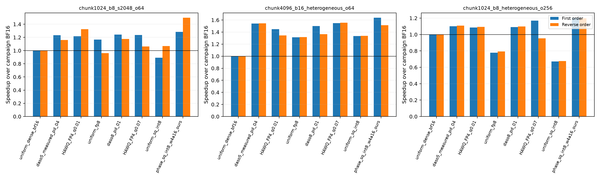
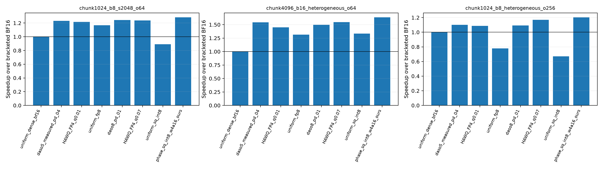
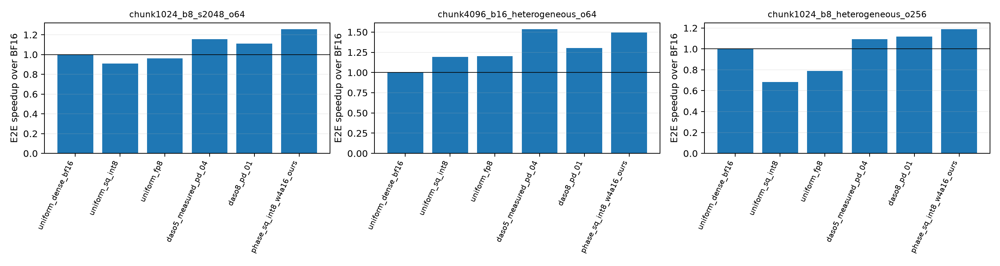

# Run006：真实chunked-prefill混合token执行

原global-phase、异步单表示释放实现无法直接处理同一forward中的不同请求阶段。本轮是独立进程安装的dual-resident变体：按vLLM实际scheduled token位置与原prompt长度区分每行，分别执行两种真实Linear适配器，再合并BF16输出。共享vLLM代码未修改。

三种冻结burst负载，实际开启vLLM V1 chunked prefill；所有请求在一次burst起点进入，尚非HTTP/open-loop到达负载。每次实际观测9–15个mixed forward，所有prefill/decode行数与请求token数精确核对；异格式模块调用数=真实mixed forward数×异格式模块数。

## 最终复核：全部八策略反向顺序重复

首轮standard BF16终点/起点约0.942，足以影响小差距比较。因此预先固定对全部八策略、全部三负载反向顺序复测，不更换策略、输入或质量结果。每轮独立进程初始化，均2 warmups+5 timed；每轮开头/结尾均测BF16。以下合并每策略10个timed burst，BF16合并20个，并完整保留两轮归一化结果和原始计时范围。
反向顺序减少单调时间漂移造成的偏差，但只有两个campaign；不能把合并10次的中位数写成跨负载/生产性能保证，也不能把小差距说成显著领先。质量仍是同16窗口的描述性检查，实际质量切片是事后分析。

| 负载 | campaign | BF16起点 ms | 终点 ms | 终点/起点 |
| --- | ---: | ---: | ---: | ---: |
| chunk1024_b8_s2048_o64 | 1 | 2429.0 | 2289.2 | 0.942 |
| chunk1024_b8_s2048_o64 | 2 | 2289.0 | 2282.8 | 0.997 |
| chunk4096_b16_heterogeneous_o64 | 1 | 3925.1 | 3927.4 | 1.001 |
| chunk4096_b16_heterogeneous_o64 | 2 | 3922.4 | 3928.6 | 1.002 |
| chunk1024_b8_heterogeneous_o256 | 1 | 4360.8 | 4359.4 | 1.000 |
| chunk1024_b8_heterogeneous_o256 | 2 | 4369.2 | 4357.0 | 0.997 |

| 负载 | 策略 | 合并E2E ms | 合并BF16加速 | 首轮加速 | 反向轮加速 | ΔNLL |
| --- | --- | ---: | ---: | ---: | ---: | ---: |
| chunk1024_b8_s2048_o64 | uniform_dense_bf16 | 2289.1 | 1.000× | 1.000× | 1.000× | 0.00000 |
| chunk1024_b8_s2048_o64 | transfer_daso5_measured_prefill_decode_04 | 1970.9 | 1.161× | 1.232× | 1.160× | 0.03580 |
| chunk1024_b8_s2048_o64 | hawq_fp4_phase_pair_signed_prefill_decode_q0.01 | 1992.1 | 1.149× | 1.217× | 1.325× | 0.01954 |
| chunk1024_b8_s2048_o64 | uniform_fp8 | 2223.7 | 1.029× | 1.168× | 0.961× | 0.00156 |
| chunk1024_b8_s2048_o64 | transfer_daso8_prefill_decode_01 | 1951.2 | 1.173× | 1.243× | 1.175× | 0.01986 |
| chunk1024_b8_s2048_o64 | hawq_fp4_phase_pair_signed_prefill_decode_q0.07 | 2060.7 | 1.111× | 1.237× | 1.062× | 0.04774 |
| chunk1024_b8_s2048_o64 | uniform_sq_int8 | 2250.7 | 1.017× | 0.892× | 1.069× | -0.00870 |
| chunk1024_b8_s2048_o64 | phase_sq_int8_w4a16_ours | 1707.7 | 1.340× | 1.284× | 1.497× | 0.06012 |
| chunk4096_b16_heterogeneous_o64 | uniform_dense_bf16 | 3925.7 | 1.000× | 1.000× | 1.000× | 0.00000 |
| chunk4096_b16_heterogeneous_o64 | transfer_daso5_measured_prefill_decode_04 | 2543.9 | 1.543× | 1.543× | 1.544× | 0.01750 |
| chunk4096_b16_heterogeneous_o64 | hawq_fp4_phase_pair_signed_prefill_decode_q0.01 | 2719.4 | 1.444× | 1.448× | 1.343× | 0.01237 |
| chunk4096_b16_heterogeneous_o64 | uniform_fp8 | 2984.1 | 1.316× | 1.314× | 1.317× | 0.01457 |
| chunk4096_b16_heterogeneous_o64 | transfer_daso8_prefill_decode_01 | 2742.8 | 1.431× | 1.498× | 1.366× | 0.02318 |
| chunk4096_b16_heterogeneous_o64 | hawq_fp4_phase_pair_signed_prefill_decode_q0.07 | 2534.5 | 1.549× | 1.548× | 1.556× | 0.03316 |
| chunk4096_b16_heterogeneous_o64 | uniform_sq_int8 | 2935.4 | 1.337× | 1.334× | 1.338× | -0.01803 |
| chunk4096_b16_heterogeneous_o64 | phase_sq_int8_w4a16_ours | 2403.7 | 1.633× | 1.636× | 1.512× | 0.04008 |
| chunk1024_b8_heterogeneous_o256 | uniform_dense_bf16 | 4361.1 | 1.000× | 1.000× | 1.000× | 0.00000 |
| chunk1024_b8_heterogeneous_o256 | transfer_daso5_measured_prefill_decode_04 | 3953.1 | 1.103× | 1.100× | 1.109× | -0.00895 |
| chunk1024_b8_heterogeneous_o256 | hawq_fp4_phase_pair_signed_prefill_decode_q0.01 | 4005.6 | 1.089× | 1.086× | 1.094× | -0.00556 |
| chunk1024_b8_heterogeneous_o256 | uniform_fp8 | 5557.6 | 0.785× | 0.778× | 0.793× | 0.00580 |
| chunk1024_b8_heterogeneous_o256 | transfer_daso8_prefill_decode_01 | 3995.7 | 1.091× | 1.091× | 1.097× | 0.00510 |
| chunk1024_b8_heterogeneous_o256 | hawq_fp4_phase_pair_signed_prefill_decode_q0.07 | 3837.8 | 1.136× | 1.170× | 0.954× | 0.01420 |
| chunk1024_b8_heterogeneous_o256 | uniform_sq_int8 | 6482.2 | 0.673× | 0.671× | 0.677× | -0.01158 |
| chunk1024_b8_heterogeneous_o256 | phase_sq_int8_w4a16_ours | 3633.5 | 1.200× | 1.204× | 1.197× | 0.03536 |

同一实际均值质量上限内的已测点（事后切片）：

| 负载 | 实际ΔNLL cap | uniform最快 | 固定DASO最快 | HAWQ FP4控制最快 |
| --- | ---: | ---: | ---: | ---: |
| chunk1024_b8_s2048_o64 | 0.01 | 1.029× | — | — |
| chunk1024_b8_s2048_o64 | 0.02 | 1.029× | 1.173× | 1.149× |
| chunk4096_b16_heterogeneous_o64 | 0.01 | 1.337× | — | — |
| chunk4096_b16_heterogeneous_o64 | 0.02 | 1.337× | 1.543× | 1.444× |
| chunk1024_b8_heterogeneous_o256 | 0.01 | 1.000× | 1.103× | 1.089× |
| chunk1024_b8_heterogeneous_o256 | 0.02 | 1.000× | 1.103× | 1.136× |

B16异长case中，五候选DASO两轮均约1.54×，ΔNLL均值.01750；HAWQ实际分配点为.01237，两轮约1.45×/1.34×。在均值cap=.02的已测切片里存在较稳定优势。更快的全NV4/W4控制均值.03316，属于更宽质量区间。
标准B8 case中，七候选DASO与HAWQ实际分配点的排名在两轮间反转；不能将合并中位数的小优势表述成稳定领先。长decode下五候选对HAWQ实际分配点差距约1.3%，同样不声称统计显著。最紧质量上限时uniform仍可能最合适。

[合并完整CSV](results/serving_counterbalanced_summary.csv) · [逐轮锚点](results/counterbalanced_brackets.csv) · [所有实际质量上限切片](results/counterbalanced_quality_frontiers.json) · [复核预定配置](configs/counterbalanced_repeat_design.json)。

## 首轮扩展对照：HAWQ-FP4与前后BF16锚点

009的FP4/P+D三种Hessian处理在两个cap下仅产生两份唯一map。本扩展全部纳入；原六策略与两份新控制在同一GPU6重新测全部三负载。BF16起点/终点各2 warmups+5 timed，用合并10个timed burst中位数归一化，其余各5次。原21个速度记录保持独立，以下不混用原时段的BF16。
原六策略复用同method-map、原canonical权重/scales、同冻结输入/forced target及相同执行语义的已通过质量文件；两份新HAWQ控制在同16个validation窗口补齐所有真实B/S/O质量。全部source与aliases记录在扩展配置中。

| 负载 | BF16起点 ms | BF16终点 ms | 10轮合并中位 ms | 终点/起点 |
| --- | ---: | ---: | ---: | ---: |
| chunk1024_b8_s2048_o64 | 2429.0 | 2289.2 | 2427.8 | 0.942 |
| chunk4096_b16_heterogeneous_o64 | 3925.1 | 3927.4 | 3925.7 | 1.001 |
| chunk1024_b8_heterogeneous_o256 | 4360.8 | 4359.4 | 4360.5 | 1.000 |

| 新控制 | 实际prefill/decode格式数量 |
| --- | --- |
| hawq_fp4_phase_pair_signed_prefill_decode_q0.01 | dense_nvfp4/w4a16_ours: 97, dense_bf16/dense_bf16: 45, int8/int8: 2 |
| hawq_fp4_phase_pair_signed_prefill_decode_q0.07 | dense_nvfp4/w4a16_ours: 144 |

最紧请求cap在原动作集合不可行并被抬至最小成本，其对应map退化为全NVFP4-prefill/W4A16-decode，作为phase-uniform/min-cost控制报告，不将这一点的收益归因于Hessian分配。另一map为实际混合精度分配。

| 负载 | 策略 | E2E ms | 相对合并BF16 | 实测ΔNLL | 描述性95%窗口区间 | p95 TTFT | p95 TPOT |
| --- | --- | ---: | ---: | ---: | --- | ---: | ---: |
| chunk1024_b8_s2048_o64 | uniform_dense_bf16 | 2427.8 | 1.000× | 0.00000 | [0.00000, 0.00000] | 1415.0 | 32.03 |
| chunk1024_b8_s2048_o64 | transfer_daso5_measured_prefill_decode_04 | 1970.3 | 1.232× | 0.03580 | [0.00121, 0.07372] | 930.9 | 26.03 |
| chunk1024_b8_s2048_o64 | hawq_fp4_phase_pair_signed_prefill_decode_q0.01 | 1994.8 | 1.217× | 0.01954 | [-0.00413, 0.04324] | 932.9 | 26.18 |
| chunk1024_b8_s2048_o64 | uniform_fp8 | 2078.6 | 1.168× | 0.00156 | [-0.01269, 0.01704] | 813.3 | 26.69 |
| chunk1024_b8_s2048_o64 | transfer_daso8_prefill_decode_01 | 1953.3 | 1.243× | 0.01986 | [-0.00535, 0.04952] | 897.3 | 25.62 |
| chunk1024_b8_s2048_o64 | hawq_fp4_phase_pair_signed_prefill_decode_q0.07 | 1962.9 | 1.237× | 0.04774 | [0.01908, 0.07779] | 978.9 | 26.03 |
| chunk1024_b8_s2048_o64 | uniform_sq_int8 | 2721.5 | 0.892× | -0.00870 | [-0.02622, 0.00816] | 651.4 | 34.30 |
| chunk1024_b8_s2048_o64 | phase_sq_int8_w4a16_ours | 1891.5 | 1.284× | 0.06012 | [0.03010, 0.09236] | 790.9 | 24.72 |
| chunk4096_b16_heterogeneous_o64 | uniform_dense_bf16 | 3925.7 | 1.000× | 0.00000 | [0.00000, 0.00000] | 2916.2 | 55.20 |
| chunk4096_b16_heterogeneous_o64 | transfer_daso5_measured_prefill_decode_04 | 2544.6 | 1.543× | 0.01750 | [-0.03270, 0.06832] | 1690.7 | 36.12 |
| chunk4096_b16_heterogeneous_o64 | hawq_fp4_phase_pair_signed_prefill_decode_q0.01 | 2710.4 | 1.448× | 0.01237 | [-0.02671, 0.05356] | 1862.4 | 38.27 |
| chunk4096_b16_heterogeneous_o64 | uniform_fp8 | 2987.4 | 1.314× | 0.01457 | [0.00460, 0.02637] | 1680.5 | 41.68 |
| chunk4096_b16_heterogeneous_o64 | transfer_daso8_prefill_decode_01 | 2620.1 | 1.498× | 0.02318 | [-0.00950, 0.05710] | 1777.2 | 37.01 |
| chunk4096_b16_heterogeneous_o64 | hawq_fp4_phase_pair_signed_prefill_decode_q0.07 | 2535.7 | 1.548× | 0.03316 | [-0.00585, 0.07992] | 1742.9 | 35.91 |
| chunk4096_b16_heterogeneous_o64 | uniform_sq_int8 | 2941.9 | 1.334× | -0.01803 | [-0.03973, 0.00610] | 1393.5 | 40.50 |
| chunk4096_b16_heterogeneous_o64 | phase_sq_int8_w4a16_ours | 2399.2 | 1.636× | 0.04008 | [0.00343, 0.07560] | 1611.6 | 33.96 |
| chunk1024_b8_heterogeneous_o256 | uniform_dense_bf16 | 4360.5 | 1.000× | 0.00000 | [0.00000, 0.00000] | 878.8 | 16.26 |
| chunk1024_b8_heterogeneous_o256 | transfer_daso5_measured_prefill_decode_04 | 3962.9 | 1.100× | -0.00895 | [-0.02556, 0.00528] | 554.6 | 14.87 |
| chunk1024_b8_heterogeneous_o256 | hawq_fp4_phase_pair_signed_prefill_decode_q0.01 | 4016.3 | 1.086× | -0.00556 | [-0.02165, 0.01099] | 555.4 | 15.06 |
| chunk1024_b8_heterogeneous_o256 | uniform_fp8 | 5604.8 | 0.778× | 0.00580 | [0.00010, 0.01152] | 504.7 | 21.02 |
| chunk1024_b8_heterogeneous_o256 | transfer_daso8_prefill_decode_01 | 3996.1 | 1.091× | 0.00510 | [-0.00777, 0.01874] | 552.7 | 14.98 |
| chunk1024_b8_heterogeneous_o256 | hawq_fp4_phase_pair_signed_prefill_decode_q0.07 | 3728.2 | 1.170× | 0.01420 | [-0.00055, 0.02983] | 555.0 | 14.13 |
| chunk1024_b8_heterogeneous_o256 | uniform_sq_int8 | 6496.3 | 0.671× | -0.01158 | [-0.02043, -0.00193] | 391.5 | 24.46 |
| chunk1024_b8_heterogeneous_o256 | phase_sq_int8_w4a16_ours | 3622.4 | 1.204× | 0.03536 | [0.02417, 0.04673] | 477.7 | 13.60 |

实际质量上限切片(.01/.02/.04/.07)在extended_quality_frontiers.json中完整保留；均是已测点的事后分析，不能将某个最好均值当作严格质量保证或所有负载全局最优。

[扩展完整CSV](results/serving_extended_summary.csv) · [BF16漂移控制](results/bf16_bracket.csv) · [扩展配置](configs/baseline_extension_design.json)。

## 初始六策略serving测量

以下保留初始阶段记录；最终八策略比较以顶部反向顺序复核及其完整CSV为准。

同一GPU6、6GiB BF16 KV、eager、无prefix cache、2 warmups+5次完整burst。p50/p95基于最终5轮中的请求观测，包含排队；TPOT为每请求首末token间平均间隔。均匀BF16也走相同实验fast path，另有原apply数值控制。

| 负载 | 策略 | E2E ms | 相对BF16 | 输出tokens/s | p50 TTFT | p95 TTFT | p50 TPOT | p95 TPOT | mixed forward |
| --- | --- | ---: | ---: | ---: | ---: | ---: | ---: | ---: | ---: |
| chunk1024_b8_s2048_o64 | uniform_dense_bf16 | 2290.4 | 1.000× | 223.5 | 864.0 | 1414.2 | 21.19 | 30.46 | 15 |
| chunk4096_b16_heterogeneous_o64 | uniform_dense_bf16 | 3921.6 | 1.000× | 261.1 | 1584.1 | 2903.8 | 36.00 | 55.02 | 9 |
| chunk1024_b8_heterogeneous_o256 | uniform_dense_bf16 | 4374.1 | 1.000× | 468.2 | 512.5 | 879.2 | 14.89 | 16.31 | 10 |
| chunk1024_b8_s2048_o64 | uniform_sq_int8 | 2516.4 | 0.910× | 203.5 | 373.8 | 644.3 | 30.27 | 31.77 | 15 |
| chunk4096_b16_heterogeneous_o64 | uniform_sq_int8 | 3286.5 | 1.193× | 311.6 | 742.4 | 1397.5 | 36.07 | 43.93 | 9 |
| chunk1024_b8_heterogeneous_o256 | uniform_sq_int8 | 6405.1 | 0.683× | 319.7 | 216.0 | 392.2 | 23.81 | 24.05 | 10 |
| chunk1024_b8_s2048_o64 | uniform_fp8 | 2382.1 | 0.961× | 214.9 | 491.3 | 823.0 | 27.47 | 30.44 | 15 |
| chunk4096_b16_heterogeneous_o64 | uniform_fp8 | 3262.1 | 1.202× | 313.9 | 901.4 | 1684.2 | 34.54 | 45.03 | 9 |
| chunk1024_b8_heterogeneous_o256 | uniform_fp8 | 5538.2 | 0.790× | 369.8 | 286.5 | 506.1 | 20.21 | 20.77 | 10 |
| chunk1024_b8_s2048_o64 | transfer_daso5_measured_prefill_decode_04 | 1983.2 | 1.155× | 258.2 | 539.3 | 935.0 | 20.70 | 26.16 | 15 |
| chunk4096_b16_heterogeneous_o64 | transfer_daso5_measured_prefill_decode_04 | 2550.7 | 1.537× | 401.5 | 881.4 | 1689.7 | 25.45 | 36.06 | 9 |
| chunk1024_b8_heterogeneous_o256 | transfer_daso5_measured_prefill_decode_04 | 4001.0 | 1.093× | 511.9 | 300.6 | 554.5 | 14.33 | 15.89 | 10 |
| chunk1024_b8_s2048_o64 | transfer_daso8_prefill_decode_01 | 2063.0 | 1.110× | 248.2 | 526.1 | 924.3 | 22.17 | 27.01 | 15 |
| chunk4096_b16_heterogeneous_o64 | transfer_daso8_prefill_decode_01 | 3014.7 | 1.301× | 339.7 | 944.6 | 1801.1 | 31.29 | 41.69 | 9 |
| chunk1024_b8_heterogeneous_o256 | transfer_daso8_prefill_decode_01 | 3911.6 | 1.118× | 523.6 | 301.5 | 551.7 | 14.21 | 18.52 | 10 |
| chunk1024_b8_s2048_o64 | phase_sq_int8_w4a16_ours | 1821.0 | 1.258× | 281.2 | 443.1 | 784.9 | 20.30 | 24.17 | 15 |
| chunk4096_b16_heterogeneous_o64 | phase_sq_int8_w4a16_ours | 2624.3 | 1.494× | 390.2 | 845.2 | 1624.6 | 27.01 | 36.82 | 9 |
| chunk1024_b8_heterogeneous_o256 | phase_sq_int8_w4a16_ours | 3675.2 | 1.190× | 557.2 | 258.6 | 479.0 | 13.16 | 13.80 | 10 |

## 数值核验与chunking影响

- Uniform BF16原apply与routed fast path在三负载全部生成token逐个相同；两者Python bookkeeping不同，不能把时间差全部归为压缩收益。
- 对每个异格式模块，用相同随机输入、相同行子集分别调用prefill/decode适配器，再和实际gather/scatter路径逐元素比较，精确一致。
- 另用16个validation文本块、固定相同32个目标token，比较非chunked与两档chunked调度。以下用于数值/阶段检查，不是完整下游任务或测试分布的质量保证。NVFP4的全张量activation scale可能随chunk分组改变，因此同一方法的跨chunk结果无需逐位相同。

首次质量试跑捕获评估器问题：原非chunked teacher-forcing计数器会消费vLLM为未完成prompt chunk生成、随后丢弃的sample。固定目标断言失败后，独立修正为仅在prompt完成时计分，并按真实output_ids长度索引target。非chunked旧基准512条capture的step均等于实际output_length，仍有效；失败的chunked capture和日志保留，未写入最终NLL。全部冻结速度结果保持原样。

| 策略 | token预算 | 非chunked NLL | mixed NLL | ΔNLL | 最大block绝对Δ |
| --- | ---: | ---: | ---: | ---: | ---: |
| uniform_dense_bf16 | 1024 | 2.390738 | 2.388147 | -0.002591 | 0.023278 |
| uniform_dense_bf16 | 4096 | 2.390738 | 2.390833 | 0.000095 | 0.015263 |
| phase_sq_int8_w4a16_ours | 1024 | 2.430334 | 2.432571 | 0.002237 | 0.024748 |
| phase_sq_int8_w4a16_ours | 4096 | 2.430334 | 2.428821 | -0.001513 | 0.026790 |
| transfer_daso8_prefill_decode_01 | 1024 | 2.382217 | 2.383666 | 0.001449 | 0.069815 |
| transfer_daso8_prefill_decode_01 | 4096 | 2.382217 | 2.395736 | 0.013519 | 0.130889 |

## 与实际serving负载对齐的质量检查

短数值探针显示chunk分组可以改变FP4误差，因此进一步固定16个长度4352的非重叠validation窗口，对全部六个benchmark策略按真实B/S/O和token预算执行teacher forcing。模型策略与原速度结果保持冻结；没有用这些标签修改策略。每场景均以相同mixed调度的BF16作为质量参考。

| 场景 | 策略 | 实际ΔNLL | 描述性95%窗口区间 | 已测速度 |
| --- | --- | ---: | --- | ---: |
| chunk1024_b8_s2048_o64 | uniform_dense_bf16 | 0.00000 | [0.00000, 0.00000] | 1.000× |
| chunk1024_b8_s2048_o64 | uniform_sq_int8 | -0.00870 | [-0.02614, 0.00821] | 0.910× |
| chunk1024_b8_s2048_o64 | uniform_fp8 | 0.00156 | [-0.01283, 0.01777] | 0.961× |
| chunk1024_b8_s2048_o64 | transfer_daso5_measured_prefill_decode_04 | 0.03580 | [0.00284, 0.07694] | 1.155× |
| chunk1024_b8_s2048_o64 | transfer_daso8_prefill_decode_01 | 0.01986 | [-0.00590, 0.04938] | 1.110× |
| chunk1024_b8_s2048_o64 | phase_sq_int8_w4a16_ours | 0.06012 | [0.03151, 0.09171] | 1.258× |
| chunk4096_b16_heterogeneous_o64 | uniform_dense_bf16 | 0.00000 | [0.00000, 0.00000] | 1.000× |
| chunk4096_b16_heterogeneous_o64 | uniform_sq_int8 | -0.01803 | [-0.03986, 0.00748] | 1.193× |
| chunk4096_b16_heterogeneous_o64 | uniform_fp8 | 0.01457 | [0.00445, 0.02620] | 1.202× |
| chunk4096_b16_heterogeneous_o64 | transfer_daso5_measured_prefill_decode_04 | 0.01750 | [-0.02978, 0.07159] | 1.537× |
| chunk4096_b16_heterogeneous_o64 | transfer_daso8_prefill_decode_01 | 0.02318 | [-0.00768, 0.05725] | 1.301× |
| chunk4096_b16_heterogeneous_o64 | phase_sq_int8_w4a16_ours | 0.04008 | [0.00593, 0.07667] | 1.494× |
| chunk1024_b8_heterogeneous_o256 | uniform_dense_bf16 | 0.00000 | [0.00000, 0.00000] | 1.000× |
| chunk1024_b8_heterogeneous_o256 | uniform_sq_int8 | -0.01158 | [-0.02043, -0.00240] | 0.683× |
| chunk1024_b8_heterogeneous_o256 | uniform_fp8 | 0.00580 | [0.00028, 0.01135] | 0.790× |
| chunk1024_b8_heterogeneous_o256 | transfer_daso5_measured_prefill_decode_04 | -0.00895 | [-0.02618, 0.00535] | 1.093× |
| chunk1024_b8_heterogeneous_o256 | transfer_daso8_prefill_decode_01 | 0.00510 | [-0.00844, 0.01867] | 1.118× |
| chunk1024_b8_heterogeneous_o256 | phase_sq_int8_w4a16_ours | 0.03536 | [0.02435, 0.04659] | 1.190× |

共288个计分窗口/36864个目标token；不同场景重复使用同16个窗口，不是288份独立文本。区间为配对窗口bootstrap描述，样本较少，不应把单个均值落在预算内写成严格保证。
固定五候选策略在三个负载的实测ΔNLL约−0.009至+0.036，七候选约+0.005至+0.023；新混合执行与原同质校准的实际质量并不完全一致。所有点与质量区间保留，不能只引速度或把原预算直接迁移为mixed保证。

## 显存与适用范围

| 策略 | GPU Linear权重GiB | host Linear权重GiB | 峰值allocated GiB |
| --- | ---: | ---: | ---: |
| uniform_dense_bf16 | 12.938 | 0.000 | 21.712 |
| uniform_sq_int8 | 6.476 | 0.000 | 15.516 |
| uniform_fp8 | 6.476 | 0.000 | 15.297 |
| transfer_daso5_measured_prefill_decode_04 | 10.545 | 10.545 | 19.960 |
| transfer_daso8_prefill_decode_01 | 10.956 | 8.284 | 19.943 |
| phase_sq_int8_w4a16_ours | 10.114 | 10.114 | 19.205 |

双表示保留在GPU，额外显存是支持任意混合阶段的明确代价；host缓存本轮未删除，CPU/pinned内存仍需计入。gather/scatter、两个子batch kernel与行分类的开销均包含在最终E2E。这里只报告总体实测效果，不将全部差异归为纯DMA或纯gather开销。
策略仍是003冻结的同质负载策略，本轮未根据serving测试质量/速度重新挑选策略。固定策略迁移的限制与原global-phase实现、此dual-resident变体的新增能力必须分别表述。
本轮证实真实调度中能正确选择两种阶段格式；不主张原文已有生产兼容性，不主张完成多机、多租户、preemption或严格open-loop SLA验证。

[完整CSV](results/serving_summary.csv) · [路由/数值审计](results/mixed_runtime_audit.json) · [chunking质量](results/chunking_quality.csv) · [冻结负载](configs/design.json)。
