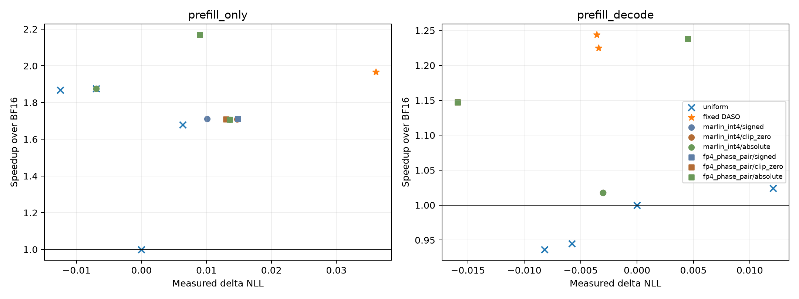

# Run009：HAWQ敏感度符号与INT4/FP4移植稳健性

冻结Hessian平均特征值中35/252项为负。原001/003 signed处理保持不变，本轮额外固定max(h,0)与abs(h)控制；不依据实测NLL选择处理方式。35条预定比较，完整map合并为16份模型。

INT4列为Marlin INT4 / INT8 / BF16，precision绑定prefill/decode；FP4列沿用001移植的4bit精度对：prefill dense NVFP4、decode W4A16 NVFP4，另有INT8/BF16。FP4 weight-error代理沿用001 dense NVFP4量化误差，不将其写成原CNN integer-only QAT/TVM流程。三种Hessian处理在原unfused block上执行后再合并成runtime fused module。
相同profile、相同原DASO预测Linear latency cap，两个预算标签0.01/0.07只是cap的来源，不是HAWQ的实际NLL保证。若低于该HAWQ动作集合的最小成本，明确记录infeasible并clamp。策略在质量测量前固定。

## 全部预定点

速度统一GPU0、B8/S2048/O1或64、2 warmups+5 timed、6GiB KV；质量同一64个非重叠test窗口，B8 prompt logprobs或实际teacher-forced decode。原DASO固定策略和uniform锚点在本轮统一重测，不能将003/009跨run绝对延迟混用。

| 场景 | 策略 | 实测ΔNLL | 描述性95%区间 | ms | 加速 | 请求cap不可行 |
| --- | --- | ---: | --- | ---: | ---: | --- |
| prefill_only | uniform_dense_bf16 | 0.00000 | [0.00000, 0.00000] | 1126.5 | 1.000× | — |
| prefill_decode | uniform_dense_bf16 | 0.00000 | [0.00000, 0.00000] | 2010.4 | 1.000× | — |
| prefill_only | uniform_int8 | -0.00699 | [-0.01030, -0.00352] | 600.6 | 1.876× | — |
| prefill_decode | uniform_int8 | -0.00819 | [-0.02029, 0.00394] | 2146.3 | 0.937× | — |
| prefill_only | uniform_sq_int8 | -0.01252 | [-0.01546, -0.00984] | 603.0 | 1.868× | — |
| prefill_decode | uniform_sq_int8 | -0.00577 | [-0.01775, 0.00568] | 2127.8 | 0.945× | — |
| prefill_only | uniform_fp8 | 0.00633 | [0.00521, 0.00757] | 671.0 | 1.679× | — |
| prefill_decode | uniform_fp8 | 0.01208 | [0.00665, 0.01742] | 1962.7 | 1.024× | — |
| prefill_decode | transfer_daso5_measured_prefill_decode_04 | -0.00356 | [-0.01984, 0.01281] | 1616.5 | 1.244× | — |
| prefill_decode | transfer_daso8_prefill_decode_01 | -0.00343 | [-0.01879, 0.01147] | 1641.0 | 1.225× | — |
| prefill_only | transfer_daso8_prefill_only_02 | 0.03606 | [0.03100, 0.04156] | 573.0 | 1.966× | — |
| prefill_only | hawq_marlin_int4_signed_prefill_only_q0.01 | 0.01011 | [0.00738, 0.01281] | 658.1 | 1.712× | False |
| prefill_only | hawq_marlin_int4_signed_prefill_only_q0.07 | -0.00699 | [-0.01030, -0.00352] | 600.6 | 1.876× | True |
| prefill_decode | hawq_marlin_int4_signed_prefill_decode_q0.01 | -0.00302 | [-0.01549, 0.00922] | 1975.0 | 1.018× | True |
| prefill_decode | hawq_marlin_int4_signed_prefill_decode_q0.07 | -0.00302 | [-0.01549, 0.00922] | 1975.0 | 1.018× | True |
| prefill_only | hawq_fp4_phase_pair_signed_prefill_only_q0.01 | 0.01482 | [0.01161, 0.01791] | 658.0 | 1.712× | False |
| prefill_only | hawq_fp4_phase_pair_signed_prefill_only_q0.07 | 0.00900 | [0.00425, 0.01394] | 519.4 | 2.169× | True |
| prefill_decode | hawq_fp4_phase_pair_signed_prefill_decode_q0.01 | -0.01591 | [-0.02992, -0.00090] | 1752.1 | 1.147× | False |
| prefill_decode | hawq_fp4_phase_pair_signed_prefill_decode_q0.07 | 0.00450 | [-0.00965, 0.01874] | 1624.1 | 1.238× | True |
| prefill_only | hawq_marlin_int4_clip_zero_prefill_only_q0.01 | 0.01474 | [0.01196, 0.01754] | 659.4 | 1.708× | False |
| prefill_only | hawq_marlin_int4_clip_zero_prefill_only_q0.07 | -0.00699 | [-0.01030, -0.00352] | 600.6 | 1.876× | True |
| prefill_decode | hawq_marlin_int4_clip_zero_prefill_decode_q0.01 | -0.00302 | [-0.01549, 0.00922] | 1975.0 | 1.018× | True |
| prefill_decode | hawq_marlin_int4_clip_zero_prefill_decode_q0.07 | -0.00302 | [-0.01549, 0.00922] | 1975.0 | 1.018× | True |
| prefill_only | hawq_fp4_phase_pair_clip_zero_prefill_only_q0.01 | 0.01302 | [0.01045, 0.01562] | 659.0 | 1.710× | False |
| prefill_only | hawq_fp4_phase_pair_clip_zero_prefill_only_q0.07 | 0.00900 | [0.00425, 0.01394] | 519.4 | 2.169× | True |
| prefill_decode | hawq_fp4_phase_pair_clip_zero_prefill_decode_q0.01 | -0.01591 | [-0.02992, -0.00090] | 1752.1 | 1.147× | False |
| prefill_decode | hawq_fp4_phase_pair_clip_zero_prefill_decode_q0.07 | 0.00450 | [-0.00965, 0.01874] | 1624.1 | 1.238× | True |
| prefill_only | hawq_marlin_int4_absolute_prefill_only_q0.01 | 0.01356 | [0.01042, 0.01670] | 659.8 | 1.707× | False |
| prefill_only | hawq_marlin_int4_absolute_prefill_only_q0.07 | -0.00699 | [-0.01030, -0.00352] | 600.6 | 1.876× | True |
| prefill_decode | hawq_marlin_int4_absolute_prefill_decode_q0.01 | -0.00302 | [-0.01549, 0.00922] | 1975.0 | 1.018× | True |
| prefill_decode | hawq_marlin_int4_absolute_prefill_decode_q0.07 | -0.00302 | [-0.01549, 0.00922] | 1975.0 | 1.018× | True |
| prefill_only | hawq_fp4_phase_pair_absolute_prefill_only_q0.01 | 0.01356 | [0.01042, 0.01670] | 659.8 | 1.707× | False |
| prefill_only | hawq_fp4_phase_pair_absolute_prefill_only_q0.07 | 0.00900 | [0.00425, 0.01394] | 519.4 | 2.169× | True |
| prefill_decode | hawq_fp4_phase_pair_absolute_prefill_decode_q0.01 | -0.01591 | [-0.02992, -0.00090] | 1752.1 | 1.147× | False |
| prefill_decode | hawq_fp4_phase_pair_absolute_prefill_decode_q0.07 | 0.00450 | [-0.00965, 0.01874] | 1624.1 | 1.238× | True |

## 相同实际质量上限内的已测点

以下是事后实际质量切片；不是从test中挑一种Hessian处理重新部署，所有原点均在上表和CSV中保留。

| 场景 | 实际ΔNLL cap | 组 | 最快已测加速 | 策略 |
| --- | ---: | --- | ---: | --- |
| prefill_only | 0.01 | uniform | 1.876× | uniform_int8 |
| prefill_only | 0.01 | fixed DASO | — | — |
| prefill_only | 0.01 | marlin_int4/signed | 1.876× | hawq_marlin_int4_signed_prefill_only_q0.07 |
| prefill_only | 0.01 | marlin_int4/clip_zero | 1.876× | hawq_marlin_int4_clip_zero_prefill_only_q0.07 |
| prefill_only | 0.01 | marlin_int4/absolute | 1.876× | hawq_marlin_int4_absolute_prefill_only_q0.07 |
| prefill_only | 0.01 | fp4_phase_pair/signed | 2.169× | hawq_fp4_phase_pair_signed_prefill_only_q0.07 |
| prefill_only | 0.01 | fp4_phase_pair/clip_zero | 2.169× | hawq_fp4_phase_pair_clip_zero_prefill_only_q0.07 |
| prefill_only | 0.01 | fp4_phase_pair/absolute | 2.169× | hawq_fp4_phase_pair_absolute_prefill_only_q0.07 |
| prefill_only | 0.02 | uniform | 1.876× | uniform_int8 |
| prefill_only | 0.02 | fixed DASO | — | — |
| prefill_only | 0.02 | marlin_int4/signed | 1.876× | hawq_marlin_int4_signed_prefill_only_q0.07 |
| prefill_only | 0.02 | marlin_int4/clip_zero | 1.876× | hawq_marlin_int4_clip_zero_prefill_only_q0.07 |
| prefill_only | 0.02 | marlin_int4/absolute | 1.876× | hawq_marlin_int4_absolute_prefill_only_q0.07 |
| prefill_only | 0.02 | fp4_phase_pair/signed | 2.169× | hawq_fp4_phase_pair_signed_prefill_only_q0.07 |
| prefill_only | 0.02 | fp4_phase_pair/clip_zero | 2.169× | hawq_fp4_phase_pair_clip_zero_prefill_only_q0.07 |
| prefill_only | 0.02 | fp4_phase_pair/absolute | 2.169× | hawq_fp4_phase_pair_absolute_prefill_only_q0.07 |
| prefill_only | 0.04 | uniform | 1.876× | uniform_int8 |
| prefill_only | 0.04 | fixed DASO | 1.966× | transfer_daso8_prefill_only_02 |
| prefill_only | 0.04 | marlin_int4/signed | 1.876× | hawq_marlin_int4_signed_prefill_only_q0.07 |
| prefill_only | 0.04 | marlin_int4/clip_zero | 1.876× | hawq_marlin_int4_clip_zero_prefill_only_q0.07 |
| prefill_only | 0.04 | marlin_int4/absolute | 1.876× | hawq_marlin_int4_absolute_prefill_only_q0.07 |
| prefill_only | 0.04 | fp4_phase_pair/signed | 2.169× | hawq_fp4_phase_pair_signed_prefill_only_q0.07 |
| prefill_only | 0.04 | fp4_phase_pair/clip_zero | 2.169× | hawq_fp4_phase_pair_clip_zero_prefill_only_q0.07 |
| prefill_only | 0.04 | fp4_phase_pair/absolute | 2.169× | hawq_fp4_phase_pair_absolute_prefill_only_q0.07 |
| prefill_only | 0.07 | uniform | 1.876× | uniform_int8 |
| prefill_only | 0.07 | fixed DASO | 1.966× | transfer_daso8_prefill_only_02 |
| prefill_only | 0.07 | marlin_int4/signed | 1.876× | hawq_marlin_int4_signed_prefill_only_q0.07 |
| prefill_only | 0.07 | marlin_int4/clip_zero | 1.876× | hawq_marlin_int4_clip_zero_prefill_only_q0.07 |
| prefill_only | 0.07 | marlin_int4/absolute | 1.876× | hawq_marlin_int4_absolute_prefill_only_q0.07 |
| prefill_only | 0.07 | fp4_phase_pair/signed | 2.169× | hawq_fp4_phase_pair_signed_prefill_only_q0.07 |
| prefill_only | 0.07 | fp4_phase_pair/clip_zero | 2.169× | hawq_fp4_phase_pair_clip_zero_prefill_only_q0.07 |
| prefill_only | 0.07 | fp4_phase_pair/absolute | 2.169× | hawq_fp4_phase_pair_absolute_prefill_only_q0.07 |
| prefill_decode | 0.01 | uniform | 1.000× | uniform_dense_bf16 |
| prefill_decode | 0.01 | fixed DASO | 1.244× | transfer_daso5_measured_prefill_decode_04 |
| prefill_decode | 0.01 | marlin_int4/signed | 1.018× | hawq_marlin_int4_signed_prefill_decode_q0.01 |
| prefill_decode | 0.01 | marlin_int4/clip_zero | 1.018× | hawq_marlin_int4_clip_zero_prefill_decode_q0.01 |
| prefill_decode | 0.01 | marlin_int4/absolute | 1.018× | hawq_marlin_int4_absolute_prefill_decode_q0.01 |
| prefill_decode | 0.01 | fp4_phase_pair/signed | 1.238× | hawq_fp4_phase_pair_signed_prefill_decode_q0.07 |
| prefill_decode | 0.01 | fp4_phase_pair/clip_zero | 1.238× | hawq_fp4_phase_pair_clip_zero_prefill_decode_q0.07 |
| prefill_decode | 0.01 | fp4_phase_pair/absolute | 1.238× | hawq_fp4_phase_pair_absolute_prefill_decode_q0.07 |
| prefill_decode | 0.02 | uniform | 1.024× | uniform_fp8 |
| prefill_decode | 0.02 | fixed DASO | 1.244× | transfer_daso5_measured_prefill_decode_04 |
| prefill_decode | 0.02 | marlin_int4/signed | 1.018× | hawq_marlin_int4_signed_prefill_decode_q0.01 |
| prefill_decode | 0.02 | marlin_int4/clip_zero | 1.018× | hawq_marlin_int4_clip_zero_prefill_decode_q0.01 |
| prefill_decode | 0.02 | marlin_int4/absolute | 1.018× | hawq_marlin_int4_absolute_prefill_decode_q0.01 |
| prefill_decode | 0.02 | fp4_phase_pair/signed | 1.238× | hawq_fp4_phase_pair_signed_prefill_decode_q0.07 |
| prefill_decode | 0.02 | fp4_phase_pair/clip_zero | 1.238× | hawq_fp4_phase_pair_clip_zero_prefill_decode_q0.07 |
| prefill_decode | 0.02 | fp4_phase_pair/absolute | 1.238× | hawq_fp4_phase_pair_absolute_prefill_decode_q0.07 |
| prefill_decode | 0.04 | uniform | 1.024× | uniform_fp8 |
| prefill_decode | 0.04 | fixed DASO | 1.244× | transfer_daso5_measured_prefill_decode_04 |
| prefill_decode | 0.04 | marlin_int4/signed | 1.018× | hawq_marlin_int4_signed_prefill_decode_q0.01 |
| prefill_decode | 0.04 | marlin_int4/clip_zero | 1.018× | hawq_marlin_int4_clip_zero_prefill_decode_q0.01 |
| prefill_decode | 0.04 | marlin_int4/absolute | 1.018× | hawq_marlin_int4_absolute_prefill_decode_q0.01 |
| prefill_decode | 0.04 | fp4_phase_pair/signed | 1.238× | hawq_fp4_phase_pair_signed_prefill_decode_q0.07 |
| prefill_decode | 0.04 | fp4_phase_pair/clip_zero | 1.238× | hawq_fp4_phase_pair_clip_zero_prefill_decode_q0.07 |
| prefill_decode | 0.04 | fp4_phase_pair/absolute | 1.238× | hawq_fp4_phase_pair_absolute_prefill_decode_q0.07 |
| prefill_decode | 0.07 | uniform | 1.024× | uniform_fp8 |
| prefill_decode | 0.07 | fixed DASO | 1.244× | transfer_daso5_measured_prefill_decode_04 |
| prefill_decode | 0.07 | marlin_int4/signed | 1.018× | hawq_marlin_int4_signed_prefill_decode_q0.01 |
| prefill_decode | 0.07 | marlin_int4/clip_zero | 1.018× | hawq_marlin_int4_clip_zero_prefill_decode_q0.01 |
| prefill_decode | 0.07 | marlin_int4/absolute | 1.018× | hawq_marlin_int4_absolute_prefill_decode_q0.01 |
| prefill_decode | 0.07 | fp4_phase_pair/signed | 1.238× | hawq_fp4_phase_pair_signed_prefill_decode_q0.07 |
| prefill_decode | 0.07 | fp4_phase_pair/clip_zero | 1.238× | hawq_fp4_phase_pair_clip_zero_prefill_decode_q0.07 |
| prefill_decode | 0.07 | fp4_phase_pair/absolute | 1.238× | hawq_fp4_phase_pair_absolute_prefill_decode_q0.07 |

## 解释范围

- 强化控制用于排除Hessian负值处理及实际4bit后端选择造成的移植偶然性；不把signed/clip/abs中对test最有利者当作事先选定的算法。
- 使用相同原Hessian样本和权重量化误差；没有重训、裁剪测试标签、对global NLL重新拟合Hessian目标。
- HAWQ优化其权重敏感度代理，DASO使用校准NLL代理；两者可行性都应看最终实际NLL。HAWQ的ILP最优不等于实际质量全局最优，DASO也不作此保证。
- BF16 attention/KV与非Linear保持相同vLLM路径，INT8为真实W8A8，FP4/INT4为实际对应kernel；本轮只测中心负载，扩展B/S/O与mixed证据分别见003/006。
- 全部源、参数、数值目标、最小可行cap与失败记录保留。已有001–003档案与共享运行时完整性由008的protected_integrity审计核对。

[完整CSV](results/summary_final.csv) · [Hessian符号检查](results/hessian_sign_audit.json) · [冻结策略](configs/candidate_pool.json)。
