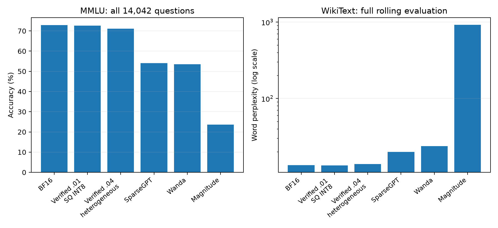

# Run010：预先选定策略的完整下游任务

策略取自run005在最终test之前冻结的验证选择，预先固定epsilon=.01/.04的prefill与P+D代表点；没有根据下游得分换策略或删任务。Magnitude/Wanda固定补齐五个likelihood任务。

相同method-map且原canonical权重/scales来源完全相同的结果继承002，并逐文件校验SHA；新Wanda/magnitude权重全部重新评测，不能因稀疏格式相同而继承SparseGPT结果。18份继承结果、18份新结果，共36份完整任务结果。

## 完整likelihood任务

采用原002协议：zero-shot、max_model_len=2048、3GiB KV；WikiText滚动PPL为batch1，其余batch4。WikiText为完整原测试集的62篇文档，Winogrande1267、ARC-E2376、ARC-C1172、MMLU57科共14042题；全部effective=original，limit=None。ARC使用normalized accuracy，其余分类使用accuracy。

| 策略 | WikiText PPL ↓ | Winogrande % | ARC-E norm % | ARC-C norm % | MMLU % |
| --- | ---: | ---: | ---: | ---: | ---: |
| BF16 | 13.492 | 68.035 | 80.766 | 56.911 | 72.874 |
| Verified prefill, epsilon=.01 (SQ INT8) | 13.396 | 68.982 | 81.229 | 57.167 | 72.611 |
| Verified prefill, epsilon=.04 (heterogeneous) | 13.892 | 69.929 | 79.251 | 55.034 | 71.101 |
| SparseGPT 2:4 | 20.125 | 64.246 | 69.823 | 44.454 | 54.102 |
| Wanda 2:4 | 23.809 | 61.721 | 70.707 | 41.724 | 53.561 |
| Magnitude 2:4 | 922.415 | 52.802 | 35.227 | 21.416 | 23.594 |

## 完整生成任务

CNN/DM1000、XSum原dsum子集1500、IWSLT333，均沿用002冻结输入、native Qwen3 non-thinking chat template、batch8、max_new_tokens=256、6GiB KV、允许EOS。生成长度随策略改变，因此generation_seconds不用于固定工作量加速比。epsilon=.01的验证选择回退BF16，epsilon=.04为异构策略。

| 策略 | 任务 | 指标 | 得分 | 对BF16变化（百分点） | 样本数 |
| --- | --- | --- | ---: | ---: | ---: |
| Verified P+D, epsilon=.01 (BF16) | IWSLT | rougeL_percent | 68.8419 | +0.0000 | 333 |
| Verified P+D, epsilon=.01 (BF16) | IWSLT | sacre_bleu | 40.1339 | +0.0000 | 333 |
| Verified P+D, epsilon=.01 (BF16) | cnn_dm_1000 | rougeL_percent | 22.8086 | +0.0000 | 1000 |
| Verified P+D, epsilon=.01 (BF16) | dsum | rougeL_percent | 26.9605 | +0.0000 | 1500 |
| Verified P+D, epsilon=.04 (heterogeneous) | IWSLT | rougeL_percent | 68.1559 | -0.6860 | 333 |
| Verified P+D, epsilon=.04 (heterogeneous) | IWSLT | sacre_bleu | 39.5404 | -0.5935 | 333 |
| Verified P+D, epsilon=.04 (heterogeneous) | cnn_dm_1000 | rougeL_percent | 22.5998 | -0.2089 | 1000 |
| Verified P+D, epsilon=.04 (heterogeneous) | dsum | rougeL_percent | 26.7203 | -0.2402 | 1500 |

## 解释与边界

- 两个prefill代表点在005的中心B8/S2048/O1负载分别为1.953×和2.213×；这里likelihood任务的batch/长度不同，不能把这两个速度称为完整MMLU任务的加速比。
- 相同2:4 kernel下，简单剪枝方法具有相近速度而不同下游精度；Wanda/SparseGPT的完整任务显著好于magnitude，但均有明显质量下降。
- epsilon=.04的P+D点在005固定B8/S2048/O64计时为1.358×，其三个完整生成任务ROUGE-L/BLEU变化另见表；不可把固定长度E2E速度与可变长度生成任务混为一个实验。
- WikiText NLL质量预算不保证跨任务准确率。prefill异构点MMLU比BF16下降约1.77个百分点；完整表保留该代价。epsilon=.01的SQ点下降约0.26个百分点，并非异构配置在所有任务上都更好。
- 本轮代表性确认不等同于对所有003负载、所有候选或HAWQ变体都做全任务；原001/002完整任务应共同引用。未运行完整30B模型。

[likelihood完整CSV](results/likelihood_summary.csv) · [生成完整CSV](results/generation_summary.csv) · [预注册规则](configs/task_rules.json) · [选择/继承来源](configs/task_catalog.json) · [审计](results/task_audit.json)。
