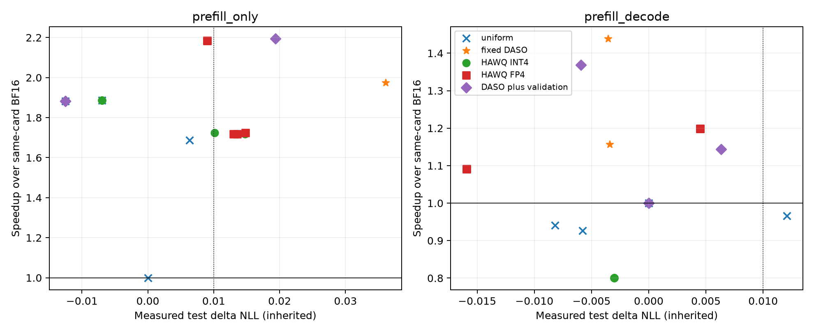

# Run011：验证后策略与强化HAWQ的同卡标准负载复核

005验证后策略与009强化基线此前分别在GPU2/GPU0计时。本轮把009全部35比较点与005全部8个质量预算验证选择合并，同一GPU0计时；19份唯一map、23个唯一policy/scenario，所有43个标签保留。没有新策略、质量拟合或规则调整。

质量直接继承005/009同64个test窗口、B8 prompt-logprobs/真实KV teacher forcing的结果，逐SHA核验，重复map的均值也核对一致。所有canonical/scales/kernel相同。这里新增的是确认速度，不把再次计时称为新的独立质量测试。

速度为B8/S2048/O1或64、eager、无chunked/prefix cache、6GiB KV、2 warmups+5 timed，统一新seed144983，BF16开头/结尾各一次，合并10个timed burst作锚。

首轮固定seed144985打乱方法顺序，但部分时段与另一GPU上的006共享host。全部其他GPU实验结束后，将同一19map完整反向顺序再测一次，作为本报告最终主结果；不混合两轮环境。首轮25速度文件、完整报告/CSV/图保留在diagnostics_first_campaign，质量与策略完全不改，也不按输赢继续增加重复。

| 场景 | BF16起点ms | 终点ms | 终点/起点 | 合并10轮ms |
| --- | ---: | ---: | ---: | ---: |
| prefill_only | 1125.0 | 1131.0 | 1.005 | 1128.5 |
| prefill_decode | 2014.9 | 2013.4 | 0.999 | 2013.9 |

| 场景 | 比较点 | 实测ΔNLL | 描述性95%窗口区间 | E2E ms | 相对BF16 |
| --- | --- | ---: | --- | ---: | ---: |
| prefill_only | uniform_dense_bf16 | 0.00000 | [0.00000, 0.00000] | 1128.5 | 1.000× |
| prefill_only | uniform_int8 | -0.00699 | [-0.01044, -0.00356] | 598.1 | 1.887× |
| prefill_only | uniform_sq_int8 | -0.01252 | [-0.01539, -0.00964] | 599.4 | 1.883× |
| prefill_only | uniform_fp8 | 0.00633 | [0.00513, 0.00754] | 669.1 | 1.687× |
| prefill_only | transfer_daso8_prefill_only_02 | 0.03606 | [0.03090, 0.04160] | 571.7 | 1.974× |
| prefill_only | hawq_marlin_int4_signed_prefill_only_q0.01 | 0.01011 | [0.00738, 0.01273] | 654.8 | 1.724× |
| prefill_only | hawq_marlin_int4_signed_prefill_only_q0.07 | -0.00699 | [-0.01044, -0.00356] | 598.1 | 1.887× |
| prefill_only | hawq_fp4_phase_pair_signed_prefill_only_q0.01 | 0.01482 | [0.01156, 0.01791] | 654.8 | 1.723× |
| prefill_only | hawq_fp4_phase_pair_signed_prefill_only_q0.07 | 0.00900 | [0.00417, 0.01371] | 516.6 | 2.184× |
| prefill_only | hawq_marlin_int4_clip_zero_prefill_only_q0.01 | 0.01474 | [0.01194, 0.01765] | 656.9 | 1.718× |
| prefill_only | hawq_marlin_int4_clip_zero_prefill_only_q0.07 | -0.00699 | [-0.01044, -0.00356] | 598.1 | 1.887× |
| prefill_only | hawq_fp4_phase_pair_clip_zero_prefill_only_q0.01 | 0.01302 | [0.01043, 0.01564] | 657.1 | 1.717× |
| prefill_only | hawq_fp4_phase_pair_clip_zero_prefill_only_q0.07 | 0.00900 | [0.00417, 0.01371] | 516.6 | 2.184× |
| prefill_only | hawq_marlin_int4_absolute_prefill_only_q0.01 | 0.01356 | [0.01042, 0.01682] | 656.5 | 1.719× |
| prefill_only | hawq_marlin_int4_absolute_prefill_only_q0.07 | -0.00699 | [-0.01044, -0.00356] | 598.1 | 1.887× |
| prefill_only | hawq_fp4_phase_pair_absolute_prefill_only_q0.01 | 0.01356 | [0.01042, 0.01682] | 656.5 | 1.719× |
| prefill_only | hawq_fp4_phase_pair_absolute_prefill_only_q0.07 | 0.00900 | [0.00417, 0.01371] | 516.6 | 2.184× |
| prefill_only | verified_prefill_only_q0.005 | -0.01252 | [-0.01539, -0.00964] | 599.4 | 1.883× |
| prefill_only | verified_prefill_only_q0.01 | -0.01252 | [-0.01539, -0.00964] | 599.4 | 1.883× |
| prefill_only | verified_prefill_only_q0.02 | -0.01252 | [-0.01539, -0.00964] | 599.4 | 1.883× |
| prefill_only | verified_prefill_only_q0.04 | 0.01936 | [0.01371, 0.02531] | 514.4 | 2.194× |
| prefill_decode | uniform_dense_bf16 | 0.00000 | [0.00000, 0.00000] | 2013.9 | 1.000× |
| prefill_decode | uniform_int8 | -0.00819 | [-0.02016, 0.00378] | 2141.4 | 0.940× |
| prefill_decode | uniform_sq_int8 | -0.00577 | [-0.01675, 0.00589] | 2174.0 | 0.926× |
| prefill_decode | uniform_fp8 | 0.01208 | [0.00677, 0.01723] | 2084.4 | 0.966× |
| prefill_decode | transfer_daso5_measured_prefill_decode_04 | -0.00356 | [-0.02014, 0.01171] | 1400.2 | 1.438× |
| prefill_decode | transfer_daso8_prefill_decode_01 | -0.00343 | [-0.01857, 0.01140] | 1741.6 | 1.156× |
| prefill_decode | hawq_marlin_int4_signed_prefill_decode_q0.01 | -0.00302 | [-0.01514, 0.00990] | 2514.7 | 0.801× |
| prefill_decode | hawq_marlin_int4_signed_prefill_decode_q0.07 | -0.00302 | [-0.01514, 0.00990] | 2514.7 | 0.801× |
| prefill_decode | hawq_fp4_phase_pair_signed_prefill_decode_q0.01 | -0.01591 | [-0.03063, -0.00145] | 1844.9 | 1.092× |
| prefill_decode | hawq_fp4_phase_pair_signed_prefill_decode_q0.07 | 0.00450 | [-0.00964, 0.01849] | 1680.5 | 1.198× |
| prefill_decode | hawq_marlin_int4_clip_zero_prefill_decode_q0.01 | -0.00302 | [-0.01514, 0.00990] | 2514.7 | 0.801× |
| prefill_decode | hawq_marlin_int4_clip_zero_prefill_decode_q0.07 | -0.00302 | [-0.01514, 0.00990] | 2514.7 | 0.801× |
| prefill_decode | hawq_fp4_phase_pair_clip_zero_prefill_decode_q0.01 | -0.01591 | [-0.03063, -0.00145] | 1844.9 | 1.092× |
| prefill_decode | hawq_fp4_phase_pair_clip_zero_prefill_decode_q0.07 | 0.00450 | [-0.00964, 0.01849] | 1680.5 | 1.198× |
| prefill_decode | hawq_marlin_int4_absolute_prefill_decode_q0.01 | -0.00302 | [-0.01514, 0.00990] | 2514.7 | 0.801× |
| prefill_decode | hawq_marlin_int4_absolute_prefill_decode_q0.07 | -0.00302 | [-0.01514, 0.00990] | 2514.7 | 0.801× |
| prefill_decode | hawq_fp4_phase_pair_absolute_prefill_decode_q0.01 | -0.01591 | [-0.03063, -0.00145] | 1844.9 | 1.092× |
| prefill_decode | hawq_fp4_phase_pair_absolute_prefill_decode_q0.07 | 0.00450 | [-0.00964, 0.01849] | 1680.5 | 1.198× |
| prefill_decode | verified_prefill_decode_q0.005 | 0.00000 | [0.00000, 0.00000] | 2013.9 | 1.000× |
| prefill_decode | verified_prefill_decode_q0.01 | 0.00000 | [0.00000, 0.00000] | 2013.9 | 1.000× |
| prefill_decode | verified_prefill_decode_q0.02 | 0.00633 | [-0.00009, 0.01281] | 1761.0 | 1.144× |
| prefill_decode | verified_prefill_decode_q0.04 | -0.00593 | [-0.02175, 0.00939] | 1471.6 | 1.369× |

## 时段复核与排名变化

首轮与最后单GPU作业时段的部分phase策略有明显变化，不能据主表单次中位数宣称跨时段稳定最优。CSV同时列出两轮ms、加速及其比值；首轮完整点均保留。下表只列P+D主要phase点以明确展示排序反转。

| P+D策略 | 首轮加速 | 最后单GPU作业加速 | 后轮/首轮ms |
| --- | ---: | ---: | ---: |
| transfer_daso5_measured_prefill_decode_04 | 1.247× | 1.438× | 0.867 |
| transfer_daso8_prefill_decode_01 | 1.200× | 1.156× | 1.037 |
| hawq_fp4_phase_pair_signed_prefill_decode_q0.01 | 1.157× | 1.092× | 1.059 |
| hawq_fp4_phase_pair_signed_prefill_decode_q0.07 | 1.396× | 1.198× | 1.165 |
| hawq_fp4_phase_pair_clip_zero_prefill_decode_q0.01 | 1.157× | 1.092× | 1.059 |
| hawq_fp4_phase_pair_clip_zero_prefill_decode_q0.07 | 1.396× | 1.198× | 1.165 |
| hawq_fp4_phase_pair_absolute_prefill_decode_q0.01 | 1.157× | 1.092× | 1.059 |
| hawq_fp4_phase_pair_absolute_prefill_decode_q0.07 | 1.396× | 1.198× | 1.165 |

例如五候选DASO约1.247→1.438×，HAWQ全NV4/W4控制约1.396→1.198×，排序反转。其他GPU作业/host传输之外，缓存、时钟和分配也可能影响时段差异，本轮未分别建立因果解释。006中B16异长mixed两轮均约1.54×的证据更适合支持稳定的负载优势；这里完整保留条件和波动。

## 适用边界

- DASO+validation是原算法之外新增的候选实测验证阶段，其额外离线成本约38.7分钟wall（该次三GPU并行选择，含I/O/初始化）见005；不能将效果归于原文已有质量保证。
- .005/.01/.02/.04的8个验证预算点包含重复选择。很紧的P+D预算回退BF16；另有预算.04点在test均值低于.01，也不能将它称为部署前epsilon=.01验证规则选出的策略。
- 质量上限切片是已测点的事后Pareto比较。相同实际ΔNLL上限不等于同一预测约束、同一准备成本或全局最优；全部Hessian sign/clip/abs变体与min-cost clamp明确保留。
- BF16起终点、所有计时min/max以及使用各端点归一化的速度均归档；小差距和时间漂移不能解释成统计显著优势。
- HAWQ为PTQ精度分配移植，不是原CNN QAT/TVM全栈复现。真实mixed调度另见006，完整下游质量另见010；本轮没有30B整模型实验。

[全部43点CSV](results/summary_final.csv) · [全部质量上限切片](results/quality_matched_frontiers.json) · [冻结比较池](configs/candidate_pool.json) · [质量来源](reference/inherited_quality.json)。
