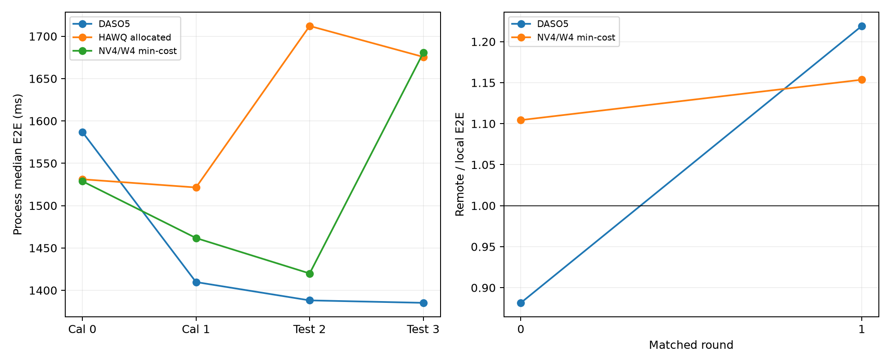

# Run012：排名重测、运行波动与实测约束

原001–011与模型策略不变。GPU0、B8/S2048、O1/O64、6GiB BF16 KV、eager、无chunked/prefix cache；所有导出完成后才做正式速度，一次只运行本实验。node0 CPU0–7、membind0；remote为CPU32–39、membind1。未改全局GPU时钟/CPU governor。

主要结论：四个node0独立campaign中，DASO5对HAWQ phase-uniform为3次较快、1次较慢，仍有排名变化；不能以单轮最佳值宣称稳定领先。相同输入的DASO5 prefill约577/576ms，而P+D约1587/1410ms，变化主要出现在decode相关执行。
95% BF16时延目标约1909ms，原5%规则选中点在新test为11/16次超时，按校准最大值筛选换点后为0/16；验证质量guard也从约.01135提高到.05548，不能说无代价修复了所有约束。80%/65%在预定小池内均不可行。
两次双驻留控制的进程中位数波动较小，但两方法都更慢；它是显存/执行模式折中，不能直接当作原流水线的免费修复。以上均为有限实测，未建立CPU频率、缓存和运行时路径各自的因果贡献。

## 质量validation究竟是什么

原005先用代理生成38份候选，再在独立64窗口validation上测真实策略NLL。质量guard=mean paired delta+2SE+.005，按预算筛选后取校准速度最快点。冻结选择后，另一份64窗口test只作评价。8预算点是4预算×2场景，对应5个选定policy/scenario，包含SQ重复选择和BF16回退；0超限是该流程的经验结果，不是原质量拟合已经修好，也不是所有预算都有压缩收益。
本轮没有新质量标签/质量重新拟合；下述时延选择只用原005 validation统计。旧test NLL仅作为既有质量上下文，不用于重新选择。

## 1. 放置与拷贝控制

| ABBA进程 | 内存/CPU节点 | MiB | GPU copy ms | wall ms | GiB/s |
| --- | ---: | ---: | ---: | ---: | ---: |
| 0 | 0 | 64 | 2.577 | 2.598 | 24.25 |
| 0 | 0 | 512 | 10.056 | 10.070 | 49.72 |
| 1 | 1 | 64 | 2.494 | 2.516 | 25.06 |
| 1 | 1 | 512 | 9.812 | 9.825 | 50.96 |
| 2 | 1 | 64 | 2.605 | 2.627 | 24.01 |
| 2 | 1 | 512 | 9.820 | 9.833 | 50.92 |
| 3 | 0 | 64 | 2.816 | 2.838 | 22.19 |
| 3 | 0 | 512 | 10.052 | 10.067 | 49.74 |

node0/node1的512MiB copy均约50GiB/s，单纯NUMA导致大块H2D带宽骤降的假设没有获得支持。完整模型还同时受CPU放置、时钟、分配与流水线影响；下表测的是CPU/内存联合放置效应，不将其全部归因于内存节点。

| round | 策略 | 场景 | local ms | remote ms | remote/local | 输出token相同 |
| --- | --- | --- | ---: | ---: | ---: | --- |
| 0 | transfer_daso5_measured_prefill_decode_04 | prefill_only | 577.1 | 575.9 | 0.998 | True |
| 0 | transfer_daso5_measured_prefill_decode_04 | prefill_decode | 1587.0 | 1399.0 | 0.882 | True |
| 0 | hawq_fp4_phase_pair_signed_prefill_decode_q0.07 | prefill_only | 670.0 | 670.1 | 1.000 | True |
| 0 | hawq_fp4_phase_pair_signed_prefill_decode_q0.07 | prefill_decode | 1528.8 | 1688.4 | 1.104 | True |
| 1 | transfer_daso5_measured_prefill_decode_04 | prefill_only | 576.1 | 575.7 | 0.999 | True |
| 1 | transfer_daso5_measured_prefill_decode_04 | prefill_decode | 1409.7 | 1718.7 | 1.219 | True |
| 1 | hawq_fp4_phase_pair_signed_prefill_decode_q0.07 | prefill_only | 670.3 | 670.4 | 1.000 | True |
| 1 | hawq_fp4_phase_pair_signed_prefill_decode_q0.07 | prefill_decode | 1461.8 | 1686.3 | 1.154 | True |

## 2. 独立进程中的排名

每个进程3 warmups+8 timed。round0/1使用完全相同的原011 seed144983，round2/3使用完全相同的新seed144995；各轮六策略输入相同、顺序交错，分开比较进程重复与输入变化。下表每行是一个独立进程中位数的配对比较，不把同进程8次当作8个独立campaign。

| round | 分区 | HAWQ点 | DASO5 ms | HAWQ ms | DASO/BF16 | HAWQ/BF16 | HAWQ/DASO ms |
| --- | --- | --- | ---: | ---: | ---: | ---: | ---: |
| 0 | calibration | hawq_fp4_phase_pair_signed_prefill_decode_q0.07 | 1587.0 | 1528.8 | 1.266× | 1.314× | 0.963 |
| 0 | calibration | hawq_fp4_phase_pair_signed_prefill_decode_q0.01 | 1587.0 | 1531.1 | 1.266× | 1.312× | 0.965 |
| 1 | calibration | hawq_fp4_phase_pair_signed_prefill_decode_q0.07 | 1409.7 | 1461.8 | 1.426× | 1.375× | 1.037 |
| 1 | calibration | hawq_fp4_phase_pair_signed_prefill_decode_q0.01 | 1409.7 | 1521.5 | 1.426× | 1.321× | 1.079 |
| 2 | test | hawq_fp4_phase_pair_signed_prefill_decode_q0.07 | 1388.1 | 1419.9 | 1.448× | 1.416× | 1.023 |
| 2 | test | hawq_fp4_phase_pair_signed_prefill_decode_q0.01 | 1388.1 | 1712.2 | 1.448× | 1.174× | 1.233 |
| 3 | test | hawq_fp4_phase_pair_signed_prefill_decode_q0.07 | 1385.2 | 1680.5 | 1.454× | 1.199× | 1.213 |
| 3 | test | hawq_fp4_phase_pair_signed_prefill_decode_q0.01 | 1385.2 | 1675.6 | 1.454× | 1.202× | 1.210 |

首批首token观察使用LLMEngine.step末端，但LLM.generate强制FINAL_ONLY，因此这些未标记版本的TTFT字段实际是完成时刻，全部排除分解。E2E/restore与输出token不受影响，原文件保留。修正后在EngineCore原始new_token_ids进入输出过滤前观测，并断言首token早于完成；process_summary.csv有valid_first_token_observer标记。

## 3. 双表示常驻：可选运行时控制

主实验完成后，用相同node0/输入/权重给DASO5和HAWQ phase-uniform各做两个独立进程控制，顺序反向。复用原004 resident实现，删除每轮动态搬运/分配/等待路径，保留host缓存并计入内存。它同时改变GPU权重布局和缓存行为，不能将全部差值归因于DMA；不是原单表示释放流水线。

| round | 策略 | async P+D ms | resident P+D ms | resident/async | resident峰值GiB | host权重GiB |
| --- | --- | ---: | ---: | ---: | ---: | ---: |
| 0 | transfer_daso5_measured_prefill_decode_04 | 1587.0 | 1738.1 | 1.095 | 22.768 | 10.545 |
| 0 | hawq_fp4_phase_pair_signed_prefill_decode_q0.07 | 1528.8 | 1703.6 | 1.114 | 19.536 | 7.277 |
| 1 | hawq_fp4_phase_pair_signed_prefill_decode_q0.07 | 1461.8 | 1735.4 | 1.187 | 19.536 | 7.277 |
| 1 | transfer_daso5_measured_prefill_decode_04 | 1409.7 | 1692.8 | 1.201 | 22.768 | 10.545 |

额外allocator_diagnostics.csv记录可用进程中每轮生成的device alloc/free、allocation retry、all-stream sync计数增量，以及首token和decode剩余时间；这些轻量查询在计时区间之外。缺少字段的早期记录不填造数值。

## 4. 5%与经验上界：校准和test严格分开

原14%示例是1.740s实测校准→1.985s实测test，5%检查为1.740×1.05≤1.921s。它是实测状态/工作负载变化，不直接等于模型预测误差。原raw inverse还另有Linear代理未覆盖整模型代价的问题，两者需要分别处理。

本轮round0/1提供每候选16个校准timed值；预先固定median×1.05与max_observed×1.02两条规则。SLA为新BF16校准中位的95/80/65%。在原BF16/inverse_r0.65/exact_q0.02三候选中，按原validation guarded质量最小选可行者，全部选择在round2之前冻结；round2/3只检查结果。max_observed不是未来最大值的数学上界，经验规则均不构成硬实时保证。

| 规则 | BF16比例 | SLA ms | 选择 | 原validation质量guard | test中位 ms | test最大 ms | 超时检查/16 |
| --- | ---: | ---: | --- | ---: | ---: | ---: | ---: |
| original_5_percent | 0.95 | 1909.2 | inverse_prefill_decode_r0.65 | 0.01135 | 2068.1 | 2146.5 | 11/16 |
| empirical_upper | 0.95 | 1909.2 | exact_prefill_decode_q0.02 | 0.05548 | 1615.0 | 1635.9 | 0/16 |
| original_5_percent | 0.80 | 1607.7 | 候选池内不可行 | — | — | — | — |
| empirical_upper | 0.80 | 1607.7 | 候选池内不可行 | — | — | — | — |
| original_5_percent | 0.65 | 1306.3 | 候选池内不可行 | — | — | — | — |
| empirical_upper | 0.65 | 1306.3 | 候选池内不可行 | — | — | — | — |

相同policy被不同阈值或规则选中会重复检查同一批计时，physical_measurement_ids提供去重依据。该小候选池用于可靠性验证，不代替完整38候选优化，也不把池内不可行写成全局不可能。BF16是质量回退，但可能不满足比BF16更紧的时延目标。

反向问题是在时延约束下最小化validation质量损失，换选更快点可能提高质量guard；本次约.01135→.05548。不能据此声称同时满足原来的严格质量上限。若用户同时规定质量和时延上限，需要检查两者交集；交集为空时返回不可行或调整服务资源/目标。

处理路径是：先稳定执行/计时，再用代理产生候选，真实validation检查决策可行性，以校准误差/波动设计保守界，最后独立test报告违约与不可行。更准的预测有助于减少验证成本；有限验证本身不能保证任意未来输入分布。

[逐进程完整CSV](results/process_summary.csv) · [排名CSV](results/ranking.csv) · [放置对照](results/placement_controls.csv) · [SLA审计](results/sla_audit.json) · [冻结设计](configs/design.json)。
