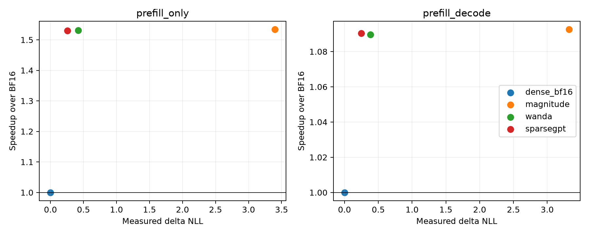

# Run007：magnitude / Wanda / SparseGPT结构化剪枝对照

三种剪枝均为每输出行连续4个输入权重保留至多2个非零，使用相同真实cuSPARSELt sparse BF16 kernel；转换时prune=False，不能偷偷再剪一次。Embedding、LM head和其余非Linear模块保持原模型。BF16为同卡锚点。

Magnitude不使用校准数据；Wanda与原SparseGPT使用相同128个WikiText训练块、每块前2048 token，并在每个pruned decoder layer之后重新传播校准激活。Wanda分数为abs(weight)×sqrt(input平方和/sample数)。
这是官方Wanda规则的Qwen3适配和相同数据对照，不是原论文C4设置的准确率复现。仅BF16普通2:4，未把它冒充Sparse NVFP4所需的pairwise4:8。

## 实际速度与质量

GPU5、B8/S2048、O=1或64、6GiB KV、2 warmups+5 timed。64个独立WikiText test非重叠窗口；prefill实际B8 prompt-logprob，decode实际B8 teacher forcing。完整上下文/目标、seed和起点预先固定。

| 方法 | 场景 | NLL | ΔNLL | 描述性95%区间 | ms | 相对BF16 |
| --- | --- | ---: | ---: | --- | ---: | ---: |
| dense_bf16 | prefill_only | 2.25049 | 0.00000 | [0.00000, 0.00000] | 1119.4 | 1.000× |
| magnitude | prefill_only | 5.64988 | 3.39939 | [3.33592, 3.46591] | 729.8 | 1.534× |
| wanda | prefill_only | 2.67239 | 0.42190 | [0.40333, 0.44071] | 730.9 | 1.532× |
| sparsegpt | prefill_only | 2.50779 | 0.25730 | [0.23849, 0.27664] | 731.6 | 1.530× |
| dense_bf16 | prefill_decode | 1.96426 | 0.00000 | [0.00000, 0.00000] | 1995.1 | 1.000× |
| magnitude | prefill_decode | 5.28606 | 3.32181 | [3.16905, 3.46766] | 1826.1 | 1.093× |
| wanda | prefill_decode | 2.34992 | 0.38567 | [0.33669, 0.44117] | 1831.0 | 1.090× |
| sparsegpt | prefill_decode | 2.21427 | 0.25002 | [0.20158, 0.30217] | 1829.7 | 1.090× |

## 准备成本与算法检查

| 方法 | 校准块 | 总时间s | 口径 |
| --- | ---: | ---: | --- |
| magnitude | 0 | 38.44 | 含模型载入、校准/剪枝、保存 |
| wanda | 128 | 144.10 | 含模型载入、校准/剪枝、保存 |
| sparsegpt | 128 | 305.03 | 001原记录，保存前；继承canonical权重 |

- 与固定commit官方WrappedGPT norm accumulator的最大相对差1.03e-06；向量化组内topk与官方逐组loop的mask完全一致。
- magnitude/Wanda全模型各252个Linear的mask均为精确50%选中、每4个至多2个非零。准备代码与官方源、MIT license、commit与SHA一并归档。
- 同样稀疏kernel并不意味着相同质量；此实验把剪枝准备算法与硬件格式分开。DASO的异构权衡应与这些完整uniform点共同看待，不能只拿同压缩率或理论FLOPs比较。
- 新magnitude/Wanda完整下游五个likelihood任务按预定规则在run010执行；SparseGPT/BF16原完整任务作为相同权重锚点继承。不得用本轮NLL代替MMLU等任务。
- 64个窗口在test split内不重叠；bootstrap区间为描述性配对窗口区间，不是跨分布质量保证。不同数据起点与B8协议应与001/002结果分开解释。

[完整CSV](results/summary_final.csv) · [准备成本](results/preparation_summary.json) · [公式/结构检查](results/pruning_formula_audit.json) · [官方源commit](reference/wanda/provenance.json)。
