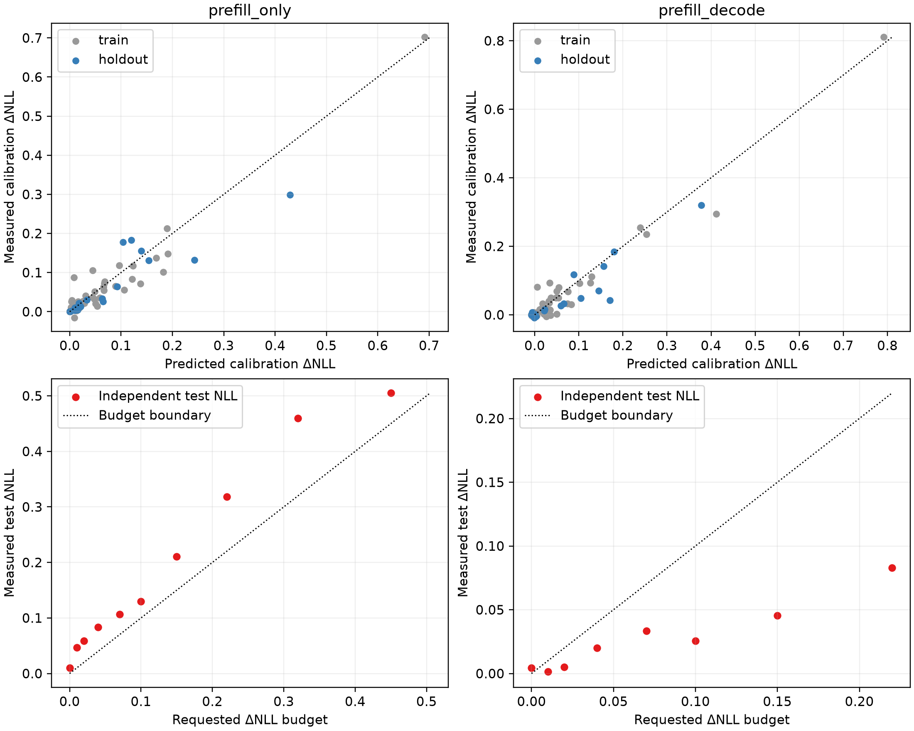
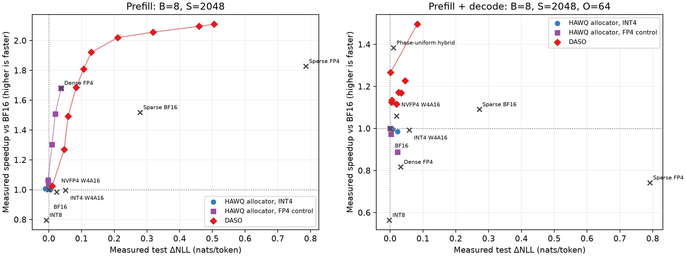
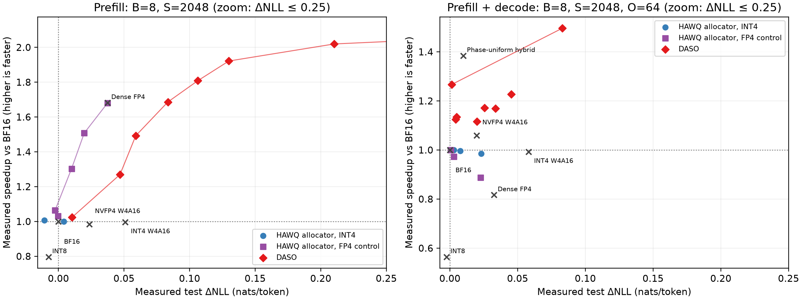

# Qwen3-8B 补充实验结果

已完成：39 份策略配置（按 policy_id 计）、46 个场景/NLL 点；13 个 prefill 配置全量评测五项任务，15 个 decode 配置各评测 CNN/DM 1000、DialogSum 1500、IWSLT 333 条样本。

正式速度和内存峰值均在同一张 RTX 5090（物理 GPU 3）测量，B=8、S=2048、O=1/64，固定 3 GiB BF16 KV、2 次 warmup + 5 次测量。生成采用原始样本与任务指令、Qwen3 non-thinking 模板、greedy、最多 256 新 token、固定 6 GiB KV。

完整机器可读数据：[summary_final.csv](results/summary_final.csv)。协议和格式适配见 [README](README.md) 与 [final_protocol.json](configs/final_protocol.json)。

## 实测质量预算

预算是质量模型预测约束，不能写成实际质量保证。表中违约量为 max(0, 实测 ΔNLL − ε)。Prefill NLL 计分 204700 个 token，decode NLL 计分 6400 个 token；均使用独立 WikiText 测试文本。

| 场景 | ε | 预测 ΔNLL | 测试 ΔNLL | 违约量 | 实测加速 |
| --- | --- | --- | --- | --- | --- |
| P | 0 | -0.00021 | 0.01034 | 0.01034 | 1.024× |
| P | 0.01 | 0.00694 | 0.04692 | 0.03692 | 1.270× |
| P | 0.02 | 0.01446 | 0.05893 | 0.03893 | 1.492× |
| P | 0.04 | 0.02587 | 0.08341 | 0.04341 | 1.686× |
| P | 0.07 | 0.04788 | 0.10626 | 0.03626 | 1.809× |
| P | 0.1 | 0.07863 | 0.12990 | 0.02990 | 1.922× |
| P | 0.15 | 0.12805 | 0.21024 | 0.06024 | 2.020× |
| P | 0.22 | 0.19814 | 0.31822 | 0.09822 | 2.056× |
| P | 0.32 | 0.29671 | 0.45945 | 0.13945 | 2.095× |
| P | 0.45 | 0.31822 | 0.50514 | 0.05514 | 2.110× |
| P+D | 0 | -0.00411 | 0.00430 | 0.00430 | 1.125× |
| P+D | 0.01 | 0.00169 | 0.00133 | 0.00000 | 1.267× |
| P+D | 0.02 | 0.00929 | 0.00498 | 0.00000 | 1.135× |
| P+D | 0.04 | 0.02068 | 0.01992 | 0.00000 | 1.116× |
| P+D | 0.07 | 0.03857 | 0.03355 | 0.00000 | 1.169× |
| P+D | 0.1 | 0.06698 | 0.02560 | 0.00000 | 1.171× |
| P+D | 0.15 | 0.11660 | 0.04532 | 0.00000 | 1.228× |
| P+D | 0.22 | 0.18332 | 0.08295 | 0.00000 | 1.496× |

prefill_only：10/10 点发生实际违约，最大 0.13945 nats/token；54 个训练策略 MAE=0.01571，18 个留出策略 MAE=0.03060，校准标签 ΔNLL 范围 [-0.01524, 0.70216]。

prefill_decode：1/8 点发生实际违约，最大 0.00430 nats/token；54 个训练策略 MAE=0.01708，18 个留出策略 MAE=0.02740，校准标签 ΔNLL 范围 [-0.00831, 0.81071]。

留出划分针对策略，仍在同一批训练文本上采集标签；上表的测试文本独立。Prefill ε=0 的策略含 27 个零预测代价压缩动作。质量成本重算与搜索导出值误差低于 1e-12，未发现成本对接不一致。

对零预算点及三个预先选定代表点，额外测量了原校准文本的真实 NLL。下表分解选中策略的校准预测误差和校准→测试差值；这些诊断没有用于重新拟合或选择策略。

| 策略 | 预测 ΔNLL | 校准实测 ΔNLL | 测试实测 ΔNLL | 校准预测误差 | 校准→测试差值 |
| --- | --- | --- | --- | --- | --- |
| daso_prefill_only_00 | -0.00021 | 0.00893 | 0.01034 | 0.00914 | 0.00141 |
| daso_prefill_only_02 | 0.01446 | 0.05813 | 0.05893 | 0.04367 | 0.00080 |
| daso_prefill_only_04 | 0.04788 | 0.09494 | 0.10626 | 0.04706 | 0.01132 |
| daso_prefill_only_09 | 0.31822 | 0.43292 | 0.50514 | 0.11470 | 0.07222 |

## 完整下游结果

准确率、ROUGE-L 为百分数，BLEU 为 SacreBLEU 分数；PPL 为 word-PPL。

| 配置 | TTFT ms | 加速 | 测试 ΔNLL | PPL | Wino | ARC-E | ARC-C norm | MMLU |
| --- | --- | --- | --- | --- | --- | --- | --- | --- |
| [BF16](configs/policies/uniform_dense_bf16.json) | 1115.6 | 1.000× | 0.00000 | 13.49 | 68.03 | 83.46 | 56.91 | 72.87 |
| [Dense NVFP4](configs/policies/uniform_dense_nvfp4.json) | 663.1 | 1.682× | 0.03742 | 14.16 | 67.96 | 82.37 | 54.61 | 70.97 |
| [Sparse BF16](configs/policies/uniform_sparse_bf16.json) | 734.4 | 1.519× | 0.27900 | 20.13 | 64.25 | 73.91 | 44.45 | 54.10 |
| [Sparse NVFP4](configs/policies/uniform_sparse_nvfp4.json) | 610.2 | 1.828× | 0.78581 | 38.15 | 55.41 | 53.87 | 28.16 | 30.80 |
| [NVFP4 W4A16](configs/policies/uniform_w4a16_ours.json) | 1133.0 | 0.985× | 0.02356 | 13.82 | 69.22 | 83.54 | 56.48 | 71.92 |
| [INT8 W8A8](configs/policies/uniform_int8.json) | 1400.2 | 0.797× | -0.00759 | 13.45 | 67.72 | 82.28 | 57.08 | 72.55 |
| [INT4 W4A16](configs/policies/uniform_marlin_int4.json) | 1119.7 | 0.996× | 0.05092 | 14.27 | 65.35 | 80.09 | 52.65 | 71.16 |
| [HAWQ INT4 00](configs/policies/hawq_marlin_int4_prefill_only_00.json) | 1107.9 | 1.007× | -0.01082 | 13.38 | 68.90 | 82.74 | 55.97 | 72.42 |
| [HAWQ INT4 01](configs/policies/hawq_marlin_int4_prefill_only_01.json) | 1115.1 | 1.000× | 0.00409 | 13.59 | 68.03 | 83.71 | 56.48 | 72.89 |
| [HAWQ FP4 02](configs/policies/hawq_fp4_prefill_only_02.json) | 856.0 | 1.303× | 0.00999 | 13.62 | 66.85 | 82.70 | 55.72 | 72.30 |
| [DASO ε=0.02](configs/policies/daso_prefill_only_02.json) | 747.5 | 1.492× | 0.05893 | 14.57 | 66.38 | 81.27 | 54.86 | 70.20 |
| [DASO ε=0.07](configs/policies/daso_prefill_only_04.json) | 616.9 | 1.809× | 0.10626 | 15.81 | 66.93 | 79.38 | 53.50 | 65.09 |
| [DASO ε=0.45](configs/policies/daso_prefill_only_09.json) | 528.8 | 2.110× | 0.50514 | 27.26 | 61.09 | 65.82 | 36.43 | 46.11 |

| 配置 | E2E ms | 加速 | TPOT ms | 测试 ΔNLL | CNN/DM R-L | DialogSum R-L | IWSLT BLEU |
| --- | --- | --- | --- | --- | --- | --- | --- |
| [BF16](configs/policies/uniform_dense_bf16.json) | 1998.6 | 1.000× | 14.02 | 0.00000 | 22.81 | 26.96 | 40.13 |
| [Dense NVFP4](configs/policies/uniform_dense_nvfp4.json) | 2446.4 | 0.817× | 28.31 | 0.03254 | 22.35 | 27.08 | 40.20 |
| [Sparse BF16](configs/policies/uniform_sparse_bf16.json) | 1831.8 | 1.091× | 17.42 | 0.27167 | 21.45 | 21.29 | 32.30 |
| [Sparse NVFP4](configs/policies/uniform_sparse_nvfp4.json) | 2692.0 | 0.742× | 33.05 | 0.79149 | 13.53 | 5.32 | 0.91 |
| [NVFP4 W4A16](configs/policies/uniform_w4a16_ours.json) | 1886.4 | 1.059× | 11.96 | 0.01983 | 22.55 | 27.44 | 40.12 |
| [INT8 W8A8](configs/policies/uniform_int8.json) | 3540.8 | 0.564× | 33.98 | -0.00236 | 22.79 | 27.27 | 39.79 |
| [INT4 W4A16](configs/policies/uniform_marlin_int4.json) | 2013.0 | 0.993× | 14.18 | 0.05799 | 21.96 | 26.35 | 40.02 |
| [HAWQ INT4 00](configs/policies/hawq_marlin_int4_prefill_decode_00.json) | 2029.9 | 0.985× | 14.42 | 0.02311 | 22.60 | 26.25 | 40.57 |
| [HAWQ INT4 01](configs/policies/hawq_marlin_int4_prefill_decode_01.json) | 2006.4 | 0.996× | 14.09 | 0.00771 | 22.88 | 27.48 | 40.34 |
| [HAWQ INT4 02](configs/policies/hawq_marlin_int4_prefill_decode_02.json) | 1998.1 | 1.000× | 14.00 | 0.00288 | 22.76 | 27.14 | 40.16 |
| [HAWQ FP4 01](configs/policies/hawq_fp4_prefill_decode_01.json) | 1997.7 | 1.000× | 14.59 | 0.00057 | 22.71 | 26.94 | 40.28 |
| [DASO ε=0.02](configs/policies/daso_prefill_decode_02.json) | 1761.6 | 1.135× | 16.34 | 0.00498 | 22.55 | 26.35 | 39.80 |
| [DASO ε=0.07](configs/policies/daso_prefill_decode_04.json) | 1709.8 | 1.169× | 17.51 | 0.03355 | 21.71 | 24.85 | 37.80 |
| [DASO ε=0.22](configs/policies/daso_prefill_decode_07.json) | 1335.8 | 1.496× | 12.80 | 0.08295 | 21.18 | 19.78 | 10.60 |
| [阶段统一 hybrid](configs/policies/phase_uniform_nvfp4_marlin.json) | 1443.5 | 1.385× | 12.36 | 0.00979 | 22.49 | 27.30 | 40.18 |

低损失区间放大图如下；完整视图保留所有实测点。线段仅用于连接同族非支配实测点。

## 内存和准备成本

下表为程序周期的 PyTorch allocator 峰值（含初始化、固定 KV、工作区），CPU 权重缓存是在模型加载后按实际 tensor 字节计数。RSS 包含进程及映射文件，不等于常驻权重缓存；序列化权重大小另见 CSV 和 tensor_footprint.json。

| 配置 | GPU peak GiB | GPU reserved GiB | CPU prefill cache GiB | CPU decode cache GiB | pinned cache GiB | RSS peak GiB |
| --- | --- | --- | --- | --- | --- | --- |
| [BF16](configs/policies/uniform_dense_bf16.json) | 20.04 | 21.22 | 0.00 | 0.00 | 0.00 | 16.77 |
| [Dense NVFP4](configs/policies/uniform_dense_nvfp4.json) | 12.89 | 13.64 | 0.00 | 0.00 | 0.00 | 7.47 |
| [INT4 W4A16](configs/policies/uniform_marlin_int4.json) | 10.46 | 11.16 | 0.00 | 0.00 | 0.00 | 7.17 |
| [DASO ε=0.02](configs/policies/daso_prefill_decode_02.json) | 15.77 | 21.25 | 2.97 | 3.13 | 6.10 | 21.16 |
| [DASO ε=0.07](configs/policies/daso_prefill_decode_04.json) | 13.85 | 20.81 | 4.57 | 4.26 | 8.83 | 24.34 |
| [DASO ε=0.22](configs/policies/daso_prefill_decode_07.json) | 12.65 | 21.36 | 5.48 | 4.45 | 9.93 | 26.49 |
| [阶段统一 hybrid](configs/policies/phase_uniform_nvfp4_marlin.json) | 12.94 | 17.41 | 3.64 | 3.64 | 7.28 | 20.60 |

| 准备阶段 | 壁钟秒 |
| --- | --- |
| SparseGPT BF16 | 305.03 |
| SparseGPT NVFP4 | 305.30 |
| HAWQ Hessian | 1765.64 |
| HAWQ INT4 分配 | 0.16 |
| HAWQ FP4 分配 | 0.26 |
| 局部输出误差 | 66.62 |
| DASO prefill_only 标签采集壁钟 | 4856.44 |
| DASO prefill_only 质量拟合 | 3.59 |
| DASO prefill_only 延迟查询与 DP | 4.57 |
| DASO prefill_decode 标签采集壁钟 | 2583.39 |
| DASO prefill_decode 质量拟合 | 4.83 |
| DASO prefill_decode 延迟查询与 DP | 12.69 |

标签采集包含模型导出/加载等开销；decode 首 12 个标签串行，剩余标签分到三张卡。第 11 个策略父进程日志耗时包含等待并行区间的时间，不能将各日志时长直接相加。各准备阶段存在重叠，不应把上表全部相加作为总壁钟。

## 复现口径与边界

- HAWQ-v3 是 Hessian 敏感度 + ILP 分配器的 Qwen3 PTQ 移植，未复现原 CNN QAT/TVM integer-only 流水线。主候选 INT4 W4A16 / INT8 W8A8 / BF16；另有 NVFP4 / INT8 / BF16 控制。BF16 是新增锚点，QKV、gate/up 融合决策绑定，prefill/decode 方法绑定。252 个块中 35 个负 trace 均值保留，未静默截断。来源：[官方 HAWQ](https://github.com/Zhen-Dong/HAWQ)，[固定 revision 与哈希](reference/sources.json)。
- INT4 使用原生 BF16 输入/输出的 Marlin group-128 kernel。INT8 使用真实 torch._int_mm，包含激活量化、padding 和缩放；安装版 vLLM CUTLASS INT8 拒绝 SM120。该 INT8 基线没有 SmoothQuant smoothing。所有格式保留 embedding、LM head、norm 的 BF16 权重。
- Sparse BF16 使用 2:4；Sparse NVFP4 使用后端所需的成对 4:8 权重模式。所有 kernel 均真实执行。HAWQ 延迟限制与 DASO 质量预算单位不同，比较必须依据实际 NLL/任务指标和延迟。
- 速度仅覆盖本轮固定 B/S/O，模型为 Qwen3-8B；这些数据不能支持 30B、MoE 或混合在线调度的结论。代码、输入、所有成功和失败日志/结果均保留；仅任务自建的可重建临时模型二进制按清理记录释放。

代码：[code](code/)；冻结输入：[data](data/)；完整性与 SHA-256：[manifest.json](results/manifest.json)。统一速度测量位于 results/speed_common_gpu3，原始重复测量、显存和 CPU 缓存元数据均可逐行追溯。
