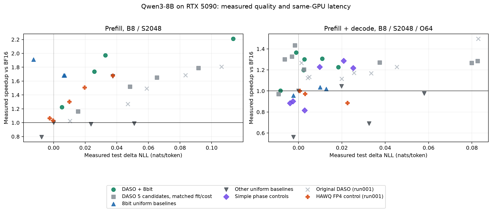

# 已完成的 NLL 与速度结果

47 个配置同卡测速、57 个测试 NLL 点均完成。本文件记录当时完成的 NLL/速度快照；后续全部下游任务与审计也已完成，正式结果见 [REPORT.md](REPORT.md)。

| 场景 | 实际 ΔNLL 上限 | 扩展七候选 DASO | 匹配五候选 DASO | Uniform 最佳 | Phase-uniform 最佳 |
| --- | ---: | --- | --- | --- | --- |
| prefill_only | 0.005 | — | — | 1.911× (uniform_sq_int8) | — |
| prefill_only | 0.01 | 1.225× (daso8_prefill_only_00) | — | 1.911× (uniform_sq_int8) | — |
| prefill_only | 0.02 | 1.225× (daso8_prefill_only_00) | 1.163× (daso5_measured_prefill_only_00) | 1.911× (uniform_sq_int8) | — |
| prefill_only | 0.04 | 1.972× (daso8_prefill_only_02) | 1.163× (daso5_measured_prefill_only_00) | 1.911× (uniform_sq_int8) | — |
| prefill_only | 0.07 | 1.972× (daso8_prefill_only_02) | 1.651× (daso5_measured_prefill_only_02) | 1.911× (uniform_sq_int8) | — |
| prefill_only | 0.1 | 1.972× (daso8_prefill_only_02) | 1.791× (daso5_measured_prefill_only_03) | 1.911× (uniform_sq_int8) | — |
| prefill_only | 0.15 | 2.229× (daso8_prefill_only_04) | 1.993× (daso5_measured_prefill_only_05) | 1.911× (uniform_sq_int8) | — |
| prefill_only | 0.22 | 2.261× (daso8_prefill_only_05) | 1.993× (daso5_measured_prefill_only_05) | 1.911× (uniform_sq_int8) | — |
| prefill_only | 0.45 | 2.299× (daso8_prefill_only_07) | 2.079× (daso5_measured_prefill_only_07) | 1.911× (uniform_sq_int8) | — |
| prefill_decode | 0.005 | 1.366× (daso8_prefill_decode_01) | 1.433× (daso5_measured_prefill_decode_04) | 1.000× (uniform_dense_bf16) | 0.903× (phase_fp8_sq_int8) |
| prefill_decode | 0.01 | 1.366× (daso8_prefill_decode_01) | 1.433× (daso5_measured_prefill_decode_04) | 1.035× (uniform_fp8) | 1.229× (phase_dense_nvfp4_w4a16_ours) |
| prefill_decode | 0.02 | 1.366× (daso8_prefill_decode_01) | 1.433× (daso5_measured_prefill_decode_04) | 1.045× (uniform_w4a16_ours) | 1.229× (phase_dense_nvfp4_w4a16_ours) |
| prefill_decode | 0.04 | 1.366× (daso8_prefill_decode_01) | 1.433× (daso5_measured_prefill_decode_04) | 1.045× (uniform_w4a16_ours) | 1.287× (phase_sq_int8_w4a16_ours) |
| prefill_decode | 0.07 | 1.366× (daso8_prefill_decode_01) | 1.433× (daso5_measured_prefill_decode_04) | 1.045× (uniform_w4a16_ours) | 1.287× (phase_sq_int8_w4a16_ours) |
| prefill_decode | 0.1 | 1.366× (daso8_prefill_decode_01) | 1.433× (daso5_measured_prefill_decode_04) | 1.045× (uniform_w4a16_ours) | 1.287× (phase_sq_int8_w4a16_ours) |
| prefill_decode | 0.15 | 1.366× (daso8_prefill_decode_01) | 1.433× (daso5_measured_prefill_decode_04) | 1.045× (uniform_w4a16_ours) | 1.287× (phase_sq_int8_w4a16_ours) |
| prefill_decode | 0.22 | 1.366× (daso8_prefill_decode_01) | 1.433× (daso5_measured_prefill_decode_04) | 1.045× (uniform_w4a16_ours) | 1.287× (phase_sq_int8_w4a16_ours) |
| prefill_decode | 0.45 | 1.366× (daso8_prefill_decode_01) | 1.433× (daso5_measured_prefill_decode_04) | 1.073× (uniform_sparse_bf16) | 1.287× (phase_sq_int8_w4a16_ours) |

所有新策略均在测量前冻结。本轮未改原 2000-bin DP 或质量模型；统一平滑 INT8 的小误差动作被全局网格过度向上取整，见 results/uniform_grid_audit.json。

001 历史曲线仅作参考；本轮 INT8 融合实现、候选与成本输入变化，不能将跨轮差异单独归因于分配器。

完整数表：results/summary_latency_nll.csv；正式完整结果将在 REPORT.md 与 results/summary_final.csv 收尾。
